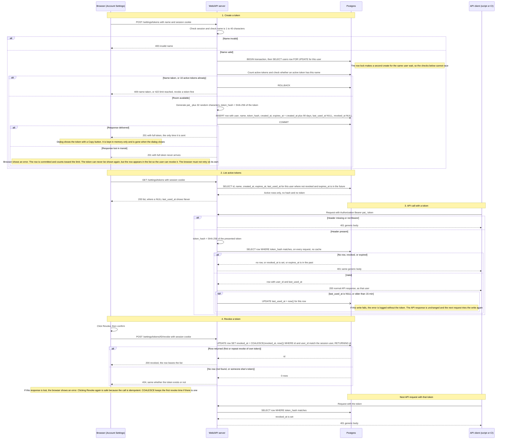

# Personal API tokens on Account Settings: sequence diagram

**What this design does.** A signed-in user creates a personal API token on the Account Settings page. An API token is a long random password for scripts and CI jobs (automated build and test systems). The token starts with `pat_`. A script sends it in an `Authorization: Bearer <token>` header to call our REST API (the web addresses programs use to read and change data). The script never needs the user's password.

The server shows the full token one time, in the reply to the create request. After that, it can never show the token again, not even to support or engineers. A user who loses a token creates a new one.

The server stores only a SHA-256 hash of the token, in a new `api_tokens` table in Postgres (our database). A hash is a fixed fingerprint computed from the token. SHA-256 works in one direction only. To check a presented token, the server computes its fingerprint and compares it with the stored one. It cannot recover the token from the fingerprint.

Every API request reads the token's row, so a revoke takes effect on the very next request. The server keeps no cache of whether a token is valid. Each row also has a `last_used_at` column. The server writes that column at most once every 15 minutes per token. The displayed last-used time is therefore at most 15 minutes old, which is inside the 1 hour the brief allows. Busy scripts also do not cause a database write on every call.

Creates for the same user run one at a time. Each create runs in a transaction, a group of database steps that either all happen or none do. The first step locks that user's `users` row with `SELECT ... FOR UPDATE` (a row lock). A second create for the same user waits until the first one commits or rolls back. Without this lock, two creates could both pass the 10-token limit or both pass the name check.

**Terms used below**

- **Bearer token:** a credential. Whoever holds it can use it. No other proof is needed.
- **Hash (SHA-256):** a fixed-length fingerprint. The same token always gives the same fingerprint, but the fingerprint cannot be reversed.
- **CSPRNG:** a cryptographically secure random number generator. It is safe to use for secrets.
- **Idempotent:** running the same action twice has the same result as running it once.
- **Session cookie:** the login cookie the browser already sends to the settings pages. API clients do not use it.
- **Endpoint:** a URL the server answers to, such as POST /settings/tokens.
- **Status codes:** 400 means bad input. 401 means not authorized. 404 means not found. 409 means conflict, here a duplicate name. 422 means the request was refused by a rule, here the token limit.
- **Generic 401 body:** the same error text for every kind of bad token, so a caller cannot tell which check failed.

**Reading the diagram.** A solid arrow is a request. A dashed arrow is a response. `--x` marks a response that never arrives. `-)` marks a background write, which the API response does not wait for. An `alt` block is an either-or branch. An `opt` block happens only in some cases.

**Where state lives**

| State | Location | Notes |
|---|---|---|
| Plaintext token | Browser memory, for the create dialog only | Never written to storage, logs, or analytics. Lost when the dialog closes. |
| Token hash, name, user, created, expires, last used, revoked | Postgres `api_tokens` table | No plaintext column. `token_hash` is unique and indexed, so each API request finds its row quickly. |
| Per-user create lock | Postgres `users` row | Held only for the length of the create transaction. |
| Session identity | Session cookie | Used only by the settings endpoints. Token authentication never uses it. |
| Validity | Not cached anywhere | Each API request reads the row, so the first request after a revoke is rejected. |
| Request logs and analytics | Log and analytics stores | Record the token id and the outcome only. Never the Authorization header, the token, or its hash. |

**Failure handling**

| Failure | Result |
|---|---|
| 11th active token | 422. The message tells the user to revoke a token first. Nothing is written. |
| Name already used by an active token | 409. Nothing is written. A revoked or expired token does not block its name. |
| Create fails before COMMIT | The transaction rolls back. Nothing is stored, and the user can retry. |
| Create response lost after COMMIT | The server cannot tell whether the response arrived. A row exists, but its token can never be shown. The row counts toward the limit until the user revokes it or 90 days pass. A retry would create a second token, so the browser must not retry automatically. |
| Missing, malformed, unknown, revoked, or expired token | The same 401 status and generic body in every case, so the response does not reveal which check failed. |
| Revoke response lost | The browser shows an error. The token may already be revoked, so the user can click Revoke again. The call is idempotent, so a repeat is safe. |
| `last_used_at` write fails | Logged without the token. The API response is unchanged. The next request retries the write. |
| Request already in flight during revoke | May still succeed. The guarantee covers only requests that start after the revoke response returns. |

**Decisions and open items**

- **Write throttle (decided by this design).** The 15-minute interval is a choice made here, not something the brief sets. The displayed last-used time can be at most 15 minutes stale, inside the 1 hour the brief allows. The throttle compares against the `last_used_at` value stored in Postgres, not an in-memory timer. It therefore still works after a server restart.
- **Token format (assumed, needs confirmation).** The token is `pat_` followed by 32 characters. Each character is one of the 62 letters and digits (a to z, A to Z, 0 to 9). The server draws random bytes and throws away any byte from 248 to 255. This is needed because 256 does not divide evenly by 62, so keeping those bytes would make some characters slightly more likely than others. The brief does not fix the character set, so please confirm it.
- **Name uniqueness (assumed, needs confirmation).** The name check is an exact, case-sensitive match. So "CI" and "ci" are different names.
- **Token management endpoints (not decided by the brief).** The default is that the endpoints which create and revoke tokens accept only the session cookie, not API tokens. This means a leaked token cannot mint more tokens or revoke others.
- **Hashing (decided).** The token has about 190 bits of randomness. 62 to the power of 32 is about 2 to the power of 190. Guessing it is infeasible even for someone who has the hash, so plain SHA-256 is enough. Salted, slow hashes such as bcrypt protect human-chosen passwords, which can be guessed. They are not needed here.