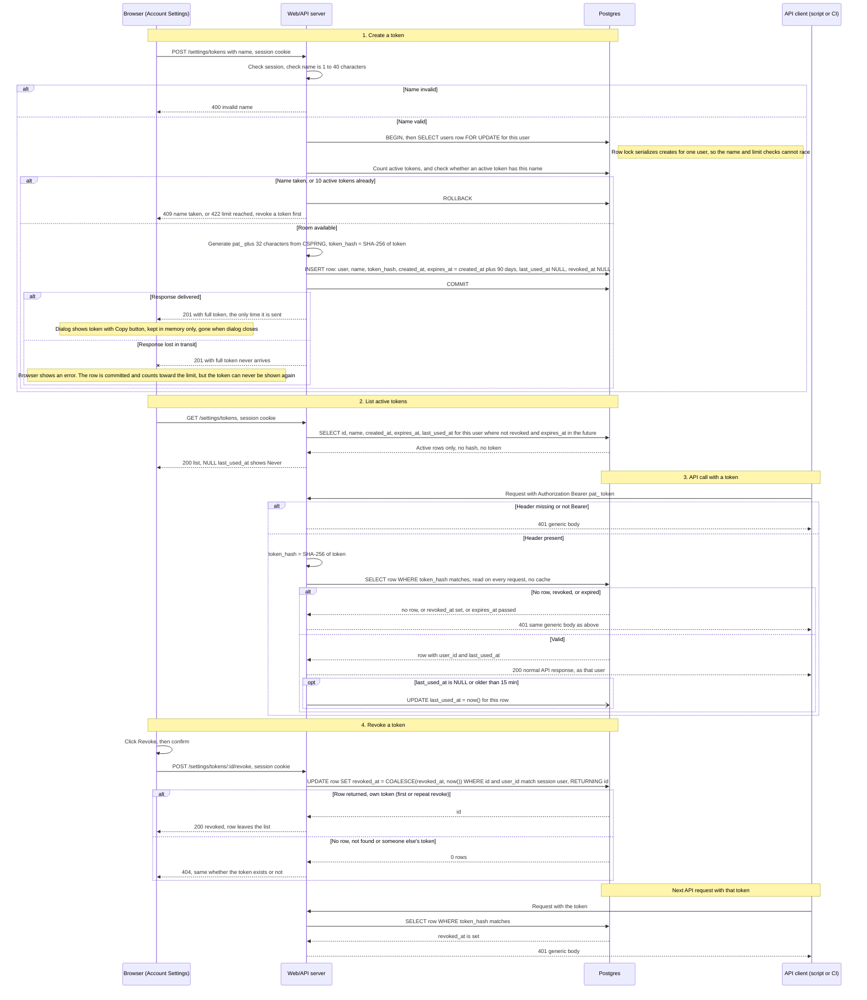

# Personal API tokens on Account Settings: sequence diagram

Design in one paragraph: the token is generated by the server, shown once, and stored only as a SHA-256 hash in a new `api_tokens` table in Postgres. Every API request reads that row, so revocation takes effect on the next request with no validity cache. `last_used_at` is written at most once every 15 minutes per token, which keeps it inside the 1 hour allowed. Creates for one user are serialized with a row lock on that user's `users` row, so the 10-token limit and the name check cannot race.

**Where state lives**

| State | Location | Notes |
|---|---|---|
| Plaintext token | Browser memory, for the create dialog only | Never written to storage, logs, or analytics. Lost once the dialog closes. |
| Token hash, name, user, created, expires, last used, revoked | Postgres `api_tokens` | No plaintext column. `token_hash` is unique and indexed. |
| Per-user create lock | Postgres `users` row | Held only for the create transaction. |
| Session identity | Session cookie | Used by settings endpoints only. Token auth never uses it. |
| Validity | Not cached anywhere | Each API request reads the row, so revocation is seen by the next request. |
| Request logs and analytics | Log and analytics stores | Record token id and outcome only. Never the Authorization header, the token, or its hash. |

**Failure handling**

| Failure | Result |
|---|---|
| 11th active token | 422, message tells the user to revoke a token first. Nothing written. |
| Name already used by an active token | 409. Nothing written. |
| Create fails before COMMIT | Transaction rolls back. Nothing is stored and the user can retry. |
| Create response lost after COMMIT | A row exists with no way to show its token. It counts toward the limit until the user revokes it or 90 days pass. A retry creates a second token, so the browser must not retry automatically. |
| Missing, malformed, unknown, revoked, or expired token | Same 401 status and generic body in every case. |
| Revoke response lost | Browser shows an error. The token may already be revoked, so the user can click Revoke again. The call is idempotent. |
| `last_used_at` write fails | Logged without the token. The API response is unchanged. The next request retries the write. |
| Request already in flight during revoke | May still succeed. The guarantee covers requests that start after the revoke response returns. |

**Decisions and open items**

- The write throttle is 15 minutes, a choice of this design. Staleness is therefore at most 15 minutes, inside the 1 hour allowed. The throttle is stored in Postgres, not in memory, so a server crash cannot lose it.
- Token format assumed: base62 characters, drawn by rejection sampling so each character is uniform. The brief does not fix the character set.
- Name uniqueness assumed to be an exact, case-sensitive match. Confirm this.
- Not decided by the brief: whether a token may call the token-management endpoints. The default should be no, so a leaked token cannot mint more tokens.
- An unhashed token has about 190 bits of entropy, so a plain SHA-256 hash is enough and no salt or key stretching is needed.