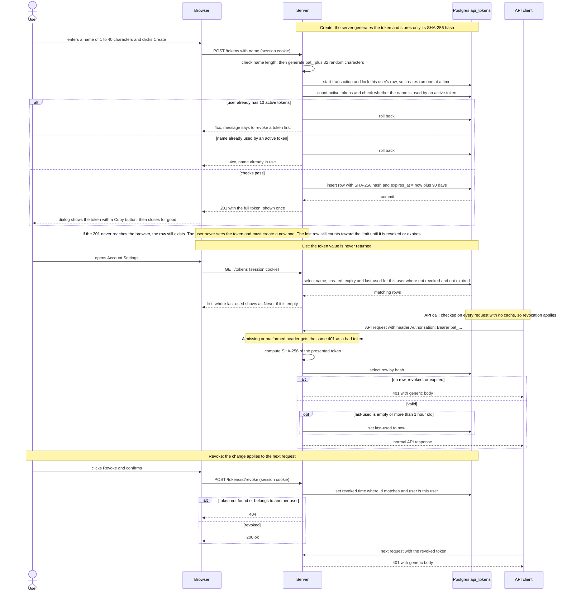

# Personal API tokens on the Account Settings page

Signed-in users can create personal API tokens. A script or CI job (an automated process that runs without a person at the keyboard) then calls our REST API by sending the token in an HTTP header. It never needs the user's password.

Everything happens on the existing Account Settings page. Two parts of the system are involved:

- the **web/API server**, which handles every request from the browser and from API clients, and
- a **Postgres database** (a relational database), with a table named `api_tokens` that holds one row per token.

## Rules

- A token name is 1 to 40 characters. Each user's active tokens must have different names.
- A user may have at most 10 active tokens. The 11th create is refused.
- The full token is shown exactly once, right after it is created. It cannot be shown again, by the server, by support or by engineering. A user who loses a token creates a new one.
- A user can list and revoke only their own tokens.

## Key terms

- **Token**: a secret string made of the prefix `pat_` followed by 32 random characters. The server generates it with a cryptographically secure random source, so it cannot be guessed.
- **Hash**: the result of running the token through SHA-256, a standard one-way function. The same token always gives the same hash, but the hash cannot be turned back into the token. The database stores only the hash. If the database leaks, the attacker gets hashes, not usable tokens.
- **Active**: a token that has not been revoked and has not reached its expiry time.
- **Expiry**: every token expires 90 days after it is created. It cannot be extended. A user who needs more time creates a new token.
- **Last used**: the time the token was last accepted on an API call. It may be up to 1 hour out of date. The server writes it at most about once an hour per token. This keeps database writes rare, because the database is not written on every API request.
- **Row lock**: a database lock on the user's row. While one create request holds the lock, other create requests for the same user wait their turn.
- **Bearer header**: the standard way a client sends a token: `Authorization: Bearer <token>`.
- **Session cookie**: the browser's proof that the user is signed in. The settings pages use it. API clients do not.

## Where state lives

- **Browser**: holds the new token only while the one-time dialog is open. It is never saved.
- **Server**: keeps no state between requests. On every API call it checks the database, and it does not cache token validity. This means a revoke takes effect on the very next request.
- **Postgres (`api_tokens`)**: one row per token. Each row holds the user, the name, the token hash, the created time, the expiry time (created time plus 90 days), the revoked time (empty until the token is revoked) and the last-used time (empty until first use). The plaintext token is never stored.
- **Logs and analytics**: never contain the token value.

## Flows

## Failure cases

- **Limit reached**: the 11th create is refused with a 4xx error, and the message tells the user to revoke a token first. The row lock makes the count and the insert happen one create at a time. Without the lock, two simultaneous creates could both read a count of 9 and both insert, which would go over the limit.
- **Duplicate name**: refused with a 4xx error if the name matches another active token of the same user.
- **Bad token**: a missing, unknown, revoked or expired token all get the same 401 body. The response does not reveal which case applied.
- **Create response lost**: the row is saved, but the user never sees the token and cannot get it back. The user creates a new token. The lost row still counts toward the 10-token limit until it is revoked or expires, so the user may need to revoke it from the list.
- **Other users' tokens**: a user can list and revoke only their own tokens. An attempt to revoke someone else's token returns 404, the same as for a token that does not exist.