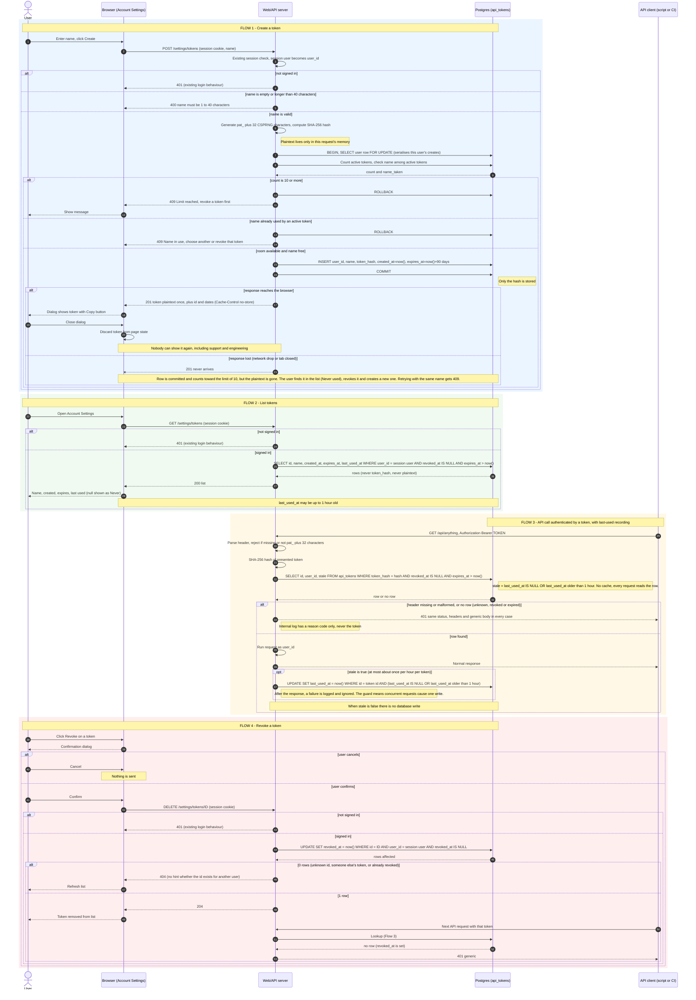

# Personal API tokens: design and sequence diagram

## Where state lives

| State | Location | Notes |
|---|---|---|
| Token plaintext | The server's memory during the create request, then the browser's dialog state | It is never written to Postgres, logs or analytics. It exists only in the create response. Closing the dialog clears it from the page. |
| Token hash and metadata | Postgres table `api_tokens` | Columns: `id`, `user_id`, `name`, `token_hash` (SHA-256, unique index), `created_at`, `expires_at` (= `created_at` + 90 days), `revoked_at`, `last_used_at`. |
| Whether a token is valid | Postgres only | No cache in the server or the browser. Every token request reads the row. |
| Login session | Existing session store | Unchanged. |

"Active" means `revoked_at IS NULL AND expires_at > now()`. Every query uses the database clock.

## Decisions behind the diagram

- **Limit and name uniqueness.** A `now()` expression can't go in an index predicate, so a partial unique index can't express "unique among active tokens". Create runs in one transaction that first locks the user's row with `SELECT ... FOR UPDATE`. It then counts active tokens, checks the name among active tokens and inserts. Two concurrent creates for one user are serialised, so neither the 10-token limit nor the name rule can be raced.
- **Last-used without a write per request.** The lookup already reads the row and returns a `stale` flag, computed by the database as `last_used_at IS NULL OR last_used_at < now() - interval '1 hour'`.
  - A write happens only when `stale` is true. That is at most one write per token per hour.
  - The write is guarded by the same condition, so concurrent requests produce one effective write.
  - It runs after the response is sent. If it fails, the failure is logged without the token and the request is unaffected.
  - The displayed value is therefore under 1 hour out of date. It survives restarts, because no in-memory buffer is involved.
- **Revoke takes effect on the next request.** Revoke sets `revoked_at = now()` in a single `UPDATE`, and the auth lookup requires `revoked_at IS NULL` on every call. The system has one server and one database, so the next read sees the commit.
- **Ownership.** The revoke `UPDATE` has `WHERE id = $1 AND user_id = $session_user`. The list query filters on `user_id`. Someone else's token id gives the same 404 as an unknown id.
- **Token routes accept session cookies only.** A Bearer token cannot list, create or revoke tokens, so a leaked token cannot mint new ones.
- **Token generation.** `pat_` plus 32 characters from the CSPRNG. The server uses base62 with rejection sampling, to avoid modulo bias. The create response sends `Cache-Control: no-store`. Response-body logging is switched off for this route.
- **Uniform 401.** A missing header, malformed value, unknown hash, revoked token and expired token all return the same status, headers and body. The lookup is one query that cannot tell the cases apart. The server may log an internal reason code, never the token.
- **Lost create response.** The server cannot replay the token, because it does not have it. Replaying would need plaintext storage, which is forbidden. The row exists and counts toward the limit of 10. The user sees it in the list, with "Never" as last used, revokes it and creates a new one. A retry with the same name returns 409, and the message says to revoke the existing token or choose another name.

## Sequence diagram

## Failure summary

| Situation | Result | State afterwards |
|---|---|---|
| 11th token requested | 409 with "revoke a token first" | Nothing inserted |
| Name invalid or already used by an active token | 400 or 409 | Nothing inserted |
| Database error during create | 500, no token in the response | Transaction rolled back, nothing stored |
| Create response never reaches the browser | The user sees no token | Row exists and counts toward the limit. The user revokes it from the list and creates a new one. |
| Missing, unknown, revoked or expired Bearer token | Identical 401 | No state change |
| `last_used_at` update fails | The API request still succeeds | Last-used stays stale until the next stale request |
| Revoke of another user's or an unknown token | 404 | No state change |

## Assumptions to confirm

- The existing session middleware already protects state-changing settings routes against CSRF. If it doesn't, add that before shipping.
- A single-column unique index on `token_hash` and an index on `(user_id)` are enough at this scale.
- Expired and revoked rows stay in the table, with no cleanup job in this scope. They don't count toward the limit and don't block reuse of a name.
