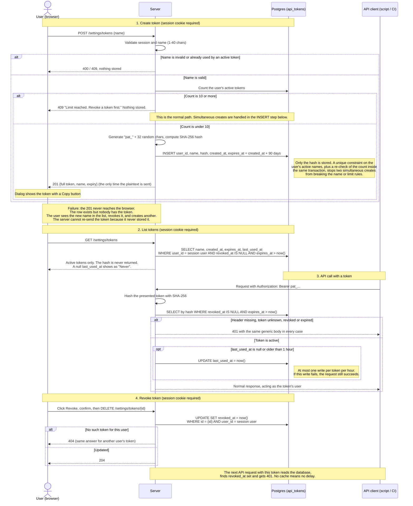

## Personal API tokens: design

Users create personal API tokens on the Account Settings page. Scripts and CI jobs send a token to the REST API instead of a password. One web/API server and one Postgres database handle everything.

There are two kinds of caller. Settings calls (create, list, revoke) come from the browser with a session cookie. API calls come from scripts with `Authorization: Bearer <token>`.

### Where state lives

| State | Location |
|---|---|
| Token record: id, user_id, name, SHA-256 hash, created_at, expires_at, revoked_at, last_used_at | New Postgres table `api_tokens`. The hash column has a unique index. |
| Plaintext token | Not stored anywhere. It exists only in the create response and the user's clipboard. It is never written to the database, logs or analytics. |
| Login session | Session cookie. It already exists and protects the settings endpoints. |
| Token validity | Not cached. Every API request reads the database, so a revoke takes effect on the next request. |

### Rules

- **Format.** `pat_` followed by 32 characters from a cryptographically secure random source.
- **Name.** 1 to 40 characters, unique among the user's active tokens.
- **Active.** Not revoked and not expired.
- **Expiry.** 90 days after creation. Tokens cannot be renewed.
- **Limit.** At most 10 active tokens per user.
- **Last used.** May be up to 1 hour out of date. The server writes it at most once an hour per token, so there is no database write on every request.
- **Ownership.** Users can list and revoke only their own tokens. Every settings query filters on the session's user_id.
- **Shown once.** The token appears only in the create response. After the user closes the create dialog, nobody can show it again, including support and engineering. A lost token means creating a new one.

### Diagram

### Failure summary

| Situation | Result |
|---|---|
| Limit reached on create | 409 with a message telling the user to revoke a token first. No row is written. |
| Invalid or duplicate name | 400 or 409. No row is written. |
| Bad token on an API call (missing, unknown, revoked or expired) | 401 with an identical generic body, so the response does not reveal which case it was. |
| Create response lost in transit | The token exists but its plaintext is gone. The user revokes it and creates a new one. |
| Revoke for a token that is not the user's | 404. |
| Last-used update fails | The request still succeeds. The displayed time is just more out of date. |