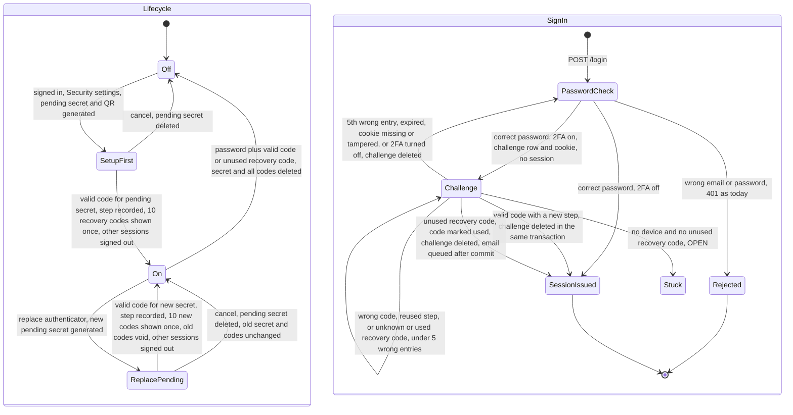

# Two-factor sign-in with an authenticator app: lifecycle and sign-in state diagram

Today `POST /login` checks the email and password, then calls `start_session()` at once. This change adds an optional second factor: an authenticator-app code or a single-use recovery code. After a correct password, a user with two-factor authentication (2FA) on gets a short-lived challenge instead of a session. A session starts only after a second factor passes. `start_session()` stays the only code that starts a session, and the session mechanism does not change. 2FA is on for a user when `totp_factors.secret_sealed` is not NULL.

## Terms

- **Authenticator app:** a phone app (Google Authenticator, 1Password and similar) that shows a 6-digit code that changes every 30 seconds.
- **TOTP (RFC 6238):** the standard for those codes. Each code is computed from a secret and the current time step.
- **Time step:** the 30-second slot the current time falls in. It is Unix time divided by 30, rounded down.
- **Secret:** a random key that the server generates and the app also holds.
- **Pending secret:** a new secret made during setup or replacement that is not yet confirmed. Sign-in never reads it.
- **`last_step`:** the latest time step at which this user's code was accepted. It is per user.
- **`seal()` / `unseal()`:** AES-GCM encryption with the app key, which is held in the KMS (the cloud key service). It hides the value and detects any change to it.
- **sha256 hash:** a one-way fingerprint. The server can compare it but cannot recover the original value.
- **Sealed cookie:** a cookie whose value is sealed with `seal()`, so the browser cannot read or change it.
- **`sid` cookie:** the existing cookie that identifies a signed-in session.
- **Recovery code:** a single-use backup code for signing in without the phone.
- **Challenge:** the step between a correct password and a session. It is a row in `login_challenges` plus a cookie that holds the row's token. It grants no access to `/home`.
- **`start_session()`:** existing helper. It writes a `sessions` row, sets the `sid` cookie and redirects to `/home`.
- **`enqueue_email()`:** existing helper. It puts an email on a background queue. It never blocks the caller, and failed sends are retried in the background.
- **`rate_limit()`:** existing helper. It refuses too many requests from one IP.
- **`bcrypt_check()`:** existing helper. It checks a password against its stored bcrypt hash.
- **Conditional UPDATE:** an `UPDATE` whose `WHERE` clause holds the check. If the check fails, zero rows change, and the code treats that as a refusal. Two requests cannot both pass the same check.

## Diagram

Notes: `Lifecycle` changes the account. `SignIn` covers one sign-in attempt. The arrow from `Challenge` to `Stuck` has no defined trigger yet, because how a user says they have no device is open. `Stuck` has no way out in this plan.

## Where state lives

- **`totp_factors`**, one row per user (`user_id` references `users`, `ON DELETE CASCADE`):
  - `secret_sealed bytea`: the active secret, sealed. NULL when 2FA is off.
  - `pending_secret_sealed bytea`: the secret being set up or replaced, sealed. NULL otherwise.
  - `last_step bigint`: the latest accepted time step. It is shared by all of the user's browsers.
- **`recovery_codes`** (`id`, `user_id` references `users`, `ON DELETE CASCADE`, `code_hash bytea`, `used_at timestamptz NULL`): hashes only. Raw codes are shown once and never stored.
- **`login_challenges`** (`challenge_hash bytea` primary key, the sha256 of a random token; `user_id`; `expires_at`, set to now plus 5 minutes; `failed_attempts int`). One row is created per correct password, so two browsers signing in at once each get their own row and cookie. The raw token is in the challenge cookie: sealed, `httponly`, `secure`, `samesite=Lax`, max-age 5 minutes. A challenge is not a row in `sessions`.
- **`sessions`:** unchanged. Its `token_hash` is the sha256 of the `sid` cookie value.

## Shared checks

Setup confirm, sign-in and disable all use these rules. The steps below refer back here.

- **Code check (TOTP).** The server unseals the secret the flow needs: the pending secret at setup confirm, or the active secret (`secret_sealed`) at sign-in and disable. It computes the 6-digit code for the step before, the current step and the step after. If one matches, that step is the candidate. If more than one matches, the highest is used. The candidate is accepted only if it is greater than `last_step`. That is enforced by a conditional UPDATE: `UPDATE totp_factors SET last_step = %s WHERE user_id = %s AND (last_step IS NULL OR last_step < %s)`. Zero rows changed means refused. Two requests with the same code cannot both pass.
- **Recovery code check.** One statement checks and spends the code: `UPDATE recovery_codes SET used_at = now() WHERE user_id = %s AND code_hash = sha256(%s) AND used_at IS NULL RETURNING id`. A returned row means accepted. No row means unknown or already used, which is a wrong entry. The hash is sha256, not bcrypt, because recovery codes are long random values, so a slow hash adds nothing.
- **Entry rule.** At sign-in and disable, exactly one of the two fields must be filled. Both or neither is a wrong entry.

## Setup and replacement

A signed-in user starts setup from Off, or replaces the authenticator from On, in Security settings.

1. **Start.** The server generates a secret, stores it sealed in `pending_secret_sealed` (creating the `totp_factors` row if needed) and shows a QR code. Sign-in never reads this column, so the new secret has no effect yet. There is one pending secret per user. Starting again overwrites it, so the earlier QR code stops working.
2. **Confirm.** The `sid` cookie leads to a `sessions` row, which gives the `user_id`. The server runs the code check against `pending_secret_sealed`, not the active secret. If the code is accepted, one transaction does three things:
   - A conditional UPDATE copies `pending_secret_sealed` into `secret_sealed`, clears the pending secret and sets `last_step` to the matched step. It runs only if a pending secret exists and the matched step is greater than `last_step`: `UPDATE totp_factors SET secret_sealed = pending_secret_sealed, pending_secret_sealed = NULL, last_step = %s WHERE user_id = %s AND pending_secret_sealed IS NOT NULL AND (last_step IS NULL OR last_step < %s)`.
   - It deletes the user's `recovery_codes` rows and inserts 10 new ones, stored as hashes. All earlier codes stop working.
   - It runs `DELETE FROM sessions WHERE user_id = %s AND token_hash <> sha256(%s)`, with the current cookie value. The current session stays, and every other session of the user is signed out.

   The 10 raw codes are rendered in the response to this confirm request. That response is the page itself, not a redirect. The codes are never stored raw, so this response is the only place the user sees them.

   If the conditional UPDATE changes zero rows, the whole transaction rolls back and the form is shown again with "That code did not work. Try again." A wrong code leaves the secret pending. It is not counted and nothing is locked.
3. **Replacement keeps the old secret.** While replacing, `secret_sealed` still enforces sign-in until a confirm succeeds. A sign-in with the old secret can move `last_step` to the current step. A new-secret code for that same step is then refused, so the user waits 30 seconds for the next code. This costs one step and is accepted. Sign-in ignores the pending secret.
4. **Cancel.** Cancel deletes the pending secret. From Off, the state returns to Off. From On, the old secret and codes are unchanged.

## Disable

1. **Trigger.** A signed-in user submits one form with the password and either an authenticator code or a recovery code. Exactly one code field must be filled, as at sign-in.
2. **Checks, in order.** `bcrypt_check` checks the password first. If it fails, the server stops, changes nothing and does not look at the code. If it passes, the code check runs against `secret_sealed`, the active secret. A TOTP code also moves `last_step`, so it cannot be reused.
3. **Success.** The server sets `secret_sealed` and `pending_secret_sealed` to NULL and deletes all `recovery_codes` rows for the user. The `totp_factors` row stays, with its `last_step`. The current session stays. Other sessions are left signed in (see Open).
4. **Failure.** Nothing changes. The message is "Check your password and code", which does not say which check failed.

## Sign-in

1. **Password check (trigger: `POST /login`).** The existing `rate_limit` and `bcrypt_check` run unchanged.
   - Wrong email or password: 401 with today's message. No challenge is created.
   - Correct password, 2FA off: `start_session()`, as today.
   - Correct password, 2FA on: create a `login_challenges` row with a random token (sha256 stored, `failed_attempts` 0, expiry 5 minutes). Set the challenge cookie and redirect to `/login/second-factor`. No session is created.
2. **Second-factor form.** `/login/second-factor` shows two fields, `totp_code` and `recovery_code`. The browser posts the form with the challenge cookie. `rate_limit` applies to this endpoint too.
3. **Checks on every POST, in this order.** The first check that fails decides what happens next.
   - a. Read and unseal the challenge cookie. A missing, tampered or unsealable cookie counts as no challenge.
   - b. Look up the row by the sha256 of the token. If there is no row, nothing is counted. The row gives `user_id`. `user_id` is never taken from the form.
   - c. If `expires_at` has passed, delete the row and the cookie.
   - d. If `secret_sealed` is NULL for that user, 2FA was turned off after the password step. Delete the row and the cookie. During a replacement, `secret_sealed` is still the old secret, so the challenge keeps working until a confirm succeeds.
   - Checks a to d send the user to the password step: `/login`, with a message to start again. The browser sends no challenge cookie after that, so the user enters email and password again. A new challenge starts only after a correct password.
   - e. Exactly one field must be filled. Both or neither is a wrong entry.
   - f. Check the code (step 4 or step 5). Only a wrong result is counted, so a correct fifth code still succeeds.
   - g. On a wrong result, run `UPDATE login_challenges SET failed_attempts = failed_attempts + 1 WHERE challenge_hash = sha256(%s) RETURNING failed_attempts`. If the count is now 5, delete the row and the cookie, clear the cookie and redirect to `/login`. Otherwise show the form again with "That code did not work. Try again." The form does not show how many tries are left.
4. **Authenticator code.** Apply the code check to `secret_sealed`. The matched step is written to `last_step` in step 6.
5. **Recovery code.** Apply the recovery code check. A row means accepted. In the same transaction, count the unused codes that remain, for the email. The count runs after the UPDATE, so it counts only codes still unused.
6. **Success, in one transaction.** Run the write from step 4 (the `last_step` UPDATE) or step 5 (the `used_at` change). Then run `DELETE FROM login_challenges WHERE challenge_hash = sha256(%s) RETURNING challenge_hash`. Both writes commit together.
   - If the delete returns no row, a concurrent request already used this challenge. The transaction rolls back: the code is not spent, `last_step` returns to its old value, and the attempt is refused as a wrong entry. The user can retry with the same code if it is still in its window, or with the next code if it has passed.
   - If the transaction commits and this was a recovery code, call `enqueue_email(user_id, "recovery_code_used", {remaining})`, with the count from the transaction. The email is queued only after commit, so a refused attempt sends nothing. It is not awaited, so sign-in does not wait for it. The email tells the user a code was used and how many remain.
   - If the transaction commits, clear the challenge cookie and call `start_session()`, which redirects to `/home`. A recovery-code sign-in shows no remaining count on screen. The count is only in the email.

   A challenge cannot be used twice. After a recovery-code sign-in, the user has a normal session and can set up a new authenticator at once. This covers a lost phone.

   Two browsers signing in at once each have their own row and cookie. `last_step` is per user, so a step accepted in one browser is refused in the other. That user then waits for the next 30-second code.

## What happens when things fail

| Failure | What happens | What the user sees |
|---|---|---|
| Wrong email or password | 401. No challenge row is created | Same message as today |
| Wrong app code, reused step, unknown or used recovery code, or both or neither field filled | `failed_attempts` goes up by one. The challenge stays | Second-factor form: "That code did not work. Try again." No count of tries left |
| Fifth wrong entry | Challenge row and cookie deleted | `/login`, asked to start again |
| Challenge older than 5 minutes | Found on the next request. Row and cookie deleted | `/login`, asked to start again |
| Challenge cookie missing, tampered, or pointing to no row | Nothing counted. Cookie cleared if present | `/login`, asked to start again. Email and password are entered again |
| 2FA turned off while a challenge is open | Row and cookie deleted. Nothing counted | `/login`, asked to start again |
| Two requests with the same code or challenge | One commits. The other finds no challenge row in its delete, rolls back, and is refused as a wrong entry | Second-factor form with an error |
| Session write fails after a valid code | The code and challenge are already committed as spent. The challenge cookie stays in the browser, because the failed response could not clear it, but it matches no row | Error page. The next request goes to `/login` as a missing challenge. The user gets a new code after a new password entry |
| Too many requests from one IP | `rate_limit(key="ip")` on `/login` and `/login/second-factor`. Suggested 10 per minute, as `/login` already uses | Rate-limit response |
| Setup or replacement confirm with a wrong code | Stays pending. Not counted, nothing locked. Sign-in ignores the pending secret: with 2FA off, sign-in is password only. During a replacement, the old secret still applies | Form again |
| Setup or replacement confirm with zero rows changed | Whole transaction rolled back. The secret stays pending | Form again: "That code did not work. Try again." |
| Confirm response lost after commit | The new secret is active. The 10 codes are not shown again. The old codes are void | The user replaces the authenticator while signed in to get 10 new codes |
| Disable with a wrong password or code | Nothing changes | "Check your password and code" |
| Email fails | The queue retries in the background | Sign-in is not affected |

Suggested, because the brief sets no limit: the per-IP rate limit also applies to the setup confirm and disable endpoints.

## Open, not designed

- **Stuck (no device and no unused recovery code):** the brief leaves this undecided. Whether support may reset 2FA, and how identity would be checked, is not designed here. A user in this state cannot turn 2FA off, because disabling needs a code. How the user tells the server they are in this state is not designed either.
- **Recovery codes used down to zero:** the email then says 0 remain. The user is in Stuck the next time they lose the phone. This is the same open question.
- **Guessing and restarts:** the 5-entry limit applies per challenge, so each new password entry gets 5 more tries. The per-IP limit of 10 per minute on `/login/second-factor` allows about 14,000 guesses a day from one IP. With up to three valid codes at any time, that is a real risk. Whether the limit should span restarts, and whether setup confirm and disable need a lock, is a product decision.
- **Other sessions on disable:** the brief does not say. This plan leaves them signed in. Product should confirm.
- **Expired challenge rows:** nothing deletes them until their cookie is presented again, so the table can grow. Each row holds only a hash and a `user_id`, no secret. A periodic delete of expired rows is a small addition for the build.
- **Assumed, not checked:** the session lookup code was not in the files. This plan assumes the `sid` cookie maps to a `sessions` row that holds `user_id`, and that `token_hash` is compared as described above.