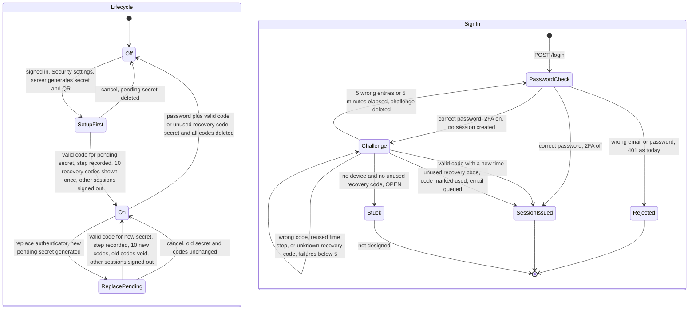

# Two-factor sign-in with an authenticator app: lifecycle and sign-in state diagram

## Where new state lives

- **Active secret and last-used step:** a new `totp_factors` table keyed by `user_id` (FK to `users`, `ON DELETE CASCADE`). Columns: `secret_sealed bytea` (set by `seal()`, NULL when 2FA is off), `last_step bigint` (the last accepted RFC 6238 time step), and `pending_secret_sealed bytea` (set only during setup or replacement, cleared on confirm or cancel).
- **Recovery codes:** a new `recovery_codes` table (`id`, `user_id` FK with `ON DELETE CASCADE`, `code_hash bytea`, `used_at timestamptz NULL`). Only hashes are stored. A confirm deletes all rows for the user and inserts 10 new ones in the same transaction.
- **Sign-in challenge:** a new `login_challenges` table (`challenge_hash bytea` PK = sha256 of a random token, `user_id`, `expires_at = now() + 5 minutes`, `failed_attempts int`). The raw token travels in a `sealed` cookie (`httponly`, `secure`, `samesite=Lax`, short max-age). A challenge grants no access to `/home` and is not a row in `sessions`.
- **Session:** unchanged. `start_session()` is called only after the second factor passes. On 2FA confirm, the other sessions are removed with `DELETE FROM sessions WHERE user_id = %s AND token_hash <> sha256(%s)`, where the second value is the current cookie.

## Transitions and their triggers

- **Setup (Off to SetupFirst):** a signed-in user asks for a secret. The server stores it in `pending_secret_sealed` and returns a QR code. Sign-in never reads this column, so the secret has no effect until confirm.
- **Confirm (SetupFirst or ReplacePending to On):** the user submits a code. The server checks the code against the pending secret, using the window of one step either side. It then moves the active secret into `secret_sealed`, sets `last_step` to the matched step, replaces the recovery codes, and deletes the other sessions.
- **Replacement (On to ReplacePending and back):** the old `secret_sealed` keeps enforcing sign-in until a confirm succeeds. Cancel leaves the old secret and codes untouched.
- **Disable (On to Off):** the user submits the password, then a valid code or an unused recovery code. The server deletes `secret_sealed`, `pending_secret_sealed`, and all `recovery_codes` rows. The current session stays.
- **Password check:** the existing `bcrypt_check` is unchanged. Only when 2FA is on does the flow branch to `Challenge` instead of `start_session`.
- **Code acceptance:** a TOTP code is accepted only if its matched step is greater than `last_step`. The server updates `last_step` with a conditional `UPDATE ... WHERE last_step < %s` (or `IS NULL`). If zero rows change, the code is rejected. This makes two concurrent requests with the same code safe.
- **Recovery code use:** the server runs `UPDATE recovery_codes SET used_at = now() WHERE id = %s AND used_at IS NULL` and continues only if one row changed. It then calls `start_session`, and calls `enqueue_email(user_id, "recovery_code_used", {remaining})`. The email is queued and never awaited, so sign-in does not wait for it.

## Failure behaviour

- **Wrong password:** 401 with the same message as today. No challenge row is created.
- **Wrong code, reused step, or unknown recovery code:** `failed_attempts` increases by one, as an atomic `UPDATE ... RETURNING`. Below 5, the challenge stays and the user may retry.
- **Fifth wrong entry or challenge older than 5 minutes:** the challenge row and cookie are deleted, and the user goes back to the password step. The 5 minute limit is checked on each request against `expires_at`.
- **Rate limit:** the existing `rate_limit(key="ip", ...)` is applied to the second-factor endpoint as well. This is a suggestion, because the brief does not set a limit for it.
- **Setup confirm with a wrong code:** the user stays in pending. The brief sets no lockout here, so any limit is a product decision.
- **Email failure:** handled by the queue, retried in the background, and never fails the sign-in request.
- **Disable with a wrong password or code:** nothing changes, and the failure is reported without revealing which check failed.

## Open, not designed

- **No device and no unused recovery code (Stuck):** the brief leaves this undecided. Whether support may reset 2FA, and how identity would be checked, is not designed here. Note that disabling 2FA also needs a code, so the user cannot turn it off from this state either. The diagram marks this state as OPEN, with no outgoing path.
- **Recovery code used down to zero:** the email reports the count (0 remaining). The user is then in the Stuck state the next time they lose their device. This is the same open question.