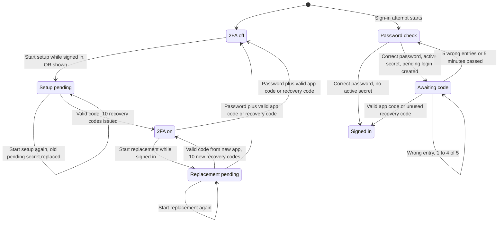

## TOTP 2FA plan

Users can add an authenticator app (the 6-digit codes from Google Authenticator, 1Password and similar) to password sign-in. Today a correct password creates a session at once. With 2FA on, a correct password creates a short-lived pending login instead, and the session starts only after the user enters an app code or an unused recovery code. The session mechanism does not change: the `sid` cookie and the `sessions` table stay as they are. The new steps only decide when `start_session()` runs.

### Terms

- **TOTP**: a 6-digit code that changes every 30 seconds. It is computed from a shared secret and the current time (RFC 6238).
- **Secret**: the random key that the server and the app share. Stored sealed with `seal()`.
- **Active secret**: the secret sign-in checks codes against. Stored in `user_totp.secret`.
- **Pending secret**: a new secret waiting for its first valid code. Stored in `user_totp.pending_secret`. Sign-in ignores it.
- **Time step**: the 30-second window a code belongs to.
- **Drift window**: the current time step plus the one before and the one after. It allows for a phone clock that is slightly off.
- **Code check**: the server computes the code for each time step in the drift window from a secret, and accepts a match only if that step is later than `last_used_step`. It writes nothing. The caller saves the step.
- **last_used_step**: the latest time step accepted for the user. It blocks replay.
- **Replay**: using a code that was already accepted, for example one seen over someone's shoulder or submitted twice.
- **Recovery code**: one of 10 single-use backup codes, shown once.
- **Hash**: a one-way fingerprint (sha256 here). The server stores and compares hashes, never the raw value. Session tokens work the same way.
- **Pending login**: a short-lived row for a correct password whose second factor is not yet entered. Its cookie is `p2f`.
- **`seal()` and `unseal()`**: encrypt and decrypt a value stored at rest, using the app key in the KMS (the cloud key service).
- **`start_session()`**: creates the normal session row and sets the `sid` cookie.
- **`enqueue_email()`**: puts an email on a background queue. The send is retried there and never blocks or fails the request that queued it.

### The state diagram

Notes on the diagram:

- It has two start points. The account's 2FA lifecycle starts at Off. One sign-in attempt starts at Password. A sign-in attempt never changes the account's 2FA state.
- A wrong password is not drawn. It returns the same 401 as today and changes nothing.
- Nothing runs in the background. The 5-minute limit is noticed only when the code page is next opened or posted.

### Where the state lives

- **`user_totp`** (one row per user):
  - `secret`: sealed active secret. Empty when 2FA is off.
  - `pending_secret`: sealed new secret, set during setup or replacement. Empty otherwise.
  - `last_used_step`: the latest accepted time step. It belongs to the user, not to one secret, so it is not reset when a replacement starts.
- **`recovery_codes`** (one row per code): `user_id` and `code_hash`. A used code is deleted.
- **`pending_logins`** (one row per sign-in in progress): `token_hash` (hash of the `p2f` cookie), `user_id`, `expires_at` (now plus 5 minutes) and `wrong_count` (starts at 0). A user has at most one row.
- **Cookie `p2f`**: holds the raw random token. It is set with httponly, secure, samesite Lax and a 5-minute max age. The server finds the row by hashing the cookie, the same way it finds sessions.
- **`sessions`**: unchanged. A row is created only by `start_session()`.

### Turning 2FA on

1. **Set up.** Trigger: the signed-in user clicks Set up in Security settings. The server makes a random secret, seals it into `pending_secret` and shows a QR code. The state is Setup pending. Sign-in ignores the pending secret. Starting setup again overwrites it.
   - If the user leaves: 2FA stays off, and the pending secret stays until the next setup.
2. **Confirm code.** Trigger: the user types a 6-digit code from the app. The server runs the code check against `pending_secret`. A wrong code changes nothing, and the user may try again.
3. **Turn on.** Trigger: a valid code. Setup needs a signed-in session, so the current session always exists here. In one database transaction the server:
   - moves `pending_secret` into `secret`;
   - sets `last_used_step` to the accepted step;
   - deletes all old recovery codes and inserts 10 new ones, stored as hashes;
   - deletes every other session of this user. The current session is the one whose `sid` cookie hashes to a `sessions.token_hash`. Only that row is kept.

   The 10 codes are shown in this response only, never again. The state is 2FA on.
   - If the transaction fails: it rolls back. Nothing changes, the user sees an error, and no codes are shown. The pending secret is kept, so the user can enter a code again.

### Replacing the authenticator

4. **Start replacement.** Trigger: a user with 2FA on starts a replacement while signed in. The server seals a new secret into `pending_secret` and leaves `secret` unchanged. The state is Replacement pending. Sign-in still uses `secret`, so the old app keeps working. Starting again overwrites the pending secret.
   - If the user leaves: the old app still works, and the pending secret stays until the user starts again or turns 2FA off.
5. **Confirm new app.** Trigger: a valid code from the new app. The server runs the code check against `pending_secret`. In one transaction it then:
   - moves `pending_secret` into `secret`;
   - sets `last_used_step` to the confirming step;
   - deletes the old recovery codes and inserts 10 new ones, stored as hashes.

   It does not end other sessions. The brief requires that only at first confirmation (see open questions). The 10 new codes are shown once, and the state is 2FA on.
   - If the transaction fails: it rolls back. The old authenticator still works and no codes are shown.

Because `last_used_step` is kept across a replacement, a code from the new app in the same 30-second window as the last old-app sign-in is rejected. The user waits for the next time step.

### Signing in

6. **Password.** Trigger: the user posts email and password. The password check is unchanged. A wrong password gets the same 401 as today, and nothing is created.
7. **No second factor.** Trigger: a correct password and no active secret (2FA off, or Setup pending). The server calls `start_session()`, as it does today. The state is Signed in.
8. **Pending login.** Trigger: a correct password and an active secret (2FA on, or Replacement pending). The server:
   - deletes any existing `pending_logins` row for this user, expired or not, so there is at most one per user. An expired row therefore never blocks a new sign-in;
   - inserts a new row: `token_hash` of a new random token, `user_id`, `expires_at` (now plus 5 minutes) and `wrong_count` 0;
   - sets the `p2f` cookie to the raw token and redirects to the code page.

   It does not set `sid`, so no session exists yet. The state is Awaiting code. An older browser that still holds the old `p2f` cookie now has no row, and step 9 sends it to the password page.
9. **Code page.** Trigger: the code page is opened or posted. The server finds the row from the `p2f` cookie.
   - If there is no row, the server clears `p2f` and sends the user to the password page.
   - If the row has expired, the server deletes it, clears `p2f` and sends the user to the password page.
   - Otherwise the page shows one input for the code. A 6-digit value goes to step 10. Any other value goes to step 11. Recovery codes are never 6 digits, so the two cannot be confused.
10. **App code.** Trigger: a 6-digit value. The server runs the code check against the active secret (`secret`, never the pending one). If it matches, the server sets `last_used_step` to that step, deletes the pending row, clears `p2f` and calls `start_session()`. The state is Signed in.
    - A wrong app code is a wrong entry (step 12).
11. **Recovery code.** Trigger: a value that is not 6 digits. The server hashes it and looks for an unused hash for this user. On a match, it deletes that code and the pending row, clears `p2f`, calls `start_session()` and calls `enqueue_email()`. The state is Signed in.
    - The email says a recovery code was used and how many remain. The count is the user's `recovery_codes` rows left after the used one is deleted, so it is 9 after the first use.
    - The sign-in does not wait for the email. If the email never sends, the queue retries it, and the sign-in is not affected.
    - A recovery code does not change `last_used_step`. It is not a TOTP code and is deleted on use, so it cannot be reused.
    - An unknown or already used code is a wrong entry (step 12).
12. **Wrong entry.** Trigger: a wrong app code (outside the drift window, or a step already used), or an unknown or used recovery code. The server adds 1 to `wrong_count`.
    - At 5: the server deletes the pending row, clears `p2f` and sends the user to the password page.
    - Below 5: the user stays on the code page.

### Turning 2FA off

13. **Turn off.** Trigger: the user, signed in with 2FA on or Replacement pending, enters the password and a valid app code or unused recovery code in Security settings. The request must carry a valid `sid` cookie, as any settings page does. The server checks the password first, then the code. The app code is checked against `secret`, never `pending_secret`, because an unconfirmed secret has not proved the user has the app. Only when both checks pass, the server:
    - deletes the `user_totp` row (secret, pending secret and last step);
    - deletes all `recovery_codes` rows of the user;
    - deletes the user's `pending_logins` rows, so a login begun while 2FA was on cannot finish after it is off.

    The state is 2FA off. The current session stays signed in, because it made the request. Other sessions are not ended.
    - If the password or code is wrong: nothing is deleted.
    - Setup pending has no turn-off action, because 2FA is already off. Its pending secret stays until the next setup.

### Lost phone

A user who has lost the phone signs in with an unused recovery code (step 11). The session is then normal, and 2FA is still on. From Security settings the user starts a replacement and confirms it with the new app. No code from the old app is needed, because the recovery code has just proved the user's identity. Confirming gives 10 new recovery codes. A user with no unused recovery codes is not covered here (see open questions).

### Open questions

- **Lost phone with no unused recovery codes:** not designed. Product has not decided whether support may reset 2FA, or how a person's identity would be checked.
- **Other sessions on replacement:** the brief ends other sessions only at first confirmation. It is not decided whether a replacement should too. Currently it does not.
- **Password for starting a replacement:** not stated. Currently any signed-in session can start one.
- **Attempt limits:** no limit is stated for the setup code (step 2) or the turn-off code (step 13). Each correct password starts a new 5-try pending login, so only the login rate limit (10 per minute per IP) bounds guessing by someone who has the password. A per-user limit is not decided.
- **Expired pending logins:** an expired row is ignored when it is seen. How and when expired rows are deleted in bulk is not decided.
- **Sessions on turning 2FA off:** not decided whether turning 2FA off should also end other sessions. Currently it does not.