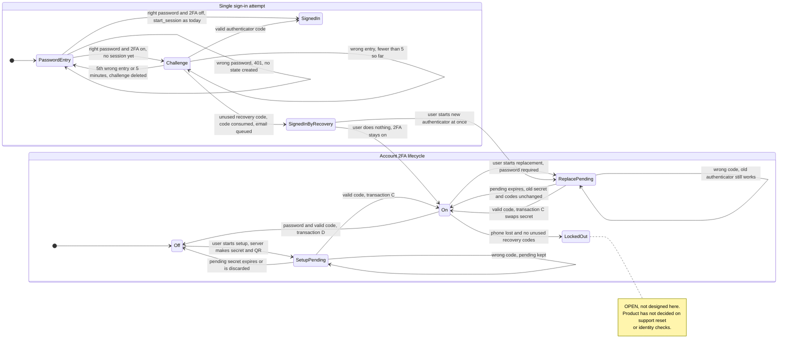

# Two-factor sign-in with an authenticator app: state design

## How to read this

The diagram has two parts. **Account 2FA lifecycle** is long-lived and stored per user. **Sign-in attempt** is one login and is stored for at most 5 minutes. The only link between them is that a recovery-code sign-in can go straight to setting up a new authenticator.

## Where each piece of new state lives

All secrets and codes live in new tables. `sessions` and `start_session` are unchanged.

| State | Location | Notes |
|---|---|---|
| Active TOTP secret | `user_totp.secret_sealed` | Written with `seal()` and read with `unseal()`. 2FA is on for a user only when `confirmed_at` is not null. |
| Pending secret | `user_totp.pending_secret_sealed`, `pending_expires_at` | Sealed. Kept separate from the active secret so a replacement attempt never weakens or disables the current authenticator. Sign-in never reads it. The assumed lifetime is 30 minutes (product to confirm). |
| Replay guard | `user_totp.last_step` (bigint) | The highest time step already accepted for the user. |
| Recovery codes | `recovery_codes(user_id, code_hash, used_at)` | Only hashes are stored. Codes are random with about 50 bits or more, so SHA-256 is enough, and they are shown once. |
| Sign-in challenge | `login_challenges(token_hash, user_id, expires_at, failures)` | The raw token goes in a short-lived `mfa` cookie (HttpOnly, Secure, SameSite=Lax). Only its hash is stored, like `sid`. It is deliberately not a `sessions` row, so an unfinished sign-in can never authenticate. |
| Session | `sessions`, unchanged | Created only by `start_session` after a second factor succeeds. |

## What triggers each transition, and what happens on failure

**Turning 2FA on (`Off` to `SetupPending` to `On`)**
- Trigger: a signed-in user opens Security settings and chooses "set up". The server generates a secret and stores it as pending. It shows the QR code and secret once.
- Trigger: the user types a code. It must be valid for the pending secret within ±1 step, and its step must be greater than `last_step`.
- Success (transaction C): in a single database transaction the server does four things.
  - It moves the pending secret to the active secret and sets `confirmed_at`.
  - It deletes all old recovery codes and inserts 10 new hashed ones.
  - It sets `last_step` to the accepted step.
  - It deletes every other session of the user (`DELETE FROM sessions WHERE user_id=? AND token_hash<>current`). The current session stays.
  - The 10 plaintext codes are returned in that one response and never stored.
- Failure: a wrong code or a replayed step leaves the state as `SetupPending`, with an error and per-user rate limiting. Sign-in still ignores the pending secret. If the pending secret expires, the state returns to `Off` with nothing else changed. If the transaction fails, nothing changes, including sessions and codes.

**Replacing the authenticator (`On` to `ReplacePending` to `On`)**
- Trigger: the user starts replacement from Security settings. This works in any signed-in session, including one that came from a recovery code, so a user with a lost phone can do it at once.
- Assumption to confirm: starting replacement asks for the password again. This stops a stolen session from swapping the authenticator. It does not need the old authenticator, so it does not block the lost-phone case.
- Success: this is the same transaction C. The old secret is replaced, a fresh set of 10 recovery codes replaces all earlier ones, and other sessions are signed out.
- Failure: wrong codes leave the old authenticator and old recovery codes working. An expired or abandoned replacement changes nothing.

**Signing in (single attempt)**
- Wrong password: the response is unchanged (401 "Wrong email or password") and nothing is created. The existing IP rate limit still applies.
- Right password, 2FA off: `start_session` runs as today.
- Right password, 2FA on: no session and no `sid` cookie. The server inserts a `login_challenges` row (expiry now + 5 minutes, `failures` = 0) and sets the `mfa` cookie. The user is sent to the code page.
- Entering a code or recovery code: the server loads the challenge by cookie. A missing or expired challenge restarts the attempt from the password.
  - A valid authenticator code must match within ±1 step and have a step greater than `last_step`. The step is recorded with a guarded `UPDATE ... WHERE last_step < step`, so two simultaneous submissions cannot both pass.
  - A valid recovery code is claimed atomically with `UPDATE ... SET used_at=now() WHERE code_hash=? AND used_at IS NULL`. The claim must affect one row.
  - Success deletes the challenge, clears the `mfa` cookie and calls `start_session`.
- Recovery-code success also calls `enqueue_email(user_id, "recovery_code_used", {remaining})` after the commit. The email is queued, never sent inline, so sign-in does not wait for it and a send failure cannot fail the sign-in.
- Any wrong entry increments `failures` atomically. This includes a bad code, an unknown recovery code and a replayed step. On the fifth wrong entry, or once 5 minutes pass, the challenge row and cookie are deleted and the user returns to the password screen. The password is checked again, so a new challenge is a new attempt with a fresh count. A rate limit on the code endpoint is also advisable.

**Turning 2FA off (`On` to `Off`)**
- Trigger: the user submits the password plus a valid authenticator code or an unused recovery code.
- Success (transaction D): in one transaction the server deletes the `user_totp` row (active and pending secrets) and all of the user's recovery codes. If a recovery code was the proof, its use is recorded as part of the same transaction and the row is then deleted.
- Failure: a wrong password, wrong code or replayed step leaves 2FA on, shows an error and is rate limited. Nothing is deleted.

## Open item: lost phone and no recovery codes

The `LockedOut` state is deliberately a dead end in this design. Product has not decided whether support may reset 2FA, or how they would check the person's identity. This plan does not design that path. Until it is decided, a user in that state cannot sign in. Someone must make the decision before launch, because every design here assumes the account owner always holds either a phone or a recovery code.
