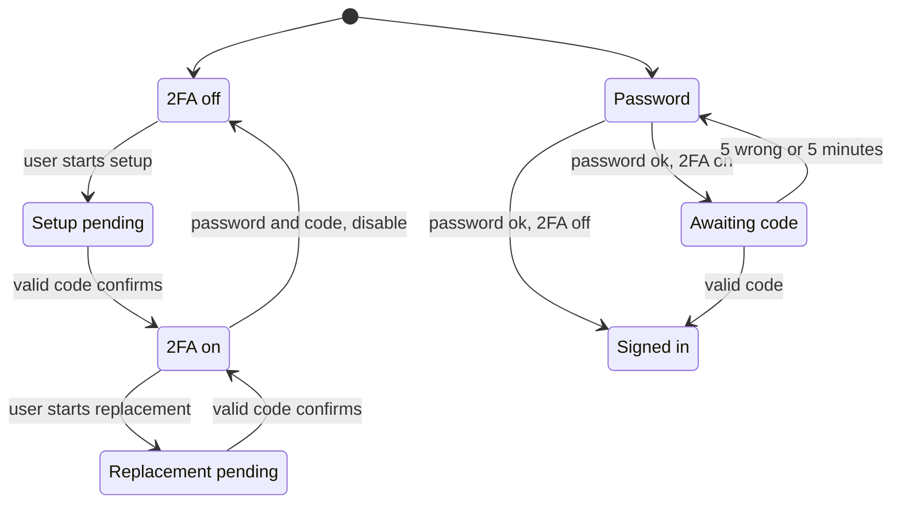

# TOTP 2FA plan

Today a correct email and password creates a session at once (`start_session` sets the `sid` cookie). This plan adds optional authenticator-app 2FA. A user with 2FA on who gives the right password gets no session yet, only a short-lived pending login. The session is created after they also enter a valid authenticator code or a recovery code. The existing session mechanism, `seal()`, `enqueue_email()` and `start_session()` are reused unchanged.

## Terms

- TOTP code: the 6-digit code an authenticator app shows, changing every 30 seconds (RFC 6238). A "step" is one 30-second window. The server accepts the current step and one either side, to allow for clock drift.
- Recovery code: a single-use code typed instead of a TOTP code, for example after losing a phone. It is 10 random letters and digits, shown as two groups of five, so it is never exactly 6 digits and cannot be mistaken for a TOTP code. When one is typed, spaces, hyphens and upper/lower case are ignored.
- Pending login: a row saying "this user passed the password check and still owes a code". It is not a session and grants nothing.
- `p2f`: the cookie that holds the random token of a pending login. Only the token's sha256 is stored, the same way `sid` works. It is not sealed.
- `seal()`: existing helper that encrypts a secret before it is stored. Here it protects the TOTP secrets only.
- Pending secret: a new TOTP secret the user has not yet proved they can use. Sign-in ignores it.

## Where the new state lives

- `user_totp` (one row per user): `secret_sealed` (the active secret, empty when 2FA is off), `pending_secret_sealed` (the pending secret), `last_step` (the newest TOTP step already accepted, used to reject replays). Both secrets are stored with `seal()`.
- `recovery_codes`: `user_id`, `code_hash`, `used_at`. Only hashes are stored.
- `pending_logins`: `token_hash`, `user_id`, `attempts`, `expires_at`.
- New cookie: `p2f`.

## Lifecycle and sign-in diagram

The top half is the account's 2FA lifecycle. The bottom half is one sign-in attempt. The two are linked only through "2FA on".

## Steps: account lifecycle (user is signed in, in Security settings)

1. Start setup (Off to Setup pending) or start replacement (On to Replacement pending). Replacement exists so a user can swap authenticators, for example after a lost phone, while 2FA stays on. The server makes a new secret, saves it sealed in `pending_secret_sealed` and shows a QR code. Starting again overwrites the earlier pending secret. Replacement needs only the current signed-in session, so a user who got in with a recovery code can start it straight away.
2. Confirm (to 2FA on). The user types a code from the new secret. The server checks it against `pending_secret_sealed` with the same drift and replay rules as sign-in. If it is wrong, the user sees an error and can retry; 2FA stays as it was. If it is right, in one database transaction the server:
   - moves the pending secret into `secret_sealed` and clears the pending one;
   - sets `last_step` to the accepted step;
   - deletes all old recovery codes and stores 10 new hashed ones (so every previous code stops working);
   - deletes every other session of this user (the current `sid` session stays).

   The 10 new codes are shown once, in that response, and never again.
3. Abandoned setup or replacement: nothing happens and the pending secret stays unused. During a replacement the old authenticator and old recovery codes keep working until a new one is confirmed.
4. Disable (On to Off). The user gives their password and a valid TOTP code or unused recovery code. The server deletes the secret rows and all recovery codes. A wrong password or code changes nothing.

## Steps: one sign-in attempt

1. `POST /login`. The password check is unchanged, and the existing per-IP rate limit still applies. A wrong password gives the usual 401 and no pending login.
2. Password ok, 2FA off: `start_session`, as today.
3. Password ok, 2FA on (Password to Awaiting). No session is created. The server inserts a `pending_logins` row (`attempts` 0, expires in 5 minutes) with a random token (`new_token`), sets `p2f` to that token (httponly, secure, SameSite Lax, 5-minute max age) and shows an "enter your code" form. The form takes either an app code or a recovery code.
4. Submit code (Awaiting to Signed in). The user posts one code field. The server looks up the pending row by the hash of `p2f`. If it is missing or expired, go to step 6. Otherwise:
   - A value of exactly 6 digits is checked as a TOTP code, and only as one. It is valid if it matches the active secret in one of the three allowed steps and that step is newer than `last_step`. The server then sets `last_step` to that step in one conditional update, so the same code cannot be used twice.
   - Any other value is checked as a recovery code: hash it and mark one unused matching row used, in one conditional update. On success the server also calls `enqueue_email` to say a code was used and how many remain. Sign-in does not wait for the email, and a failed send never fails the sign-in. The user is then redirected to Security settings so they can replace their authenticator.
   - On success the server deletes the pending row, clears `p2f` and calls `start_session`. After a recovery-code sign-in the user is fully signed in and 2FA stays on. Nothing forces replacement.
5. Wrong code. Any entry that fails step 4 counts the same: a wrong or replayed TOTP code, or an unknown or already-used recovery code (counting them differently would let an attacker guess recovery codes without limit). `attempts` goes up by one and the form shows an error. The count is per pending login. At 5 wrong entries, go to step 6.
6. Back to Password (Awaiting to Password). Triggered by 5 wrong entries, 5 minutes passing, or a missing or expired row. The server deletes the pending row, clears `p2f` and sends the user to the password form. They must pass the password check again.

## What happens when things fail

| Failure | Result |
|---|---|
| Wrong password | 401, no pending login |
| Wrong code during sign-in (TOTP or recovery) | `attempts` + 1, error shown; at 5, pending login discarded |
| TOTP code from a step already accepted | Rejected like a wrong code |
| Recovery code already used or unknown | Rejected like a wrong code |
| Pending login older than 5 minutes, or `p2f` missing | Discarded, user starts at the password form |
| Recovery-code email fails to send | Retried in the background; sign-in already succeeded |
| Wrong code while confirming setup or replacement | Error shown, can retry, 2FA stays as it was |
| Wrong password or code while disabling | Nothing changes |

## Rollout

New tables are added by a migration. Existing users start with 2FA off, so nothing changes for them until they enable it.

## Open questions

- A user who lost their phone and has no unused recovery codes: whether support may reset 2FA, and how they would verify the person's identity. Product has not decided. This plan does not design that path.
