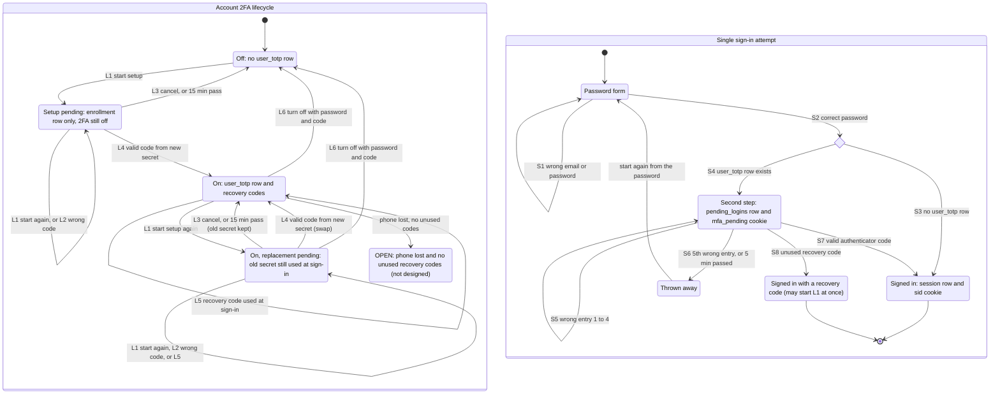

# TOTP two-factor sign-in: state diagram and notes

This design adds four tables and one short-lived cookie. The `sessions` table, the `sid` cookie and `start_session()` work as they do today. A session row is still the only thing that means "signed in", and only `start_session()` creates one. `start_session()` gets one optional argument, `next="/home"`, so a recovery-code sign-in can land on Security settings. The existing call does not change.

## Where the new state lives

| State | Where | Contents |
|---|---|---|
| Confirmed authenticator | `user_totp` (`user_id` PK, FK to `users` ON DELETE CASCADE) | `secret_sealed bytea` (from `seal()`), `last_step bigint` (the newest time step accepted for this user), `confirmed_at`. **2FA is on exactly when this row exists.** |
| Setup in progress | `totp_enrollments` (`user_id` PK, CASCADE) | `secret_sealed bytea`, `expires_at` (created + 15 min). There is at most one per user. Sign-in never reads this table. |
| Recovery codes | `recovery_codes` (`id`, `user_id` CASCADE, `code_hash bytea`, `used_at timestamptz NULL`), UNIQUE (`user_id`, `code_hash`) | Each code is 80 random bits from `new_token(10)`, shown as base32 groups. Only `sha256` of the normalised code is stored, the same way session tokens are stored. At 80 bits a fast hash cannot be brute-forced, and it allows an indexed, atomic "use once" update. |
| Second sign-in step | `pending_logins` (`token_hash bytea` PK, `user_id` CASCADE, `expires_at` = created + 5 min, `failures int DEFAULT 0`) plus the cookie `mfa_pending` | The cookie holds the raw `new_token(32)`, with `httponly`, `secure`, `samesite=Lax`, `max_age=300` and `path=/login`. Only the sha256 is stored, as with `sid`. |
| Signed in | the existing `sessions` table and `sid` cookie | Unchanged. |

Expiry is checked whenever a row is read: a row with `expires_at <= now()` is treated as missing and deleted. A periodic job removes stale `pending_logins` and `totp_enrollments` rows. Nothing depends on that job running on time.

## Diagram

## Shared check: verifying an authenticator code

Steps S7 and L6 both use one function, `verify_totp(user_id, code)`, and both call it inside a transaction:

1. `SELECT ... FROM user_totp WHERE user_id = %s FOR UPDATE`. The row lock means two requests carrying the same code are handled one after the other.
2. Let T = floor(now / 30). The candidate steps are T-1, T and T+1, but only those greater than `last_step`. For each candidate, compute the RFC 6238 code (HMAC-SHA1, 6 digits) from `unseal(secret_sealed)` and compare it in constant time.
3. If a code matches, set `last_step` to the matched step. If none matches, reject the code.

Rejecting every step at or below `last_step` blocks any step that was already accepted. It is slightly stricter than the requirement: if T was accepted, a code for T-1 that was never used is also refused. This is harmless, because the app shows the current code.

## Account lifecycle: triggers, effects, failures

All of these endpoints need a valid `sid` session. Each has a `rate_limit(key="user")`.

- **L1, start setup** (`POST /settings/security/2fa/setup`). Generates a 160-bit secret and upserts `totp_enrollments`, replacing any earlier pending secret. Renders a QR code for `otpauth://totp/...?secret=...&digits=6&period=30`. The plaintext secret exists only in this response. This step needs only a session, and deliberately does not ask for the current authenticator. That is what lets a user who has just signed in with a recovery code replace a lost phone straight away. If 2FA is already on, `user_totp` is not touched, so sign-in keeps using the old secret.
- **L2, wrong code at confirm.** Shows an error. Nothing changes and the enrollment stays pending.
- **L3, cancel or expiry.** Cancel deletes the enrollment row. After 15 minutes the row counts as missing. Either way the account returns to where it was, and an existing `user_totp` row is untouched.
- **L4, confirm** (`POST /settings/security/2fa/confirm`). One transaction:
  1. Lock the `totp_enrollments` row. If it is missing or expired, show "Setup expired, start again".
  2. Check the code against the pending secret at T-1, T and T+1. If it is wrong, go to L2.
  3. Upsert `user_totp` with the pending `secret_sealed`, `last_step` set to the matched step, and `confirmed_at = now()`. Delete the enrollment row.
  4. `DELETE FROM recovery_codes WHERE user_id = %s`, then insert 10 new hashes.
  5. `DELETE FROM sessions WHERE user_id = %s AND token_hash <> sha256(current sid)`. Every other session is signed out and the current one stays.
  6. `DELETE FROM pending_logins WHERE user_id = %s`, so a half-finished sign-in elsewhere cannot finish against the new secret.

  After the commit, the 10 plaintext codes are rendered once, with `Cache-Control: no-store`, and are never stored or shown again. If anything fails before the commit, everything rolls back: the old secret, the old codes and the other sessions all stay as they were. If the codes page is lost after the commit, the user gets a fresh set by doing L1 and L4 again.
- **L5, recovery code used.** See S8. The account stays On, with one fewer unused code.
- **L6, turn off** (`POST /settings/security/2fa/disable`, with password and code). `bcrypt_check` runs first. If the password is wrong, show an error and touch nothing. Then the code is checked with `verify_totp`, or used up as a recovery code, the same way as in S8. If the code is wrong, show an error and nothing changes. On success, one transaction deletes the user's rows from `user_totp`, `recovery_codes`, `totp_enrollments` and `pending_logins`. Sessions are kept.

## Sign-in attempt: triggers, effects, failures

- **S1.** Unchanged from today: 401 and "Wrong email or password". No new state is created.
- **S2 to S4.** After the existing password check, `/login` runs `SELECT 1 FROM user_totp WHERE user_id = %s`.
  - **No row (S3):** call `start_session(user.id)`, exactly as today. A pending enrollment does not count as 2FA.
  - **Row exists (S4):** no session is created. Delete the user's older `pending_logins` rows, so only one second step is live at a time. Insert a new row, set `mfa_pending`, and render the code form.
- **Second step** (`POST /login/2fa`, field `code`). In one transaction, lock the row with `SELECT ... FROM pending_logins WHERE token_hash = sha256(mfa_pending) FOR UPDATE`, which makes concurrent guesses count one at a time. If the cookie is missing, the row is missing or `expires_at` has passed, go to S6. A code of 6 digits is checked as an authenticator code. Anything else is uppercased and stripped of spaces and hyphens, then checked as a recovery code.
- **S5 and S6, wrong entry.** A wrong entry is any of these: a malformed code, a code that does not match, a time step that was already accepted, or an unknown or used recovery code. Each one runs `failures = failures + 1`.
  - Below 5: 401 and "Wrong code".
  - At 5, or once the 5 minutes are up: delete the row, clear `mfa_pending`, redirect to `/login` with "Please sign in again".

  The 5 minutes count from S4. Entering codes does not extend them.
- **S7, valid authenticator code.** `verify_totp` advances `last_step` and the `pending_logins` row is deleted. After the commit, `start_session(user_id)` runs and `mfa_pending` is cleared.
- **S8, unused recovery code.** Run `UPDATE recovery_codes SET used_at = now() WHERE user_id = %s AND code_hash = sha256(%s) AND used_at IS NULL RETURNING id`. If no row comes back, treat it as a wrong entry (S5 or S6). This single conditional update is what stops one code being used twice. Then count the remaining codes, delete the `pending_logins` row and commit. After the commit:
  - Call `start_session(user_id, next="/settings/security")`. The page shows "You used a recovery code, N left. Set up a new authenticator." and links to L1.
  - Call `enqueue_email(user_id, "recovery_code_used", {"remaining": N})`. It only queues the email, and per its contract it never blocks or fails the request. It is called after the commit so that a rolled-back sign-in sends no email.

## Open

- **Lost phone and no unused recovery codes.** Product has not decided this path, for example whether support may reset 2FA and how they would check the person's identity. It is not designed here. Such a user can get no further than S4. A user with 0 codes left after S8 is warned in that email and on the settings banner. The warning text is the only thing this design does about it.
- **Not in the brief, suggested.** The only limits on repeated second-step attempts are the 5 entries per password and `/login`'s per-IP limit. An attacker who has the password and many IPs could keep guessing. A per-user limit on `/login/2fa` would close that. Product should decide whether to add it.
- **My choice, not in the brief.** Pending setups expire after 15 minutes. Any value works.
