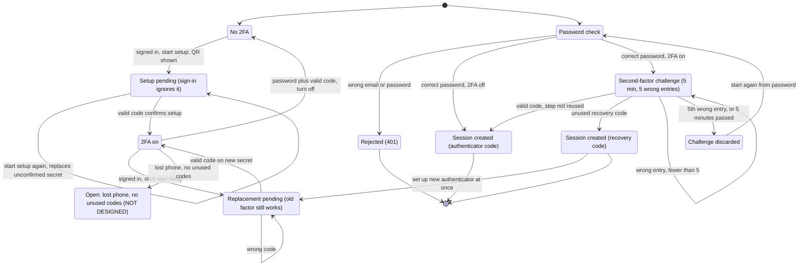

# Two-factor sign-in with an authenticator app: state diagram

## What this is

This adds an optional second factor to the existing email and password sign-in. Today a correct password creates a session at once: a row in `sessions`, and the `sid` cookie. With this change, a user who has turned on 2FA gets a second step after the password. They enter a code from their authenticator app, or an unused recovery code, and only then is the session created. Sessions and the `sid` cookie work as they do today.

A new secret or set of codes takes effect only after the user proves it works. A half-finished setup never blocks sign-in.

## Terms

- **Authenticator app**: a phone app, such as Google Authenticator or 1Password, that shows a six-digit code that changes every 30 seconds.
- **TOTP (RFC 6238)**: the standard that makes these codes. The server and the app share a secret and compute the same code from it and the current time.
- **Time step**: a 30-second window. A code belongs to one step. The server also accepts the step before and the step after, to allow for clock drift.
- **Secret**: the shared key. It is stored encrypted with `seal()` (AES-GCM, key held in the KMS).
- **Recovery code**: a single-use backup code. It is stored only as a one-way hash, so the server cannot read it back.
- **Session and `sid` cookie**: the existing login. The cookie holds a random token. The database stores only its hash.
- **Challenge**: the short-lived record for the second step. It is created after a correct password.
- **`mfa` cookie**: holds the raw challenge token so the server can find the challenge. It is not a login and grants no access by itself.
- **Pending and active secret**: pending means set up but not yet confirmed. Active is the one sign-in checks.
- **Atomic update**: one database statement that changes a row only if a condition still holds. Two requests cannot both use the same code this way.
- **Row lock (`SELECT ... FOR UPDATE`)**: makes other requests wait on the same row. Parallel wrong guesses are then counted one at a time.
- **`enqueue_email`**: puts an email on a background queue. The request does not wait for the send.

## Diagram

## Steps

### Turning 2FA on

1. **Start setup.** Trigger: a signed-in user opens Security settings and starts setup. The server generates a secret, seals it, saves it as a `pending` row and shows a QR code. Sign-in ignores pending rows, so nothing changes yet. Starting again replaces the old unconfirmed pending row. If 2FA is already on, the active secret keeps working until the replacement is confirmed.
2. **Confirm.** Trigger: the user types the current code from the app. The server accepts it only if it matches the current step or one step either side, and that step is later than `last_used_step`. Then, in one transaction:
   - the pending secret becomes active, and any old active secret is removed;
   - `last_used_step` is recorded;
   - all old recovery codes are deleted and 10 new ones are inserted, as hashes;
   - every other session of this user is deleted, with `WHERE user_id = $1 AND token_hash <> sha256(current cookie)`. The current session stays.

   The 10 new codes are shown in this response only and never again.
   Failure: a wrong or already used code changes nothing, issues no codes, and the user may retry.

### Signing in

3. **Password.** Trigger: the login form is submitted. The existing bcrypt check runs unchanged.
   - Wrong email or password: 401 as today. Nothing is written.
   - Correct password, 2FA off: `start_session` runs as today.
   - Correct password, 2FA on: go to step 4. No session row is created here.
4. **Create challenge.** The server makes a random token and stores its sha256 in `mfa_challenges`, with the user, `expires_at` five minutes later and `failed_attempts` set to 0. It sets the `mfa` cookie with the raw token: httponly, secure, SameSite=Lax, max-age five minutes.
5. **Submit a code.** Trigger: the user submits an authenticator code or a recovery code to the challenge endpoint. The server finds the challenge from the hash of the cookie's token and locks its row. If `expires_at` has passed, go to step 7. Otherwise:
   - **Authenticator code.** If the code matches the step window, and the atomic update `WHERE last_used_step IS NULL OR last_used_step < $step` succeeds, delete the challenge and call `start_session`. The session is created here.
   - **Recovery code.** An atomic `UPDATE ... SET used_at = now() WHERE used_at IS NULL RETURNING` uses up the matching code. If it succeeds, delete the challenge and call `start_session`. After the commit, call `enqueue_email` with the number of unused codes left. Sign-in does not wait for that email. If the send fails, it is retried in the background and sign-in is not affected.
   - **Anything else** (wrong code, replayed step, used or unknown recovery code) counts as one wrong entry. Increment `failed_attempts` while the row is locked.
6. **Stay in the challenge.** After a wrong entry, with fewer than five, the user may try again within the five minutes.
7. **Discard.** Trigger: the fifth wrong entry, or a submission after `expires_at`. Delete the challenge row, clear the `mfa` cookie and send the user back to the password step (step 3). The user must re-enter the password.

### Lost phone

8. **Set up a new authenticator.** Trigger: a user signed in with a recovery code starts setup. This is allowed at once, with no waiting period. It uses steps 1 and 2 as a replacement. If the user abandons setup, 2FA stays on with the old secret.

### Turning 2FA off

9. **Turn off.** Trigger: a signed-in user gives their password and a valid authenticator code or unused recovery code. The server deletes the active and pending secrets and all recovery codes.
   Failure: any failed check changes nothing.

## Where each piece of state lives

- **`users`, `sessions`, `sid` cookie:** unchanged. A session row is created only by `start_session`, after the second factor passes.
- **`totp_secrets` (new):** `user_id`, `status` (`pending` or `active`), `secret_sealed`, `last_used_step`, `created_at`. A partial unique index allows at most one pending and one active row per user. Sign-in reads only active rows.
- **`recovery_codes` (new):** `user_id`, `code_hash`, `used_at`. Ten rows per confirmation. Regenerating deletes all of the user's rows and inserts ten new ones in one transaction.
- **`mfa_challenges` (new):** `challenge_hash`, `user_id`, `expires_at`, `failed_attempts`. It lives on the server, so the client cannot reset the attempt limit.
- **`mfa` cookie (new):** holds the raw challenge token. It is not `sid` and authenticates nothing.

## Rules that apply to every step

- Every wrong entry counts toward the limit of five: replayed codes, used recovery codes and invalid codes alike.
- The existing `rate_limit` applies to both `/login` and the challenge endpoint.

## Design choices, and why

- **Replay rule.** Only steps later than `last_used_step` are accepted. This is stricter than the brief needs: an unused earlier step in the window is also rejected once a later one is accepted. Tracking each step would avoid this, at the cost of more storage. Storage is kept small.
- **Row lock.** `FOR UPDATE` stops parallel guesses from going past five wrong entries.

## Open questions

- **Lost phone and no unused recovery codes.** Not designed. Product has not decided whether support may reset 2FA, or how the person's identity would be checked. The `Open` state has no way out.
- **Replacement without the old factor.** A replacement started from a signed-in session does not ask for the old code. The brief does not say whether it must. Confirm with product before building.