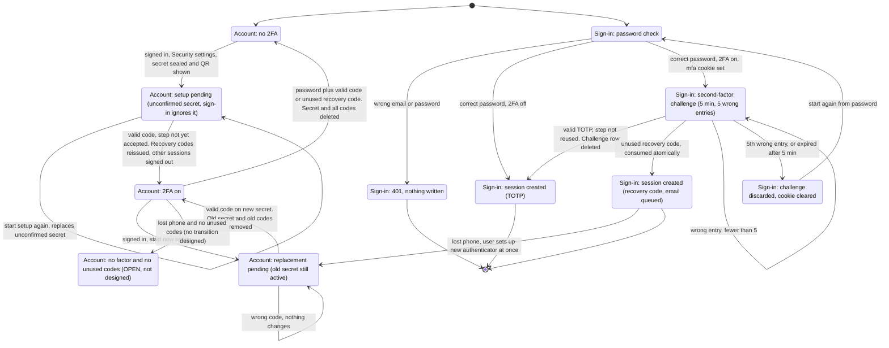

# Two-factor sign-in with an authenticator app: state diagram

## Where the new state lives

- **`users`, `sessions`, `sid` cookie:** unchanged. A session row is created only after the second factor passes (`start_session`). Confirming 2FA deletes other sessions with `WHERE user_id = $1 AND token_hash <> sha256(current cookie)`.
- **`totp_secrets` (new):** `user_id`, `status` (`pending` or `active`), `secret_sealed` (from `seal()`), `last_used_step`, `created_at`. A partial unique index allows at most one pending and one active row per user. Sign-in reads only `active` rows, so the pending secret has no effect until confirmed. A replacement keeps the active row until the pending one is confirmed.
- **`recovery_codes` (new):** `user_id`, `code_hash`, `used_at`. Ten rows per confirmation. Regeneration deletes all of the user's rows and inserts ten new ones in one transaction. Codes are stored only as hashes.
- **`mfa_challenges` (new):** `challenge_hash` (sha256 of the raw token), `user_id`, `expires_at` (created plus 5 min), `failed_attempts`. It lives server-side so the attempt limit cannot be reset by the client.
- **`mfa` cookie (new):** holds the raw challenge token. It is httponly, secure, SameSite=Lax, with max-age 5 min. It is not `sid` and authenticates nothing.

## Transitions: trigger and failure

| Transition | Trigger | On failure |
|---|---|---|
| No 2FA to Setup pending | Signed-in user starts setup; secret sealed into a pending row | None. Sign-in still ignores the pending row. |
| Setup pending to 2FA on | Valid code within ±1 step whose step is not already accepted. One transaction: promote the secret, record `last_used_step`, replace recovery codes, delete other sessions. Ten codes shown once in this response. | Wrong code: nothing changes, no codes issued, user may retry. |
| 2FA on to Replacement pending | Signed-in user starts setup | None. The old secret stays active. |
| Replacement pending to 2FA on | Same confirmation as above. Old secret and old codes removed. | Wrong code: the old factor still works. |
| 2FA on to No 2FA | Password plus valid TOTP or unused recovery code. Deletes the active and pending secrets and all codes. | Any failure: no change. |
| Password check | Existing bcrypt check. If 2FA is on, insert a challenge row and set the `mfa` cookie. No session row. | Wrong password: 401 as today, no challenge created. |
| Challenge to session (TOTP) | Code matches the step window and the atomic update `WHERE last_used_step IS NULL OR last_used_step < $step` succeeds. Delete challenge row, `start_session`. | Wrong code or reused step: one wrong entry. |
| Challenge to session (recovery) | Atomic `UPDATE ... SET used_at = now() WHERE used_at IS NULL RETURNING`. Delete challenge row, `start_session`, then `enqueue_email` after commit with the remaining count. | Used or unknown code: one wrong entry. Email failure does not affect sign-in. |
| Challenge to Discarded | 5th wrong entry, or `expires_at` passed when a submission arrives | Row deleted, cookie cleared, user returns to the password step. |
| Lost phone | Recovery-code session starts setup at once, with no waiting period | If setup is abandoned, 2FA stays on with the old secret. |

## Decisions the brief leaves to you

1. **Replay rule.** Accepting only steps greater than `last_used_step` is stricter than the brief requires. It also rejects an unused earlier step in the window after a later one was accepted. Per-step tracking would avoid this at the cost of more storage.
2. **Wrong entries.** Replayed codes, used recovery codes and invalid codes all count toward the 5-entry limit.
3. **Row lock.** Increment `failed_attempts` under `SELECT ... FOR UPDATE` so parallel guesses cannot exceed 5.
4. **Replacement without the old factor.** A replacement started from a signed-in session does not require the old code. The brief does not say it must, so confirm this with product.
5. **Rate limits.** Apply the existing `rate_limit` to the challenge submission endpoint as well as `/login`.

## Open (not designed)

- A user who has lost their phone and has no unused recovery codes. Product has not decided whether support may reset 2FA or how identity would be checked. The `Open` state in the diagram has no exit and no path is designed.