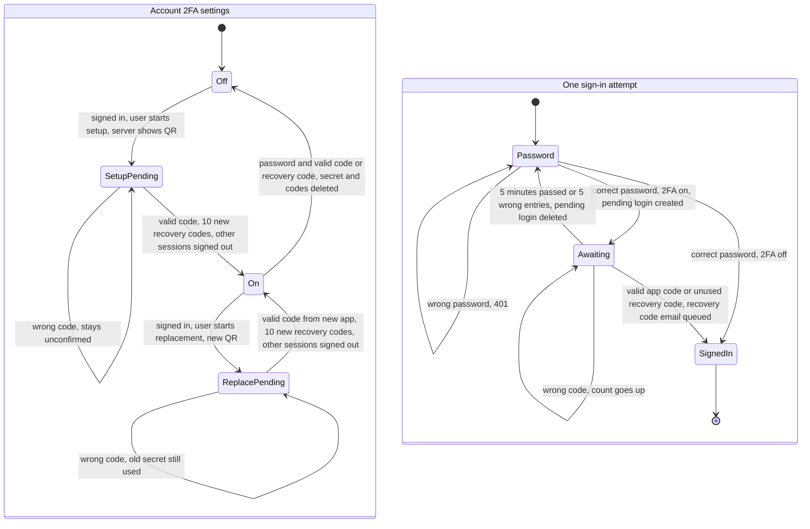

## TOTP 2FA plan

This adds optional two-factor sign-in with an authenticator app (such as Google Authenticator or 1Password) to the existing email and password login. Today, a correct password creates a session at once. With 2FA on, a correct password only starts a short pending login. The session is created after a valid app code or an unused recovery code. Sessions, the `sid` cookie and `start_session()` stay as they are, so everything after sign-in is unchanged.

### Terms

- **TOTP**: time-based one-time password. The app shows a 6-digit code that changes every 30 seconds. The code comes from a shared secret and the clock (RFC 6238).
- **Secret**: the key that the server and the app share. The server stores it encrypted with `seal()`.
- **Time step**: the 30-second window that a code belongs to.
- **Drift window**: the server accepts a code for the step before or after its own current step, so small clock differences do not lock anyone out.
- **Replay protection**: once a code's time step has been accepted for a user, that step's code is refused again.
- **Recovery code**: one of 10 single-use backup codes. The server stores only a hash of each one.
- **Pending login**: the state between a correct password and a correct second factor. It has no session yet.
- **`seal()` / `unseal()`**: the existing AES-GCM encryption helpers. The key is held in the KMS.
- **`start_session()`**: the existing function that creates a session and sets the `sid` cookie.
- **`enqueue_email()`**: the existing function that queues an email. A failed send is retried in the background and never blocks or fails the request.

### Where the new state lives

- `user_totp`: one row per user. It holds the encrypted active secret, whether setup is confirmed, and the last accepted time step. During a setup or replacement, it also holds the encrypted new secret until that is confirmed.
- `recovery_codes`: one row per code. It holds the user, a hash of the code, and the time it was used.
- `pending_logins`: one row per pending login. It holds a hash of the pending token, the user, the count of wrong entries, and the expiry time (5 minutes after the password check).
- `p2f` cookie: holds the random token of the pending login. The table stores only its hash, as `sessions` does.

### Steps

**1. Turn 2FA on (setup).** Trigger: a signed-in user opens Security settings and starts setup. The server makes a secret, seals it into `user_totp` as unconfirmed, and shows a QR code. Sign-in ignores an unconfirmed secret, so nothing changes for sign-in until the user finishes.
The user types a code from the app. The server checks it with the drift window and replay rules. A wrong code is refused and setup stays unconfirmed; the user can try again. A right code does four things. It turns 2FA on and records the time step. It creates 10 new recovery codes, shows them once, and stores only their hashes. It deletes all earlier recovery codes, so they stop working. It signs out every other session of this user. The current session stays.

**2. Replace the authenticator.** Trigger: a signed-in user whose 2FA is already on starts a replacement from Security settings. The new secret is sealed and kept as unconfirmed. The current secret still works for sign-in until the new one is confirmed. Confirming a replacement does the same four things as step 1.

**3. Turn 2FA off.** Trigger: a signed-in user asks to turn 2FA off. The user enters their password and a valid app code or an unused recovery code. Both must pass. If either fails, nothing changes. If both pass, the secret and all recovery codes are deleted.

**4. Sign in.** Trigger: a POST to `/login`.
- The email and password are checked exactly as today, with the same rate limit and the same wrong-password error (401). A wrong password stops here.
- If 2FA is off, `start_session()` runs as today.
- If 2FA is on, the server creates a pending login that expires 5 minutes from now and sets the `p2f` cookie. No session is created and no `sid` cookie is set. The user is sent to the code page.

**5. Enter the second factor.** Trigger: the user submits a code on the code page. The server reads the pending login from the `p2f` cookie.
- If the pending login is missing or expired, the server deletes it if it exists and sends the user back to the password step.
- An app code is accepted if it is inside the drift window and its time step has not been accepted for this user before. The server then records that time step.
- A recovery code is accepted if its hash matches an unused code. The server then marks that code as used.
- Any wrong code adds 1 to the wrong-entry count. When the count reaches 5, the server deletes the pending login and sends the user back to the password step.

**6. Finish sign-in.** Trigger: step 5 accepts the code. The server deletes the pending login, clears the `p2f` cookie and calls `start_session()`. If the accepted code was a recovery code, the server also calls `enqueue_email()` to tell the user that a code was used and how many unused codes remain. Sign-in does not wait for that email. If the send fails, the queue retries in the background and the sign-in is not affected.

**7. Lost phone.** A user who signed in with a recovery code can start setup (step 1) or replacement (step 2) straight away, in that same session.

### Notes

- The diagram shows the account's 2FA settings and one sign-in attempt. Each transition names its trigger, and the failure paths are labelled.
- Setup and replacement use the same confirmation rule, so there is one way to turn 2FA on.
- Product has not decided what happens to a user who has lost their phone and has no unused recovery codes. For example, it is not decided whether support may reset 2FA, or how the person's identity would be checked. This plan does not design that path.

### Open questions

- Lost phone with no unused recovery codes: not decided. Product must decide whether support may reset 2FA, and how identity would be checked. This plan does not design that path.
- The brief does not say whether starting a replacement needs the password or a current code. This plan does not decide it.
- The brief does not say whether a replayed code counts toward the 5 wrong entries.
- The brief does not say whether an unconfirmed setup or replacement expires.