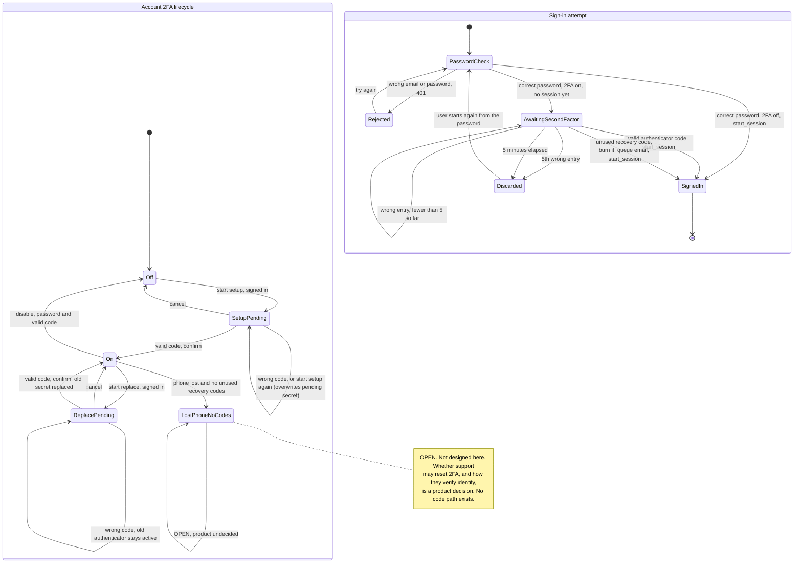

# Two-factor sign-in with an authenticator app: state diagram and notes

Today, `POST /login` checks the email and password and immediately calls `start_session`, which stores a hashed token in `sessions` and sets the `sid` cookie. This change adds optional TOTP 2FA on top. A user turns it on from Security settings by confirming a code from their app. After that, a correct password only opens a short-lived "second factor" step, and `start_session` runs only once an authenticator code or a recovery code is accepted. The existing session mechanism, `start_session` and the `sid` cookie are reused unchanged.

## Terms

- **TOTP (RFC 6238)**: a 6-digit code that an authenticator app derives from a shared secret and the current 30-second time step. The server accepts the current step and one step either side of its own clock.
- **Time step**: the 30-second slot a code belongs to, counted as a whole number.
- **Recovery code**: a single-use code, shown once, that works in place of an authenticator code. A user gets 10 at a time.
- **Challenge**: the in-between sign-in record created after a correct password for a 2FA user. It is not a session.
- **`seal()` / `unseal()`**: the existing AES-GCM helpers (app key in the KMS) for any secret stored at rest.
- **`enqueue_email`**: the existing helper that queues an email. A failed send is retried in the background and never blocks or fails the caller.
- **`rate_limit`**: the existing request limiter used by `/login`.
- **Pending secret**: a newly generated authenticator secret the user has not yet proved they can use. Sign-in ignores it.

## Diagram

The diagram has two parts. The account lifecycle is long-lived state stored on the user. The sign-in attempt is short-lived state for one login. They connect in two places. The sign-in attempt branches on whether the account is `On`. Setup, replace and disable all run from a signed-in session, and a recovery-code sign-in lands in that same kind of session, which is how a user who lost their phone can set up a new authenticator straight away.

## Where each piece of new state lives

All new tables reference `users(id) ON DELETE CASCADE`, like `sessions`.

| State | Location | Notes |
|---|---|---|
| Active authenticator | `user_totp(user_id PK, secret_sealed bytea, confirmed_at, last_step bigint)` | The secret is stored with `seal()`. A row with `confirmed_at` set means 2FA is `On`. No row means `Off`. |
| Pending authenticator | `totp_pending(user_id PK, secret_sealed bytea, created_at)` | Also sealed. The server generates it and renders the QR code. Sign-in never reads this table, so a new secret does nothing until confirmed. A second "start setup" overwrites the row. |
| Replay guard | `user_totp.last_step` | The highest time step accepted for this user. A code is accepted only if its step is within one step either side of the server clock and greater than `last_step`. Acceptance is one atomic `UPDATE ... SET last_step = $s WHERE user_id = $u AND last_step < $s`. Zero rows changed means reject. This also rejects an older in-window step after a newer one was used, which is slightly stricter than the requirement and safe. |
| Recovery codes | `recovery_codes(user_id, code_hash bytea, used_at)` | Only hashes are stored. The codes are random and high-entropy, so sha256 is enough. Use is `UPDATE ... SET used_at = now() WHERE code_hash = $h AND used_at IS NULL RETURNING`, so two concurrent attempts cannot both succeed. The remaining count is `COUNT(*) WHERE used_at IS NULL`. |
| Challenge | `login_challenges(token_hash bytea PK, user_id, created_at, expires_at, failures int)` | `expires_at` is `created_at + 5 min`. `failures` is incremented atomically. The browser holds a separate `mfa` cookie (httponly, secure, SameSite=Lax, `max_age` 300) made with `new_token(32)` and stored as a hash, like `sid`. The `mfa` cookie is never accepted as a session. |
| Sessions | existing `sessions` table and `sid` cookie | Unchanged. `start_session` is now also called from the second-factor handler. |

## Steps

**1. Start setup or replace** (signed in, Security settings)
- Generate a secret, `seal()` it into `totp_pending`, and show the QR code.
- A signed-in session is enough. Replace cannot ask for a current code, because the lost-phone user has none.
- On failure nothing changes, because an unconfirmed secret is inert.

**2. Confirm** (the user types a code from the new app)
- Check the code against the pending secret, using the same window and replay rule as sign-in.
- One transaction then does all of this:
  1. Move the pending secret into `user_totp`. On replace, this overwrites the old secret.
  2. Set `last_step` to the confirming code's step.
  3. Delete all old recovery codes and insert 10 new hashed ones.
  4. Delete every other session of the user: `DELETE FROM sessions WHERE user_id = $u AND token_hash <> sha256($current)`. The current session stays.
  5. Delete the pending row.
- The 10 plaintext codes are returned once in this response and are never stored.
- A wrong code leaves the setup pending, shows an error and applies `rate_limit`. If the transaction fails it rolls back completely: the user stays as before and no codes are shown.

**3. Password step** (`POST /login`)
- The password check, the 401 message and the rate limit stay exactly as today. A wrong password gets the generic wrong-credentials 401.
- If the user has no confirmed `user_totp` row, `start_session` runs as today.
- If the user has a confirmed row, a correct password does not create a session. Instead the server inserts a `login_challenges` row, sets the `mfa` cookie, and shows the code prompt.

**4. Second factor** (new endpoint, requires a valid `mfa` cookie)
- A missing, unknown or expired challenge goes back to the password form.
- The server tries the input first as an authenticator code, then as a recovery code. A recovery code is accepted only if it matches an unused code.
- On success, delete the challenge and the `mfa` cookie, then call `start_session`.
- On an accepted recovery code, the burn and the challenge delete happen in one transaction. After commit, call `enqueue_email(user_id, "recovery_code_used", {remaining})`. Sign-in does not wait for the email, and a failed send never affects it.
- On a wrong entry, increment `failures`. At 5, or past `expires_at`, delete the challenge and the cookie and redirect to the password form, so the user starts again from the password. Otherwise show an error and let them retry.
- The 5-minute limit runs from creation and retries do not extend it. `rate_limit` applies to this endpoint too. The attempt cap is per challenge, and each new challenge needs a correct password.

**5. Lost phone, with a recovery code**
- The recovery code signs the user in as in step 4, which gives a normal session.
- From that session they use Replace, which ends in a fresh Confirm. That mints 10 new recovery codes and signs out all other sessions.

**6. Disable** (signed in)
- Requires the current password (`bcrypt_check`) and a valid authenticator code or unused recovery code, checked as in sign-in.
- One transaction deletes `user_totp`, `totp_pending` and all `recovery_codes` for the user.
- If either check fails, reject and change nothing. Other sessions are not signed out, because the requirements do not ask for it.

## Open questions

- **A user who has lost their phone and has no unused recovery codes.** Whether support may reset 2FA, and how they would verify the person's identity, is undecided. No transition, endpoint or table is designed for it. In the diagram, `LostPhoneNoCodes` is a deliberate dead end. Until product decides, such a user cannot sign in.