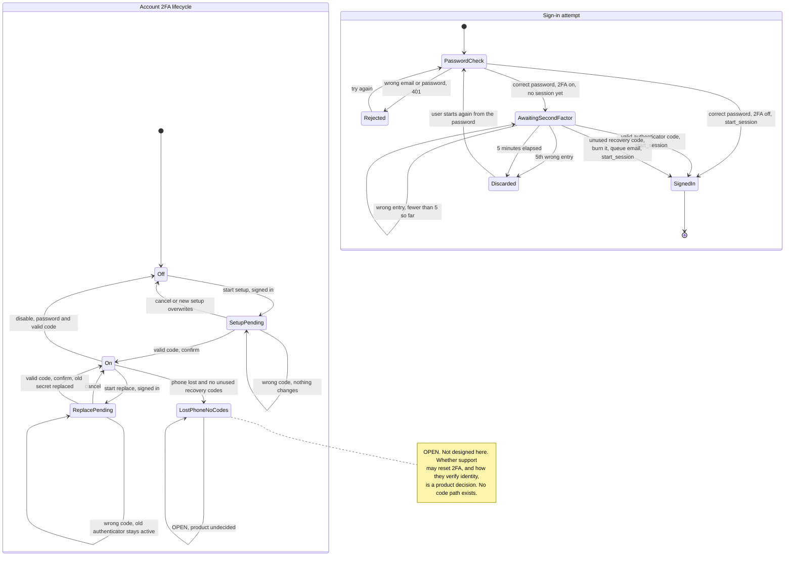

# Two-factor sign-in with an authenticator app: state diagram and notes

## How to read this

The diagram has two parts.

- **Account 2FA lifecycle** is long-lived state stored on the user.
- **Sign-in attempt** is short-lived state for one login.

The parts connect at two points:

- The sign-in attempt branches on whether the account is in `On`.
- Setup, replace and disable all run from a signed-in session. A recovery-code sign-in lands in that same session, which is how a user who lost their phone can set up a new authenticator straight away.

## Where each piece of new state lives

All new tables reference `users(id) ON DELETE CASCADE`, like `sessions`.

| State | Location | Notes |
|---|---|---|
| Active authenticator | `user_totp(user_id PK, secret_sealed bytea, confirmed_at, last_step bigint)` | The secret goes through `seal()`. A row with `confirmed_at` set means 2FA is `On`. No row means `Off`. |
| Pending authenticator | `totp_pending(user_id PK, secret_sealed bytea, created_at)` | Also sealed. The server generates it and renders the QR code. Sign-in never reads this table, so a new secret does nothing until confirmed. A second "start setup" overwrites the row. |
| Replay guard | `user_totp.last_step` | Holds the highest time step accepted for this user. A code is accepted only if its step is in the window of one step either side of the server clock and is greater than `last_step`. Acceptance is one atomic `UPDATE ... SET last_step = $s WHERE user_id = $u AND last_step < $s`. If zero rows change, the code is rejected. This also rejects an older in-window step after a newer one was used, which is slightly stricter than the requirement and safe. |
| Recovery codes | `recovery_codes(user_id, code_hash bytea, used_at)` | Only hashes are stored. The codes are random and high-entropy, so sha256 is enough. Use goes through `UPDATE ... SET used_at = now() WHERE code_hash = $h AND used_at IS NULL RETURNING`. Two concurrent attempts cannot both succeed. The remaining count is `COUNT(*) WHERE used_at IS NULL`. |
| In-between sign-in step | `login_challenges(token_hash bytea PK, user_id, created_at, expires_at, failures int)` | `expires_at` is `created_at + 5 min`. Failures are incremented atomically. The step is tracked by a separate short-lived `mfa` cookie (httponly, secure, SameSite=Lax, `max_age` 300) built with `new_token(32)` and stored as a hash, like `sid`. The `mfa` cookie is never accepted as a session. |
| Sessions | existing `sessions` table and `sid` cookie, unchanged | `start_session` is reused as-is. The only change is that it is called from the second-factor handler as well as from `login`. |

## Triggers and what happens on failure

**Start setup or replace** (signed in, Security settings)
- Generate a secret, `seal()` it into `totp_pending`, and show the QR code.
- A signed-in session is enough. Replace cannot ask for a current code, because the lost-phone user has none.
- Failure: nothing changes. An unconfirmed secret is inert.

**Confirm** (user types a code from the new app)
- The code is checked against the pending secret, with the same window and replay rule.
- One transaction does all of the following:
  1. Move the pending secret into `user_totp`. On replace, this overwrites the old secret.
  2. Set `last_step` to the confirming code's step.
  3. Delete all old recovery codes and insert 10 new hashed ones.
  4. Delete every other session for the user: `DELETE FROM sessions WHERE user_id = $u AND token_hash <> sha256($current)`.
  5. Delete the pending row.
- The 10 plaintext codes are returned once in this response and are never stored.
- Failure on a wrong code: stay pending, show an error, and apply `rate_limit`. Failure in the transaction rolls back everything. The user stays as before, and no codes are shown.

**Password step** (`POST /login`)
- The password check, the 401 message and the rate limit stay exactly as today.
- If the user has no confirmed `user_totp` row, `start_session` runs as today.
- If the user has a confirmed row, a correct password does not create a session. Instead:
  1. Insert a `login_challenges` row.
  2. Set the `mfa` cookie.
  3. Show the code prompt.
- Failure: the generic wrong-credentials 401, as today.

**Second factor** (new endpoint, requires a valid `mfa` cookie)
- A missing, unknown or expired challenge goes back to the password form.
- The server tries the input as an authenticator code, then as a recovery code. A recovery code must also be a valid unused code.
- On success:
  1. Delete the challenge and the `mfa` cookie.
  2. Call `start_session`.
- On an accepted recovery code, the burn and the challenge delete happen in the same transaction. After commit, call `enqueue_email(user_id, "recovery_code_used", {remaining})`. Sign-in does not wait for the email, and a failed send never affects it.
- On a wrong entry:
  - Increment `failures`.
  - At 5, or past `expires_at`, delete the challenge and the cookie and redirect to the password form. The user starts again from the password.
  - Otherwise show an error and let them retry.
- The 5-minute limit is fixed from creation and is not extended by retries. Apply `rate_limit` to this endpoint as well. Note that the attempt cap is per challenge, and each fresh challenge needs a correct password.

**Lost phone with a recovery code**
- The recovery code signs the user in as above, which gives them a normal session.
- From that session they use Replace, which ends in a fresh Confirm. That mints 10 new recovery codes and signs out all other sessions.

**Disable**
- Requires the current password (`bcrypt_check`) and a valid authenticator code or unused recovery code, using the same checks as sign-in.
- One transaction deletes `user_totp`, `totp_pending` and all `recovery_codes` for the user.
- Failure on either check: reject, and change nothing. Other sessions are not signed out, because the requirements don't ask for it.

## Open item

**A user who has lost their phone and has no unused recovery codes.** Whether support may reset 2FA, and how they would verify the person's identity, is undecided. No transition, endpoint or table is designed for it. In the diagram, `LostPhoneNoCodes` is a dead end that is deliberately left open. Until product decides, such a user cannot sign in.
