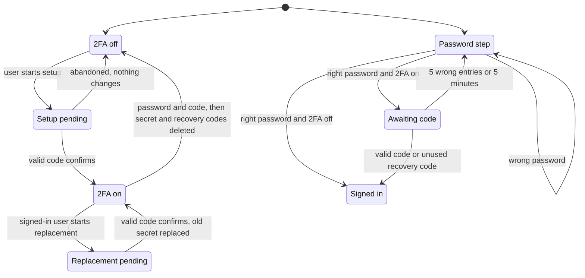

# TOTP two-factor sign-in plan

Today, `POST /login` checks the password with `bcrypt_check` and immediately calls `start_session`. That inserts a row in `sessions` (storing only the sha256 of a random token) and sets the `sid` cookie. This plan adds optional two-factor authentication (2FA) with an authenticator app. A user turns it on in Security settings. After that, a correct password only starts a short "awaiting code" step, and the session is created only once the user enters a valid authenticator code or an unused recovery code. The session mechanism stays as it is, and the new state sits in three new tables and one short-lived cookie.

## Terms

- **TOTP**: time-based one-time password (RFC 6238). The app and the server share a secret. Each derives a 6-digit code from the secret and the current 30-second time step.
- **Time step**: the 30-second window, counted from the Unix epoch, that a code belongs to. The server accepts the current step and one step either side, to allow for clock drift.
- **Recovery code**: a single-use backup code, used when the phone is lost.
- **`seal()` / `unseal()`**: existing AES-GCM helpers with the app key held in the KMS. Any secret stored at rest goes through them.
- **`enqueue_email(user_id, template, data)`**: existing helper that queues an email. A failed send is retried in the background and never blocks or fails the request.
- **`start_session(user_id)`**: existing helper that creates the session row and the `sid` cookie, and redirects to `/home`.
- **Pending login**: the in-between state after a correct password and before the second factor. It has no session and no access.

## New state

| Where | What it holds |
|---|---|
| `user_totp` (one row per user) | `secret`: the active secret, sealed (null until the first setup is confirmed). `pending_secret`: a new secret awaiting its first valid code, sealed. `last_step`: the last time step accepted for this user. |
| `recovery_codes` | `user_id`, `code_hash`, `used_at`. Only hashes are stored (sha256 of a random code, as sessions do with tokens). |
| `pending_logins` | `token_hash`, `user_id`, `expires_at` (5 minutes after creation), `failures` (starts at 0). |
| cookie `p2f` | The raw random token for a pending login. HttpOnly, Secure, SameSite=Lax, max-age 300 seconds. Only its sha256 is stored, as with `sid`. |

A user has 2FA on exactly when `user_totp.secret` is not null. Sign-in ignores `pending_secret`.

## Diagram

The first chart is the account's 2FA lifecycle. The second is one sign-in attempt.

## Steps

Every code check below (steps 2, 3, 5 and 6) works the same way. The server tries the secret with the time steps current, one before and one after. It accepts only a step greater than `last_step`, which is the replay rule. It then sets `last_step` to that step in one atomic `UPDATE ... WHERE last_step < step`. If no row is updated, the code is rejected.

1. **Start setup.**
   - Trigger: a signed-in user with 2FA off asks to turn it on.
   - The server generates a secret, seals it into `user_totp.pending_secret` and shows it as a QR code.
   - If the user abandons this, nothing else changes. Starting again overwrites `pending_secret`.
2. **Confirm setup or replacement.**
   - Trigger: the user types a code from their app.
   - If the code is valid for `pending_secret`, one transaction does all of this:
     - moves `pending_secret` into `secret` and sets `last_step`;
     - deletes all old recovery codes and inserts 10 new hashed ones;
     - deletes every other row in `sessions` for this user. The current session stays.
   - Only then does the page show the 10 recovery codes, once. They are never shown again.
   - If the code is wrong, the page shows an error and the user can retry. Nothing changes.
3. **Replace the authenticator.**
   - Trigger: a signed-in user with 2FA on asks for a new authenticator. This is also the lost-phone path. A user who signed in with a recovery code is already signed in, so no further proof is needed.
   - The server writes `pending_secret` and shows a QR code. The old `secret` keeps working until the new one is confirmed with step 2.
4. **Password check** (`POST /login`).
   - The password check and its per-IP rate limit are unchanged.
   - Wrong password: the same 401 as today. No pending login is created.
   - Right password and 2FA off: `start_session`, as today.
   - Right password and 2FA on: no session is created. The server inserts a `pending_logins` row, sets `p2f` and redirects to the code page.
5. **Enter a code** (code page).
   - Trigger: the user submits an authenticator code or a recovery code. The server looks up the pending login from `p2f`.
   - A missing, unknown or expired pending login sends the user back to the password page.
   - A wrong entry adds 1 to `failures`. At 5 failures the row is deleted, `p2f` is cleared, and the user starts again from the password.
   - A valid authenticator code deletes the pending login and clears `p2f`. It then calls `start_session`.
   - A valid recovery code is marked used with `UPDATE ... SET used_at = now() WHERE code_hash = ... AND used_at IS NULL`. If a row changes, the code was good.
     - Then the server calls `enqueue_email` with a template saying a recovery code was used and how many remain.
     - Then it deletes the pending login and calls `start_session`. Sign-in never waits for the email.
6. **Turn 2FA off.**
   - Trigger: a signed-in user asks to disable it. They must enter their password and a valid authenticator or unused recovery code.
   - If both are right, the server deletes the `user_totp` row and all of the user's recovery codes. Sessions are left alone.
   - If either is wrong, nothing changes.

## When things fail

| Situation | Result |
|---|---|
| Wrong password | 401 as today. No pending login. |
| Wrong code, 4 or fewer times in one pending login | Error shown, `failures` goes up. The pending login stays. |
| 5th wrong entry, or 5 minutes pass | Pending login deleted, `p2f` cleared. Back to the password. |
| Replayed code (its step is not above `last_step`) | Rejected as a wrong entry. |
| Recovery code already used | Rejected as a wrong entry. |
| Email send fails | Retried in the background. Sign-in has already succeeded. |
| Setup or replacement abandoned | `pending_secret` is ignored by sign-in. The old setup, if any, still works. |
| Wrong password or code when disabling | Error shown. 2FA stays on. |

Expired `pending_logins` rows are rejected when read. Deleting them is cleanup that nothing depends on.

## Rollout

Add the three tables with a migration. Change `login()` as in step 4. Add the settings and code pages. Users with 2FA off see no change.

## Open questions

- A user who has lost their phone and has no unused recovery codes: product has not decided what happens. It might be a support reset of 2FA, and how support would verify identity is also undecided. This plan does not design that path.