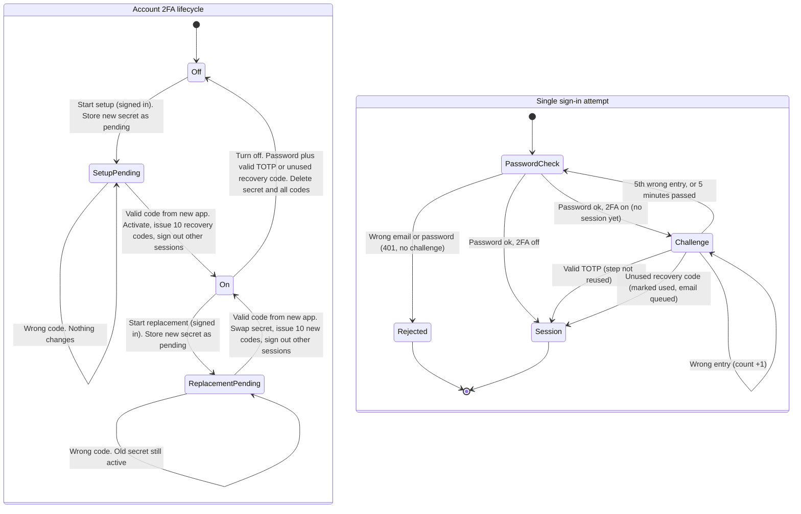

# Two-factor sign-in: 2FA lifecycle and sign-in attempt

This document describes optional two-factor authentication (2FA) using an authenticator app. It is added to our existing email-and-password sign-in.

Today, a correct password creates a session right away. With 2FA turned on, a correct password creates only a short-lived **challenge**. A session is created only after the second factor also passes.

The diagram shows two things:

1. The life of a user's 2FA setting over time (the **lifecycle**).
2. What happens during one sign-in attempt.

## Terms used below

- **TOTP** (time-based one-time password): a 6-digit code that an authenticator app (Google Authenticator, 1Password and similar) computes from a shared secret and the current time. A new code appears every 30 seconds. The server computes the same code from the same secret and checks the user's entry against it. This follows RFC 6238, the standard for these codes.
- **Step**: the 30-second window a code belongs to. It is the Unix time (seconds since 1970) divided by 30, rounded down. The server accepts the current step, plus the step before and the step after. This means small clock differences between the phone and the server do not lock users out.
- **Sealed**: encrypted with `seal()`. It uses AES-GCM (a standard encryption method) and an app key held in the KMS (the cloud key management service, which keeps keys out of our application's database). `unseal()` reverses it. We use it for any secret stored at rest, meaning any secret saved in the database.
- **Recovery code**: one of 10 random codes given when 2FA is set up. Each works once. The server stores only a sha256 hash of each code (a one-way fingerprint), never the code itself. Because the codes are random and long, a fast hash is enough here. Session tokens use the same approach.
- **Active secret and pending secret**: the active secret is the one sign-in checks codes against. A pending secret is a new secret that waits until the user proves they have it by entering a valid code from it. Until then, sign-in ignores it.
- **sid**: the existing session cookie. It is set only after the whole sign-in succeeds.
- **Challenge**: a short-lived server-side record that means "this user has passed the password check and must still pass the second factor." It is not a session and gives access to nothing.
- **Wrong entry**: a code or recovery code that the server does not accept during a challenge. Each wrong entry adds 1 to the challenge's count.

## How to read the diagram

The lifecycle and the sign-in attempt are separate. A user is in one lifecycle state at any time, and each sign-in attempt runs through the second diagram from start to finish.

- **Off**: 2FA is not set up.
- **SetupPending**: the user has started setup and has a new secret waiting to be confirmed. 2FA is not yet on, so sign-in works with the password alone.
- **On**: 2FA is on. Sign-in requires a second factor.
- **ReplacementPending**: 2FA is on, and the user has started swapping in a new authenticator. The old one still works for sign-in until the new one is confirmed.

Every change of state needs the user to be signed in, except turning 2FA off during a sign-in, which uses the password and a second factor. Setup and replacement both finish only after the user enters a valid code from the new app.

## Where the new state lives

The existing `sessions` table and `sid` cookie do not change. No session is written until the second factor passes.

The account's lifecycle state is not stored as a single label. It is read from which columns are filled in:

- **`totp_factors`** (new; one row per user; `user_id` is the primary key and a foreign key to `users`). Columns:
  - `active_secret_sealed` (bytea, sealed).
  - `pending_secret_sealed` (bytea, sealed, may be NULL).
  - `last_used_step` (bigint, may be NULL). This is the newest step already accepted for this user. Any code for this step or an older one is then refused.

  The state is read like this:
  - **Off**: no row exists.
  - **SetupPending**: pending is set, active is NULL.
  - **On**: active is set, pending is NULL.
  - **ReplacementPending**: both are set.

- **`recovery_codes`** (new). Columns: `user_id` (foreign key), `code_hash` (sha256 of a random code), `used_at` (NULL until the code is used).
  - "Issue 10 codes" means delete all of the user's existing rows, then insert 10 new ones.
  - "Turn off" deletes all of them.

- **`login_challenges`** (new, short-lived). Columns:
  - `token_hash` (bytea, primary key): sha256 of the challenge cookie's value. This is the same pattern `sessions` uses. The raw value is never stored.
  - `user_id` (foreign key).
  - `expires_at` (creation time plus 5 minutes).
  - `wrong_attempts` (int, default 0).

  The raw token is stored in its own short-lived cookie, not in `sid`. The row lives on the server rather than inside a sealed cookie. That lets the wrong-entry count be updated atomically (in one step that cannot be interrupted). So two requests cannot both read the same count and both write back the same higher number. The row is deleted on success, on the 5th wrong entry, and on expiry.

- **Sign-in checks read only `active_secret_sealed`.** Pending secrets are never used at sign-in. So a new authenticator does nothing until it is confirmed.

- **Email**: `enqueue_email(user_id, "recovery_code_used", {remaining})` runs after the sign-in transaction commits. The request does not wait for the email. A failed send is retried in the background and never fails the sign-in.

## Transitions: trigger and failure

| Transition | Trigger | On failure |
|---|---|---|
| Off to SetupPending | A signed-in user starts setup in Security settings. The server creates a new secret, seals it, stores it as pending, and shows a QR code. | Nothing is active yet. Starting again overwrites the pending secret. |
| SetupPending to On | The user enters a valid code from the new app. The matching step is saved as `last_used_step`, so that same code cannot sign in during the following 30 seconds. In one transaction: the secret becomes active, the old recovery codes are replaced with 10 new ones, and all of the user's other sessions are deleted. The current `sid` is kept. | A wrong or reused code leaves the state at SetupPending. No codes are issued and no sessions are deleted. |
| On to ReplacementPending | A signed-in user starts replacement. The server stores a new sealed secret as pending. | The old secret keeps working for sign-in. |
| ReplacementPending to On | The user enters a valid code from the new app. In one transaction: the pending secret becomes active, `last_used_step` is set to the matching step, recovery codes are replaced, and other sessions are deleted. | A wrong code leaves the old secret active and the new one pending. |
| On to Off | The user enters their password plus a valid TOTP or an unused recovery code. Delete the `totp_factors` row and all `recovery_codes` rows. | A wrong password or code leaves the state at On. Nothing is deleted. |
| PasswordCheck to Rejected | Wrong email or password. The existing `/login` rate limit (10 per minute per IP) applies. | 401 with the same message as today. |
| PasswordCheck to Challenge | Correct password and 2FA is on. Insert a `login_challenges` row, set the challenge cookie, and redirect to the code entry page. | Not applicable. No session row is written. |
| Challenge, wrong entry | The entry matches neither a valid TOTP nor an unused recovery code. Increment `wrong_attempts`. | The user stays in the challenge until `wrong_attempts` reaches 5. Then the challenge row is deleted and the user starts again from the password. |
| Challenge to Session (TOTP) | A code valid for the current step, or for the step before or after it, and whose step is greater than `last_used_step`. The check is one conditional update: `UPDATE ... WHERE last_used_step IS NULL OR last_used_step < step`. The update succeeds only if the step is new. On success, the session is created and `last_used_step` is saved. | Counts as a wrong entry. |
| Challenge to Session (recovery code) | A row matches the code's hash and has `used_at` NULL. Claim it with `UPDATE ... WHERE used_at IS NULL RETURNING`. Because the update only succeeds on a row that is still unused, two simultaneous uses cannot both succeed. The remaining count is then read. | If no row is claimed, counts as a wrong entry. On success, the email is queued and not awaited. If queuing fails, sign-in still succeeds. |
| Challenge expiry | More than 5 minutes since creation, checked on any request. | The challenge row is deleted and the user starts again from the password. |

## Lost phone path

A user who signs in with a recovery code gets a normal `sid` session. From Security settings they can start a replacement (On to ReplacementPending) and confirm it with a code from the new app. The brief requires this to work straight away. It does not need a code from the old app.

## Open

1. **Lost phone and no unused recovery codes: not decided.** No transition is drawn for this case. Product must decide whether support may reset 2FA, and how the person's identity would be checked.
2. **What proves a replacement is legitimate is not specified.** Under the lost-phone rule, a signed-in session alone can swap the factor. So a stolen session cookie could replace it. Recommendation, not yet decided: require password re-entry before a replacement can start. This still works for a user who has lost the phone, because they still know the password.
3. **No limit on setup confirmation attempts** is specified. As drawn, SetupPending to On can be retried without limit.
4. **The replay rule is stricter than the brief.** The brief rejects a step that was "already accepted." Storing only `last_used_step` and rejecting any step at or below it also rejects an older step that was never used. Example: steps 100 and 101 are both valid. If the user signs in with a code for step 101 first, a code for step 100 is then rejected, even though it was never used. Exact per-step tracking would need a stored set of used steps. Which behavior is wanted needs to be confirmed.
5. **Choices made here, not in the brief.** Recovery codes are hashed with sha256, since they are random and high-entropy, as session tokens are. The challenge is a server-side row so that the wrong-entry count can be updated atomically, which a sealed cookie cannot do.
6. **Turning 2FA off does not say what happens to other sessions.** The diagram leaves them untouched.