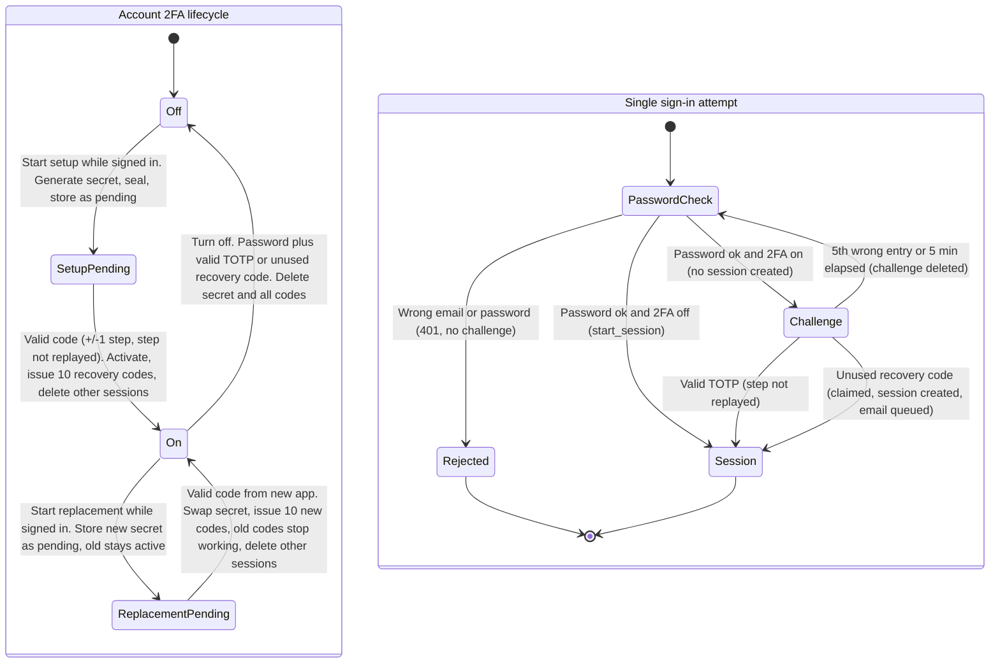

# Two-factor sign-in: 2FA lifecycle and sign-in attempt

## Where the new state lives

The existing `sessions` table and `sid` cookie are unchanged. Nothing about a session is created until the second factor passes.

- **`totp_factors`** (new, one row per user, `user_id` primary key with FK to `users`). Columns: `active_secret_sealed` bytea (`seal()`), `pending_secret_sealed` bytea NULL, `last_used_step` bigint NULL. The account state is read from which columns are set:
  - Off: no row.
  - SetupPending: pending set, active NULL.
  - On: active set, pending NULL.
  - ReplacementPending: both set.
- **`recovery_codes`** (new). Columns: `user_id` FK, `code_hash` (sha256 of a random code), `used_at` NULL. "Issue 10 codes" means delete all rows for the user and insert 10 new ones. "Turn off" deletes all rows.
- **`login_challenges`** (new, short-lived). Columns: `token_hash` bytea primary key (sha256, same pattern as `sessions`), `user_id` FK, `expires_at` (created plus 5 min), `wrong_attempts` int default 0. The raw token goes in a separate short-lived cookie, not `sid`. Rows are deleted on success, on the 5th wrong entry, and on expiry.
- **Sign-in verification** reads only `active_secret_sealed`. Pending secrets are never consulted at sign-in, which gives the "ignored until confirmed" rule.
- **Email**: `enqueue_email(user_id, "recovery_code_used", {remaining})` runs after the sign-in transaction commits and is not awaited.

## Transitions: trigger and failure

| Transition | Trigger | On failure |
|---|---|---|
| Off to SetupPending | Signed-in user starts setup in Security settings. Server writes a sealed pending secret and returns a QR code. | Nothing is active. Starting again overwrites the pending secret. |
| SetupPending to On | Valid code from the new app. The matched step is stored as `last_used_step`, so that same code cannot sign in during the next 30 s. In one transaction: activate, replace recovery codes, delete the user's other sessions (current `sid` kept). | Wrong or replayed code: stays SetupPending, no codes issued, nothing deleted. |
| On to ReplacementPending | Signed-in user starts replacement. | Old secret keeps working for sign-in. |
| ReplacementPending to On | Valid code from the new app. Active becomes the new secret, `last_used_step` set to the matched step, codes replaced, other sessions deleted. | Wrong code: old secret stays active, pending secret kept. |
| On to Off | Password plus a valid TOTP or unused recovery code. Deletes `totp_factors` row and all `recovery_codes` rows. | Wrong password or code: stays On, nothing deleted. |
| PasswordCheck to Rejected | Wrong email or password. Existing `/login` rate limit (10 per minute per IP) applies. | 401, same message as today. |
| PasswordCheck to Challenge | Correct password, 2FA on. Insert `login_challenges` row, set challenge cookie, redirect to code entry. | Not applicable. No session row is written. |
| Challenge, wrong entry | Wrong TOTP, or an unused-looking code that is not valid, or an already-used recovery code. `wrong_attempts` incremented. | Stays in Challenge until `wrong_attempts` reaches 5, then the challenge is deleted and the user restarts from the password. |
| Challenge to Session (TOTP) | Valid code within +/-1 step and step greater than `last_used_step`. Replay guard is one conditional `UPDATE ... WHERE last_used_step IS NULL OR last_used_step < step`. | Counts as a wrong entry. |
| Challenge to Session (recovery) | Matching row with `used_at` NULL. Claimed with `UPDATE ... WHERE used_at IS NULL RETURNING`, so concurrent uses cannot both succeed. | Counts as a wrong entry if no row is claimed. Email is queued, never awaited. If the queue fails, sign-in still succeeds. |
| Challenge expiry | More than 5 min since creation, on any request. | Challenge deleted, user restarts from the password. |

## Lost phone path

A user who signs in with a recovery code gets a normal `sid` session. From Security settings they can start replacement (On to ReplacementPending) and confirm with the new app's code. The brief requires this to work straight away. It needs no code from the old app.

## Open

1. **Lost phone and no unused recovery codes: not decided.** No transition is drawn. Product must decide whether support may reset 2FA and how identity would be checked.
2. **What proves a replacement is not stated.** The lost-phone rule means a signed-in session alone can swap the factor, so a stolen session cookie could replace it. Recommendation, not decided: require password re-entry before starting replacement. This still works for a user who lost the phone.
3. **No limit on setup confirmation attempts** is specified. SetupPending to On is unlimited as drawn.
4. **Replay rule is stricter than the brief.** The brief says reject a step "already accepted". Storing `last_used_step` and rejecting any step at or below it also rejects an older step that was never used. Exact per-step tracking would need a set of used steps. Confirm which is wanted.
5. **Choices made here, not in the brief:** recovery code hash is sha256 (codes are random and high-entropy, as with session tokens). Challenge is a server-side row because wrong-entry counting must be atomic, which a sealed cookie cannot do.
6. **Turning 2FA off does not say what happens to other sessions.** The diagram leaves them untouched.