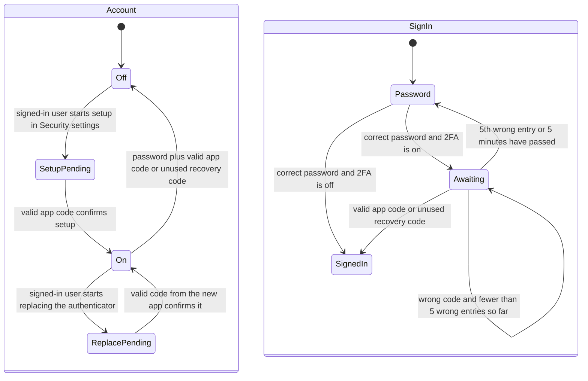

## TOTP 2FA plan

This plan adds optional two-factor sign-in with an authenticator app such as Google Authenticator or 1Password. The app shows a 6-digit code that changes every 30 seconds. "Two-factor" (2FA) means the user proves two things: something they know (the password) and something they have (the phone with the app). The feature sits on top of today's email-and-password login. A user who turns it on still types their password first, then types a code from the app. The existing `sid` session cookie and the `sessions` table do not change.

New tables: `user_totp`, `recovery_codes`, `pending_logins`. New cookie: `p2f`. Existing helpers reused: `seal()`, `enqueue_email()` and `start_session()`.

**Terms used below**

- **Session**: a row in the `sessions` table plus the `sid` cookie that points to it. Having one means you are signed in.
- **Sealing (`seal()`)**: encrypts a value before it is stored. The encryption key is kept in a key management service (KMS), not in the database. `unseal()` decrypts it again.
- **Hashing**: stores a one-way fingerprint of a value (SHA-256 here). The original value cannot be recovered from the stored hash, so a database leak does not reveal it. To check a cookie, the server hashes the value the browser sent and compares the result to the stored hash.
- **Pending login**: the short wait between a correct password and a correct second factor. No session exists during this wait.
- **Time step**: TOTP divides time into 30-second steps. Each code belongs to one step. The server accepts a code from the current step, the step before, or the step after. This allows for small differences between the phone's clock and the server's clock.
- **Replay protection**: once a code from a given time step is accepted for a user, that step and every earlier step are refused for that user. This stops someone from reusing a code they just saw typed.
- **Queued email**: `enqueue_email()` puts an email on a background queue. The request does not wait for the send. If sending fails, the queue retries it later.

**How to read the diagram**

The diagram has two independent parts. `Account` is the state of the user's 2FA setting. `SignIn` is one sign-in attempt. A sign-in attempt reads the account state, but it does not change it. Only the transitions drawn in the diagram are shown. Wrong passwords, wrong codes and failed setups are described in the notes below, not drawn as loops.

### Where each piece of state lives

- **`user_totp`** (one row per user): the secret, sealed with `seal()`. The row also has a flag saying whether the secret is confirmed, and the time step of the last accepted code. That step is what replay protection checks.
  - A new secret, from setup or replacement, is saved as unconfirmed.
  - Sign-in keeps checking codes against the confirmed secret until the new one is confirmed.
  - 2FA is on only when a confirmed secret exists.
- **`recovery_codes`**: up to 10 rows per user. Each row holds a hash of the code and whether it has been used. Each confirmation deletes all old rows and creates 10 new ones. Turning 2FA off deletes them all.
- **`pending_logins`**: one row per in-progress second-factor step. It holds the user, a hash of the token in the `p2f` cookie, an expiry time (5 minutes after the password check), and a count of wrong entries (the limit is 5).
- **`p2f` cookie**: carries a random token that identifies the pending login. Only the token's hash is stored, the same way `sid` works. This is our reading of the design. The brief does not spell it out.
- **`sessions`**: unchanged. A session row is created only after the second factor passes.

### What triggers each transition

Account 2FA setting:

- **Off to Setup pending**: a signed-in user starts setup in Security settings. The server generates a secret, saves it sealed and unconfirmed, and shows a QR code for the app to scan.
- **Setup pending to On**: the user types a valid code from the app. The server does these three things together:
  - marks the secret confirmed and records the time step of that code, so the same code cannot be used again at sign-in;
  - deletes the old recovery codes and creates 10 new ones, shown once;
  - signs out every other session of this user. The current session stays.
- **On to Replace pending**: a signed-in user starts replacing the authenticator. The server creates a new unconfirmed secret. The old secret keeps working for sign-in until the new one is confirmed. A user who lost their phone reaches this same step after signing in with a recovery code.
- **Replace pending to On**: the user types a valid code from the new app. The server replaces the secret and the recovery codes, and records the time step of that code. The brief does not say whether other sessions are also signed out here. See Open.
- **On to Off**: the user enters their password and a valid app code or an unused recovery code. The server deletes the secret and all recovery codes.

Sign-in attempt:

- **Password to Signed in** (2FA off): the existing behaviour, through `start_session()`.
- **Password to Awaiting** (2FA on): the server creates a pending login and sets the `p2f` cookie. No session is created.
- **Awaiting to Signed in**: one of two things happens.
  - A valid app code from a time step newer than the last accepted one. The server records that step.
  - An unused recovery code. The server marks that code as used, queues an email saying a code was used and how many remain, and signs the user in. Sign-in does not wait for that email.
  - In both cases the pending login is deleted.
- **Awaiting to Awaiting**: a wrong code adds one to the wrong-entry count.
- **Awaiting to Password**: the 5th wrong entry, or the 5-minute limit, ends the step. The pending login is deleted and the user must start again from the password. Both limits are checked on every entry.
- A **wrong password** keeps the user at the password step. The existing login response and rate limit apply unchanged.

### What happens on failure

- A wrong or already-used code during setup, replacement or turning 2FA off is rejected. The current state stays as it was, and the old secret keeps working.
- A recovery code that is already used, or that matches nothing, counts as a wrong entry in the pending login.
- A failed or slow email does not affect sign-in. The email is queued and retried in the background.
- An expired pending login is treated as if the user had never passed the password step.
- The brief sets no attempt limit for setup, replacement or turning 2FA off. This is not decided yet.

### Open

- **Lost phone with no unused recovery codes**: not designed. Product still needs to decide whether support may reset 2FA, and how a person's identity would be checked. No transition is drawn for this case. The only route to a new authenticator after losing a phone is signing in with an unused recovery code.
- **Sessions on replacement**: the brief says other sessions are signed out "when 2FA is confirmed". It does not say whether this also applies when an authenticator is replaced. This plan signs out other sessions on first setup only. Replacement regenerates recovery codes but leaves other sessions alone.
- **Unconfirmed secrets**: the brief does not say what happens to a secret that is never confirmed. This plan treats it as inert. It is never used for sign-in and is overwritten by the next setup or replacement.