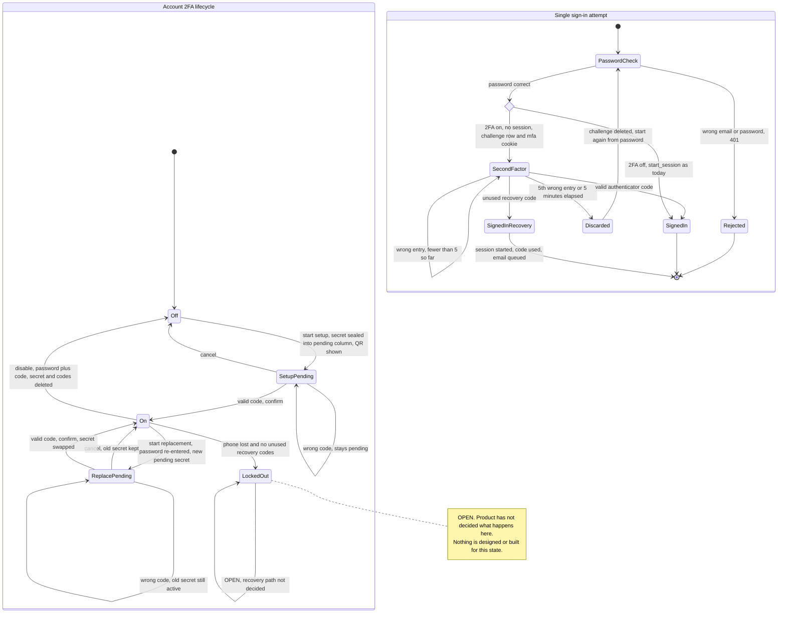

# Two-factor sign-in with an authenticator app: lifecycle and sign-in attempt

This adds optional two-factor authentication (2FA) to the existing email-and-password login, using TOTP. TOTP is the standard behind Google Authenticator and 1Password. The user's app and the server share a secret. Every 30 seconds both compute the same 6-digit code from that secret and the current time. Each 30-second period is a "time step".

The design reuses what exists today: `seal`/`unseal` (AES-GCM encryption for secrets at rest), `enqueue_email` (background email queue), `start_session` and the `sid` session cookie. The password check in `login()` is unchanged. The only change to `login()` is what happens after a correct password: if the user has 2FA on, no session is created yet.

## Terms

- **Active secret**: the secret that sign-in checks.
- **Pending secret**: a newly generated secret that the user has not yet proved they can use. Sign-in ignores it.
- **Recovery code**: a single-use code the user types instead of an authenticator code when the phone is lost.
- **Challenge**: the in-between sign-in step after a correct password and before the second factor. It is short-lived and creates no session.

## Where the new state lives

| State | Location | Notes |
|---|---|---|
| Active secret | `users.totp_secret_sealed bytea NULL` | Written with `seal()`. Sign-in reads only this column. |
| Pending secret | `users.totp_pending_sealed bytea NULL` | Written with `seal()`. Sign-in ignores it. |
| 2FA on | `users.totp_enabled boolean NOT NULL DEFAULT false` | Becomes true only when a valid code from the pending secret is submitted. |
| Last accepted time step | `users.totp_last_step bigint NOT NULL DEFAULT 0` | Replay guard (see Code checking). |
| Recovery codes | New table `recovery_codes (user_id, code_hash bytea, used_at timestamptz NULL)`, one row per code | Only hashes are stored. The raw codes are shown once, in the confirm response. |
| Challenge | New table `login_challenges (token_hash bytea PK, user_id, expires_at, attempts int)` | `expires_at` is creation time plus 5 minutes. The browser holds the raw token in a new `mfa` cookie (httponly, secure, Lax), separate from `sid`. Only the token's hash is stored, as with sessions. |

- **Recovery code hashing.** Codes are random with about 50 bits or more of entropy (for example 10 base32 characters), so a fast `sha256` is enough, as it is for session tokens. Lookups compare hashes.
- **Never stored.** The server never stores a plaintext secret or recovery code. The `sessions` table is unchanged.

## Diagram

The first block is the account's 2FA lifecycle. The second is one sign-in attempt. They are independent: sign-in reads the lifecycle only through `totp_enabled`.

## Code checking

Every authenticator code is checked the same way, whether it is against the active secret (sign-in, disable) or the pending secret (confirming setup or replacement).

- **Window.** RFC 6238, 6 digits, 30-second steps. The server accepts the current step and the steps either side (-1, 0, +1) to allow for clock drift.
- **Replay.** A step is accepted only if it is greater than `totp_last_step`. The accept is atomic: `UPDATE users SET totp_last_step = %s WHERE id = %s AND totp_last_step < %s`. If no row is updated, the code is rejected as already used.
- **Concurrency.** Because of that atomic update, two concurrent requests with the same code cannot both succeed.
- **Edge case.** After a replacement, a code from the new secret is rejected if its step is not above the old `totp_last_step`. It works again once the clock reaches a later step, at most about 30 seconds later. This is acceptable.
- **Code type.** An entry that matches the format of a recovery code is checked as a recovery code. Anything else is checked as a TOTP code.

## Transitions: triggers, effects and failures

### Account lifecycle

All of these are POST requests made from Security settings by a signed-in user.

- **Off to SetupPending (start setup).**
  - The server generates a 160-bit secret and writes `seal(secret)` to `totp_pending_sealed`.
  - It returns an `otpauth://` QR code. The page also shows the secret once, for manual entry.
  - Starting again overwrites the pending secret.
  - Sign-in is unaffected, because `totp_enabled` stays false.
  - Cancel clears the pending column and returns to Off.
- **SetupPending to On (confirm).**
  - The user submits a code from their app. The server checks it against the unsealed pending secret, using the rules in Code checking.
  - In one transaction the server:
    - moves the pending secret into `totp_secret_sealed` and clears the pending column;
    - sets `totp_enabled = true`;
    - sets `totp_last_step` to the accepted step;
    - deletes all old `recovery_codes` rows and inserts 10 new hashes;
    - signs out every other session with `DELETE FROM sessions WHERE user_id = %s AND token_hash <> sha256(current sid)`. The current session stays.
  - The 10 raw recovery codes are returned in this response only and can never be retrieved again.
  - **Failure.** A wrong code returns an error and the state stays SetupPending. Nothing else changes.
  - Submissions are rate limited per user (`rate_limit`, keyed by user), so a stolen signed-in session cannot guess codes freely.
- **On to ReplacePending (start replacement).**
  - The user must re-enter their current password. A user who signed in with a recovery code may have no working authenticator, so the password is the proof used here.
  - This is how "set up a new authenticator straight away" works. After a recovery-code sign-in the user opens Security settings, enters their password and scans the new QR code.
  - The new secret goes into the pending column. The old secret and old recovery codes stay active until confirmation.
  - **Failure.** A wrong password returns 401 and nothing changes.
- **ReplacePending to On (confirm).**
  - This runs the same transaction as first-time confirm. It swaps in the new secret, replaces all recovery codes with 10 new ones (every old code stops working) and signs out all other sessions.
  - **Failure.** A wrong code leaves the old secret and old codes active.
  - Cancel clears the pending column and returns to On.
- **On to Off (disable).**
  - The user sends the password plus a valid authenticator code or unused recovery code. The password is checked first.
  - In one transaction the server nulls both secret columns, deletes all recovery codes, sets `totp_enabled = false` and resets `totp_last_step` to 0.
  - Other sessions are not signed out, because the requirements do not ask for it.
  - **Failure.** A wrong password or code returns 401 and 2FA stays on.
- **On to LockedOut (OPEN).**
  - This is a user who lost their phone and has no unused recovery codes.
  - Product has not decided whether support can reset 2FA, or how they would verify the person.
  - No path out of this state is designed or built. Today that user cannot sign in.

### Single sign-in attempt

- **PasswordCheck.**
  - This is the existing `login()` code, including the 401 on a wrong email or password and the per-IP `rate_limit`.
  - A wrong password never creates a challenge.
- **PasswordCheck to SignedIn (2FA off).** `start_session(user.id)` runs exactly as it does today.
- **PasswordCheck to SecondFactor (2FA on).**
  - `login()` does not call `start_session` and does not set `sid`. A correct password alone creates no session.
  - It inserts a `login_challenges` row with `attempts = 0` and an expiry 5 minutes ahead.
  - It sets the `mfa` cookie and renders the code entry page.
  - The challenge grants nothing else. Every other route still requires `sid`.
- **SecondFactor, one entry (new `POST /login/2fa`).**
  - The server looks up the challenge by the hash of the `mfa` cookie. If the row is missing or expired, it redirects to `/login`.
  - Otherwise it checks the entry as an authenticator code or an unused recovery code.
  - **Wrong entry.** This includes a replayed or out-of-window code, and a recovery code that is unknown or already used.
    - The attempt is counted with an atomic `attempts = attempts + 1`.
    - If the count is now 5, the row is deleted and the user is sent to `/login`. This is Discarded.
    - Otherwise the user sees an error and stays at the second factor.
  - **Valid entry.**
    - The challenge row is deleted, so it can be used only once.
    - The `mfa` cookie is cleared.
    - `start_session` creates the session and sets `sid`.
- **Timeout.** A challenge older than 5 minutes is rejected when used, and expired rows are purged periodically. The user starts again from the password.
- **SignedInRecovery.**
  - The code is consumed atomically: `UPDATE recovery_codes SET used_at = now() WHERE user_id = %s AND code_hash = %s AND used_at IS NULL`. If no row is updated, the entry counts as a wrong entry.
  - If it succeeds, the server reads how many unused codes remain and creates the session.
  - Once that work is committed, `enqueue_email(user_id, "recovery_code_used", {remaining: n})` queues the notice. The queue retries in the background, so a mail failure never delays or fails sign-in.
  - The session is a normal 30-day `sid` session. It can start a replacement by entering the password (see above).

## Failure summary

| Failure | Result |
|---|---|
| Wrong password at sign-in | 401, existing message, no challenge |
| Wrong second-factor entry, 1st to 4th | Error, same challenge, counter up |
| 5th wrong entry or 5 minutes elapsed | Challenge deleted, back to `/login` |
| Replayed or out-of-window code | Counts as a wrong entry |
| Wrong code during setup or replacement | Error, stays pending, old state unchanged |
| Wrong password or code on disable | 401, 2FA stays on |
| Email send failure after a recovery sign-in | Retried in the background, sign-in unaffected |

## Open

- **Lost phone with no unused recovery codes.**
  - The LockedOut state has no exit.
  - Product still has to decide whether support may reset 2FA and how the person's identity would be checked.
  - No reset flow, support tool, or "contact support" copy is specified here.
