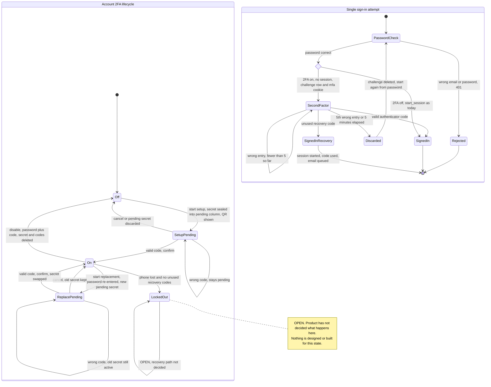

# Two-factor sign-in with an authenticator app: lifecycle and sign-in attempt

Everything here reuses `seal`/`unseal`, `enqueue_email`, `start_session` and the `sid` session mechanism. The password check in `login()` is unchanged. The only change to `login()` is what happens after a correct password.

## Where the new state lives

| State | Location | Notes |
|---|---|---|
| Active secret | `users.totp_secret_sealed bytea NULL` | Written with `seal()`. Sign-in reads only this column. |
| Pending secret | `users.totp_pending_sealed bytea NULL` | Written with `seal()`. Sign-in ignores it. |
| 2FA on | `users.totp_enabled boolean NOT NULL DEFAULT false` | Becomes true only when a code from the pending secret is verified. |
| Last accepted time step | `users.totp_last_step bigint NOT NULL DEFAULT 0` | Replay guard. |
| Recovery codes | New table `recovery_codes (user_id, code_hash bytea, used_at timestamptz NULL)`, one row per code | Only hashes are stored. The raw code is shown once, in the confirm response. |
| Half-signed-in step | New table `login_challenges (token_hash bytea PK, user_id, expires_at, attempts int)` | `expires_at` is created time plus 5 minutes. The cookie is a new `mfa` cookie (httponly, secure, Lax), separate from `sid`. The raw token is never stored. |

- **Recovery code hashing.** Codes are random with about 50 bits or more of entropy (for example 10 base32 characters). A fast `sha256` is therefore enough, as it is for session tokens. They are compared by hash.
- **Not stored.** The server never stores a plaintext secret or recovery code. The `sessions` table is unchanged.

## Diagram

## Transitions: triggers, effects and failures

### Account lifecycle

All of these are POST requests from Security settings by a signed-in user.

- **Off to SetupPending (start setup).**
  - The server generates a 160-bit secret and writes `seal(secret)` to `totp_pending_sealed`.
  - It returns an `otpauth://` QR code, and the page shows the secret once for manual entry.
  - Starting again overwrites the pending secret.
  - Sign-in is unaffected. `totp_enabled` stays false.
- **SetupPending to On (confirm).**
  - The user submits a code from their app. The server checks it against the unsealed pending secret and the replay rule below.
  - In one transaction it does the following:
    - It moves the pending secret into `totp_secret_sealed` and clears the pending column.
    - It sets `totp_enabled = true`.
    - It sets `totp_last_step` to the accepted step.
    - It deletes all old `recovery_codes` rows and inserts 10 new hashes.
    - It runs `DELETE FROM sessions WHERE user_id = %s AND token_hash <> sha256(current sid)`. The current session stays and every other session is signed out.
  - The 10 raw recovery codes go back in this response only. They are never retrievable again.
  - A wrong code returns an error and the state stays SetupPending. Nothing else changes.
  - Codes are rate limited per user (`rate_limit`, key by user) so a signed-in session cannot guess freely.
- **On to ReplacePending (start replacement).**
  - This needs the current password, because a user who signed in with a recovery code may have no working authenticator.
  - That makes "set up a new authenticator straight away" possible. After a recovery sign-in the user goes to Security settings, enters their password and scans the new QR code.
  - The new secret goes into the pending column. The old secret and old recovery codes stay active until confirmation.
  - A wrong password is a 401 and nothing changes.
- **ReplacePending to On (confirm).**
  - Same transaction as first setup. It swaps in the new secret and replaces all recovery codes with 10 new ones. Every old code stops working. It signs out all other sessions.
  - A wrong code leaves the old secret and old codes active.
  - Cancel clears the pending column.
- **On to Off (disable).**
  - The user sends the password plus a valid authenticator code or unused recovery code.
  - In one transaction it nulls both secret columns, deletes all recovery codes, sets `totp_enabled = false` and resets `totp_last_step`.
  - A wrong password or code returns 401 and 2FA stays on. If a recovery code was used, it is consumed.
  - This does not sign out other sessions, because the requirements do not ask for it.
- **On to LockedOut (OPEN).** This is a user who lost their phone and has no unused recovery codes. Whether support can reset 2FA, and how they would verify the person, is undecided. Do not build any path out of this state. Today the user simply cannot sign in.

### Code checking (every check against the active secret)

- **Window.** RFC 6238 with 6 digits and 30-second steps. The server accepts the current step and the steps either side (-1, 0, +1).
- **Replay.** A step is accepted only if it is greater than `totp_last_step`. The accept is atomic: `UPDATE users SET totp_last_step = %s WHERE id = %s AND totp_last_step < %s`. If it updates no row, the code is rejected as already used.
- **Concurrency.** Two concurrent requests with the same code cannot both succeed.
- **Edge case.** After a replacement, a code from the new secret at a step not above the old last step is rejected until the next step. This is acceptable.
- **Code type.** A submitted entry that matches the format of a recovery code is checked as a recovery code. Otherwise it is checked as a TOTP code.

### Single sign-in attempt

- **PasswordCheck.** This is the existing `login()` code, including the 401 on a wrong email or password and the IP `rate_limit`. A wrong password never creates a challenge.
- **PasswordCheck to SignedIn (2FA off).** `start_session(user.id)` runs exactly as it does today.
- **PasswordCheck to SecondFactor (2FA on).**
  - `login()` calls neither `start_session` nor sets `sid`. A correct password alone creates no session.
  - It inserts a `login_challenges` row with `attempts = 0` and an expiry 5 minutes ahead.
  - It sets the `mfa` cookie and renders the code entry page.
  - The challenge grants nothing else. Every other route still requires `sid`.
- **SecondFactor, one entry (new `POST /login/2fa`).**
  - The server looks up the challenge by the hash of the `mfa` cookie. If the row is missing or expired, it redirects to `/login`.
  - Otherwise it checks the entry as an authenticator code or an unused recovery code.
  - Wrong entry:
    - The attempt is counted with an atomic `attempts = attempts + 1`.
    - If the count is now 5, the row is deleted and the user is sent to `/login`. This is Discarded.
    - Otherwise the user sees an error and stays at the second factor.
  - Valid entry:
    - The challenge row is deleted (one-time use).
    - The `mfa` cookie is cleared.
    - `start_session` creates the session and `sid`.
- **Timeout.** A challenge older than 5 minutes is rejected on use. Expired rows are purged periodically. The user starts again from the password.
- **SignedInRecovery.**
  - The code is consumed atomically: `UPDATE recovery_codes SET used_at = now() WHERE user_id = %s AND code_hash = %s AND used_at IS NULL`. If the update touches no row, the code counts as a wrong entry.
  - On success the session is created. The remaining count is read.
  - `enqueue_email(user_id, "recovery_code_used", {remaining: n})` is called after the commit. It is queued and retried in the background, so a mail failure never delays or fails sign-in.
  - The session is a normal 30-day `sid` session. It can start a replacement by entering the password (see above).
  - A recovery code is also valid for disabling 2FA (On to Off). That is the same consumption rule.

## Failure summary

| Failure | Result |
|---|---|
| Wrong password at sign-in | 401, existing message, no challenge |
| Wrong second-factor entry, 1st to 4th | Error, same challenge, counter up |
| 5th wrong entry or 5 minutes elapsed | Challenge deleted, back to `/login` |
| Replayed or out-of-window code | Counts as a wrong entry |
| Wrong code during setup or replacement | Error, stays pending, old state unchanged |
| Wrong password or code on disable | 401, 2FA stays on |
| Email send failure after a recovery sign-in | Retried in the background, sign-in unaffected |

## Open

- **Lost phone with no unused recovery codes.**
  - The LockedOut state has no exit.
  - Product still has to decide whether support may reset 2FA and how the person's identity would be checked.
  - No reset flow, support tool, or "contact support" copy is specified here.
