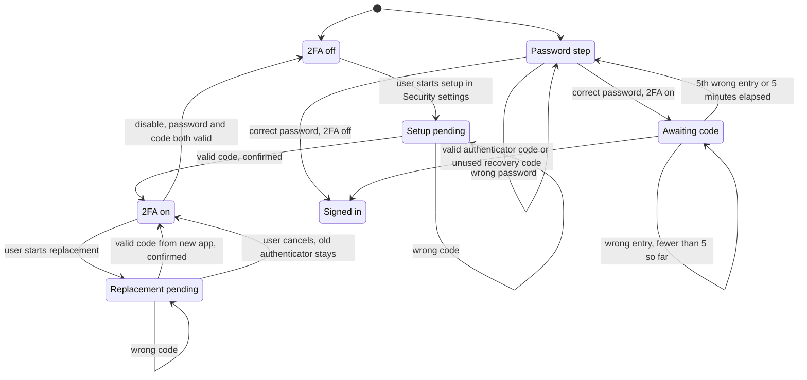

## TOTP 2FA plan

This adds optional two-factor sign-in to the existing email-and-password login. TOTP means time-based one-time password. A user with 2FA on must pass the password check and then enter one of two things:
- a 6-digit code from an authenticator app (Google Authenticator, 1Password and similar), or
- an unused recovery code, which is a single-use backup code.

Sessions work as they do today. A session is a row in `sessions` plus the `sid` cookie, created by `start_session()`.

Reused unchanged:
- `start_session(user_id)` creates a session and returns a redirect to `/home` that sets `sid`. After a recovery-code sign-in the caller changes the redirect target (see "Sign-in attempt", step 5).
- `seal()` and `unseal()` encrypt secrets at rest.
- `enqueue_email()` queues an email. A failed send is retried in the background and never blocks or fails the request.

New: three tables (`user_totp`, `recovery_codes`, `pending_logins`) and one cookie (`p2f`).

**Time steps and codes.** Codes follow RFC 6238, the standard TOTP algorithm: 6 digits, a new code every 30 seconds. A "time step" is the current Unix time divided by 30, rounded down. A code belongs to one step. The server accepts the current step and one step either side, to allow for clock drift. A step that has already been accepted for that user is rejected. This stops a code being used twice.

### Where the new state lives

| State | Where | Notes |
|---|---|---|
| Active authenticator secret | `user_totp.secret`, stored with `seal()` | Null when 2FA is off. |
| Secret being set up or replaced | `user_totp.pending_secret`, stored with `seal()` | Sign-in ignores it until the user confirms it with a valid code. |
| Newest accepted time step | `user_totp.last_step` | Used to reject replayed codes. |
| Recovery codes | `recovery_codes` (`user_id`, `code_hash`, `used_at`) | Hashes only. 10 per user. A code is unused while `used_at` is null. |
| "Password passed, code still owed" | `pending_logins` (`token_hash`, `user_id`, `expires_at`, `attempts`) | The raw token is in the `p2f` cookie and only its hash is stored, as with `sid`. No session exists yet. |

An account's 2FA state is derived from `user_totp`:
- **2FA off:** no row, or both secret columns null.
- **Setup pending:** `pending_secret` set, `secret` null.
- **2FA on:** `secret` set, `pending_secret` null.
- **Replacement pending:** both set. Sign-in still uses the old `secret`.

### Diagram

The diagram has two independent parts. The first is the account's lifecycle. The second is one sign-in attempt. It starts at the password step and ends at "Signed in" or back at the password step.

### Account lifecycle

All of these actions require the user to be signed in.

**Start setup or replacement.** The server generates a secret, stores it sealed in `pending_secret`, and shows a QR code. Starting again overwrites any earlier pending secret. Replacement needs no proof of the old authenticator. This lets a user who just signed in with a recovery code set up a new phone immediately. A user can also abandon a setup. The pending secret then sits unused, because sign-in ignores it.

**Confirm.** The user types a valid code for the pending secret. The server does the following in one transaction:
1. Moves `pending_secret` into `secret`.
2. Deletes all old recovery codes and inserts 10 new ones, hashed.
3. Deletes every other session of that user. The current session, identified by its `sid` cookie, stays.

The 10 plaintext codes are shown once, in the response to the confirming request, and cannot be retrieved afterwards. This runs on first setup and on every replacement.

**Wrong code during setup or replacement.** Nothing changes. The user stays in the pending state and can retry. The brief sets no attempt limit here. I propose applying the existing `rate_limit` to the confirm endpoint. This is an assumption, so please confirm it.

**Cancel replacement.** The server clears `pending_secret`. The old authenticator and recovery codes are untouched.

**Disable.** The user must supply their password and a valid authenticator code or unused recovery code. On success the server deletes the `user_totp` row and all recovery codes. On failure nothing changes and 2FA stays on.

### Sign-in attempt

1. **Password step.** The existing `/login` checks the password exactly as today. A wrong password returns the same 401 as now.
2. **2FA off.** `start_session()` runs as today.
3. **2FA on.** No session is created. The server inserts a `pending_logins` row (expires in 5 minutes, `attempts = 0`), sets the `p2f` cookie, and shows the code prompt.
4. **Code check.** The user enters either an authenticator code or a recovery code.
   - **Authenticator code:** the server accepts the current time step and one step either side. It rejects any step that is not newer than `last_step`. It records an accepted code by updating `last_step` in a single conditional `UPDATE` that applies only if the new step is larger. Two concurrent submissions of the same code therefore cannot both succeed. The same replay rule applies to codes entered when confirming or disabling.
   - **Recovery code:** the server hashes the input and looks for an unused match. It marks the code used (`used_at`) in one atomic update. It then calls `enqueue_email()` with a "recovery code used, N remain" message and carries on without waiting for the send.
5. **Success.** The server deletes the `pending_logins` row, clears `p2f`, and calls `start_session()`, which sets `sid`. After a recovery-code sign-in, the server changes the response's redirect target from `/home` to Security settings, so the user can set up a new authenticator. Only the target changes. The `sid` cookie is left as `start_session()` set it.
6. **Failure.** Each wrong entry, of either kind, increments `attempts`. When `attempts` reaches 5, or when `expires_at` passes, the server deletes the row, clears `p2f`, and sends the user back to the password step. They must enter the password again. Expired rows are also swept periodically.

### Open question

A user who has lost their phone and has no unused recovery codes has no path in this design. Product has not decided whether support may reset their 2FA, or how support would verify who they are. This is not designed here and is marked open.