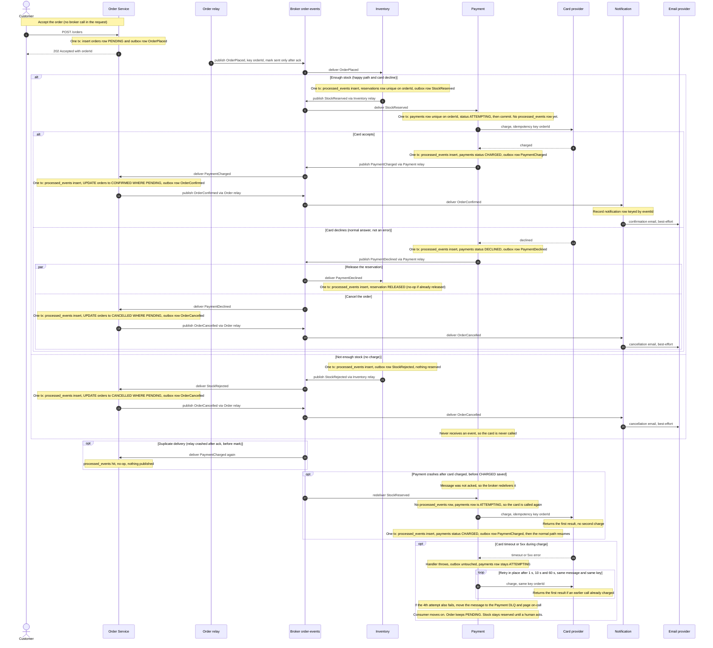

# Order fulfilment: event-driven checkout flow

Status: proposed design, for review before any code is written.

## Summary

Today `POST /orders` calls Inventory, Payment and Notification inside the request, so one slow service times out checkout, and some customers have been charged for stock that was not held. In the new flow, Order Service saves the order as `PENDING` and returns `202 Accepted` at once. Each service then reacts to events on one topic, writes its own data and publishes its own result. Stock is reserved before the card is charged, and only Order Service sets the final status, `CONFIRMED` or `CANCELLED`.

## Terms

- **Outbox**: a table in a service's own database that holds the events it will publish. The event row is written in the same transaction as the state change, so the event exists only if the change does.
- **Relay**: a small process that reads unsent outbox rows, publishes them to the broker, and marks each row sent only after the broker acknowledges it.
- **Broker**: the message system that holds the topic.
- **Topic `order-events`**: the one topic that every service publishes to and reads from. Messages are keyed by `orderId`.
- **Partition**: a slice of a topic. Messages with the same key go to the same partition, so one order's events stay in order.
- **Consumer group**: the set of consumers for one service. Each group receives every event on the topic.
- **Event**: a message on the topic. Every event carries a unique `eventId`, the `orderId` and a type. The service that writes the outbox row creates the `eventId` in the same transaction. The relay copies that same value into the message and never makes a new one.
- **Ack**: a confirmation. The broker acks a published message to the relay, and a consumer acks a message once it has handled it. An unacked message is redelivered.
- **At-least-once**: an event can arrive more than once, so every consumer must handle repeats safely.
- **processed_events**: a table in each consumer's database that records the `eventId`s it has handled.
- **Guarded update**: an update that applies only while the row is still in the expected status, for example `WHERE status = 'PENDING'`.
- **Idempotency key**: a value sent with a card charge. A repeat call with the same key returns the first result and does not charge again.
- **ATTEMPTING**: Payment's status for an order, saved before the card call. It means the card may already have charged.
- **Dead-letter queue (DLQ)**: a holding queue, one per consumer group, for a message that failed every retry.
- **Card provider**: the outside service that charges cards.
- **Email provider**: the outside service that sends email.

## Diagram

## Rules

These hold at every step.

- The card is never charged unless stock is reserved. Payment runs only after a `StockReserved`.
- Not enough stock means no charge and the order is `CANCELLED`.
- A card decline means the reservation is released and the order is `CANCELLED`.
- Only Order Service changes order status. Its final statuses are `CONFIRMED` and `CANCELLED`. Only Order Service publishes `OrderConfirmed` and `OrderCancelled`.
- Every consumer must handle the same event twice safely.
- A failed email never changes order status.

## Steps

Each step starts from its trigger. The diagram shows the order, so these steps add only the data and guards.

1. **Accept.** Trigger: `POST /orders`. Order Service writes the `orders` row as `PENDING` and an `OrderPlaced` outbox row in one transaction, then returns `202` with the `orderId`. The request handler never calls the broker.
2. **Publish.** Trigger: the relay's poll, every 500 ms. The relay publishes unsent outbox rows oldest first, keyed by `orderId`. It marks a row sent only after the broker acks it. Each service has its own relay.
3. **Reserve.** Trigger: `OrderPlaced`, received by Inventory. Inventory checks its stock count. In one transaction it writes a `processed_events` row, then either a `reservations` row (unique `orderId`) plus a `StockReserved` outbox row, or only a `StockRejected` outbox row. A rejection reserves nothing.
4. **Publish Inventory's result.** Inventory's relay publishes `StockReserved` or `StockRejected` as in step 2.
5. **Charge.** Trigger: `StockReserved`, received by Payment. Payment checks in this order and stops at the first match:
   1. If `processed_events` has this `eventId`, stop. It was already handled.
   2. If the `payments` row for `orderId` is `CHARGED` or `DECLINED`, stop without calling the card. The outbox row was written with that status, so the relay publishes it if it is still unsent.
   3. If no `payments` row exists, insert one with status `ATTEMPTING` and commit it. If one already exists as `ATTEMPTING`, keep it. Either way, write no `processed_events` row here. `ATTEMPTING` means the card may already have charged, so Payment never assumes a failure.
   4. Call the card with idempotency key `orderId`, not `eventId`.
   5. Save the outcome in one transaction, together with a `processed_events` insert. An accept saves `CHARGED` and a `PaymentCharged` outbox row. A decline is a normal answer, not an error. It saves `DECLINED` and a `PaymentDeclined` outbox row. A timeout or 5xx throws, and the retry rule applies with the `payments` row still `ATTEMPTING`.
6. **Publish Payment's result.** Payment's relay publishes `PaymentCharged` or `PaymentDeclined` as in step 2.
7. **Decide the order.** Trigger: `PaymentCharged` sets the order to `CONFIRMED`. `StockRejected` or `PaymentDeclined` sets it to `CANCELLED`. Order Service runs each change in one transaction, with a `processed_events` insert and an `OrderConfirmed` or `OrderCancelled` outbox row. The update is a guarded update, so if the order is no longer `PENDING`, it changes nothing.
8. **Release.** Trigger: `PaymentDeclined`, received by Inventory. In one transaction with its `processed_events` insert, Inventory sets the reservation to `RELEASED`. If it is already released, it does nothing. This runs in parallel with step 7, not after it.
9. **Publish the order's outcome.** Order Service's relay publishes `OrderConfirmed` or `OrderCancelled` as in step 2.
10. **Email.** Trigger: only `OrderConfirmed` or `OrderCancelled`, received by Notification. The customer gets a confirmation or a cancellation email. Notification records a `notifications` row keyed by `eventId`, sends the email, and records the result.

## Where each piece of state is written

| Service | Table or store | Written when | Key |
|---|---|---|---|
| Order Service | `orders` | Accept (`PENDING`), then `CONFIRMED` or `CANCELLED` | `orderId`. Transitions guarded by `WHERE status = 'PENDING'`. |
| Order Service | `outbox` | Same transaction as each status change | `eventId` |
| Inventory | `reservations` | Reserve, or release on `PaymentDeclined` | unique `orderId` |
| Inventory | `outbox` | `StockReserved` or `StockRejected` | `eventId` |
| Payment | `payments` | `ATTEMPTING` before the card call, then `CHARGED` or `DECLINED` | unique `orderId` |
| Payment | `outbox` | `PaymentCharged` or `PaymentDeclined` | `eventId` |
| Notification | `notifications` | Email attempt and result | `eventId` |
| Each consumer | `processed_events` | Same transaction as its final state change | `eventId` |

## Design choices

- **Duplicates.** Each consumer inserts the incoming `eventId` into its own `processed_events` table, in the same local transaction as its final state change. A second delivery hits the primary key and does nothing. Each state change is also guarded by a natural key (unique `orderId`, or `WHERE status = ...`), so the logic stays correct if the `processed_events` row is lost. Payment is the one exception to the timing. Its `ATTEMPTING` row commits before the card call and has no `processed_events` row until the final transaction. During the card call, its guard is the unique `orderId` row, which lets a redelivery reach the card again.
- **Results.** Each service publishes its own result through its own outbox and relay, to `order-events`, keyed by `orderId`. No result is sent by a direct call.
- **Consumers read everything.** Each consumer group receives every event. A consumer skips the types it does not handle. Filtering by type is the simplest option the brief allows.
- **No second charge.** The card call uses idempotency key `orderId`. A redelivery, a handler retry and a crash between "card charged" and "CHARGED saved" all reuse that key, so the provider returns the first result. Once `CHARGED` or `DECLINED` is saved, Payment never calls the card again. On a redelivery in that state, Payment writes nothing. The outbox row was written in the same transaction as the status, so the relay publishes it on its next poll if it is still unsent. The relay does the re-publish, not the consumer.
- **Retries.** Retry is consumer code, not a broker feature. When a handler throws, the consumer waits 1 s, 10 s and 60 s, then runs the same message again with the same key, and counts the attempts. It keeps one topic, and the same message and key on every retry. While it waits, it takes no other message from its partition, so other orders on that partition wait too (open question 3).
- **Separate consumer groups.** Inventory and Order Service both react to `PaymentDeclined`. They are independent, with separate databases, `processed_events` tables, retries and DLQs. A failure in one does not change the other.
- **How Order Service learns the outcome.** It consumes `order-events` like the others. It applies `PaymentCharged` as `CONFIRMED`, and `StockRejected` or `PaymentDeclined` as `CANCELLED`. These cannot conflict. Payment runs only after a reservation, and only Inventory emits `StockRejected`, so the guarded update cannot flip a status.
- **What triggers the email.** Notification reacts only to `OrderConfirmed` and `OrderCancelled`, never to raw inventory or payment events. The email therefore follows a status that Order Service has committed. Email is best-effort. A failed send is recorded and does not change order status. The recommendation to keep it out of the retry and DLQ path is open question 7.
- **Ordering.** One topic keyed by `orderId` keeps one order's events in publish order within a partition. Across producers, order is also safe, because each event is published only after the event that caused it was consumed.

## What happens when things fail

Each step's failure is listed here.

| Failure | What happens | What is kept |
|---|---|---|
| Accept transaction fails | Nothing is written. The customer gets an error, not `202`. | No order and no outbox row. |
| Broker down or slow | The relay does not mark the row sent. It tries again on the next poll. The customer is not affected, because the `202` was already returned. | The order and the unsent row. |
| Relay crashes after ack, before mark | The row is sent again. Consumers skip it as a duplicate. | `processed_events` in each consumer. |
| Handler throws (any consumer) | The local transaction rolls back, including any `processed_events` row. The consumer retries in place after 1 s, 10 s and 60 s, on the same message. Card and email calls are outside the transaction, so a rollback does not undo them. | Nothing from the failed attempt. |
| Not enough stock | `StockRejected`. The order is `CANCELLED`. The card is never called. | No reservation. |
| Card declines | The payment is `DECLINED`. The reservation is released. The order is `CANCELLED`. | The decline in `payments`. |
| Card timeout or 5xx | The handler throws, so the retry rule applies with the same key. Each retry passes the `processed_events` check, finds `ATTEMPTING` and calls the card. | The `payments` row stays `ATTEMPTING`. |
| Crash after card charged, before `CHARGED` saved | The message is not acked, so the broker redelivers it. The card is called with the same key and returns the first result. Payment then saves `CHARGED`. | The `ATTEMPTING` row. |
| 4th attempt fails | The consumer moves the message to its group's DLQ, pages on-call, acks the original and moves on. Nothing else is undone. | Depends on the consumer. See the rows below. |
| Payment DLQ | Affects only Payment's group, which consumes `StockReserved`. The order keeps `PENDING`, and stock stays reserved until a human acts. | The `payments` row and the reservation. |
| Inventory DLQ on `PaymentDeclined` | The reservation stays `RESERVED`, while Order Service still cancels the order. | A `CANCELLED` order with stock still reserved. |
| Order Service DLQ on `PaymentDeclined`, `PaymentCharged` or `StockRejected` | The order stays `PENDING`, although the payment or stock result is already set. | The `orders` row as it was. |
| Email send fails | The result is recorded. The send does not throw, so it does not enter the retry or DLQ path. | The `notifications` row. The order status does not change. |

## Build and rollout

No code is written until this design is reviewed. The brief sets no rollout plan.

## Open questions

1. **Dead-lettered orders stay `PENDING`.** Stock stays reserved until a human acts. The brief says nothing else is undone, so this needs an on-call runbook, which is not written yet. Re-driving the DLQ message is safe because of the idempotency key.
2. **Charged but dead-lettered.** The customer may be charged for an order that stays `PENDING`. A reconciliation job that compares the provider with `payments` would catch cases where nobody re-drives. This is a proposal, not a brief requirement.
3. **In-place retries pause the partition.** Other orders on the same partition wait too. One topic rules out separate retry topics. If the delay is unacceptable, revisit the choice.
4. **The relay must be single-writer per outbox.** Use one active instance per service, or a row lock. Two relays could publish one order's rows out of order.
5. **Retention.** `processed_events` must be kept at least as long as the broker can redeliver. The card provider's idempotency window must cover the longest retry chain, about 71 s plus the time to reach the 4th attempt.
6. **Email duplicates at the provider.** If the provider accepts a message but the consumer crashes before recording it, the customer may get a second email. Passing `eventId` as the provider's idempotency key, where supported, reduces this.
7. **Email failure policy.** This design keeps email best-effort and out of the retry and DLQ path. The brief does not settle this, so it needs confirmation.
8. **Where the stock count lives.** The brief does not say where Inventory keeps its stock count or how it checks it. Only the reservations table is designed.
9. **How the customer learns the outcome.** The brief gives no status endpoint and no push. The confirmation or cancellation email is the only stated notice. Whether customers can query order status is not decided.
10. **Broker product.** The brief does not name the broker. The design needs only one topic, keys and consumer groups.
11. **Stock held for a cancelled order.** If Inventory dead-letters `PaymentDeclined`, the reservation stays `RESERVED` on a `CANCELLED` order. Who releases it is not decided.