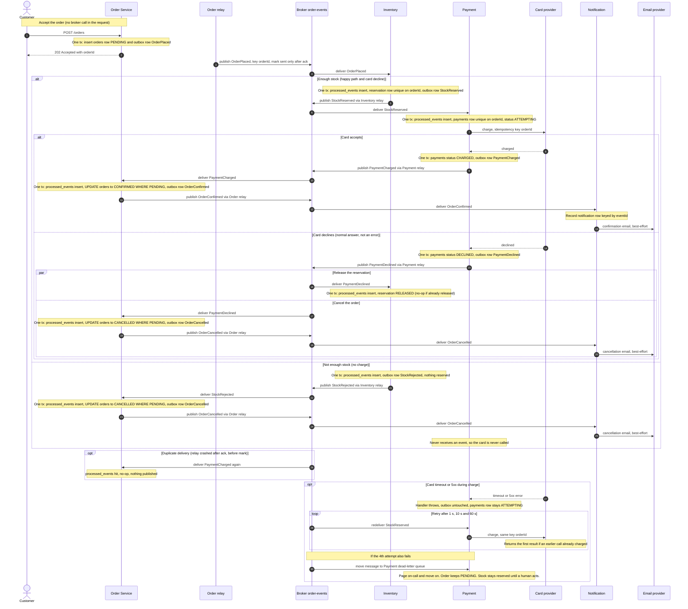

# Order fulfilment: event-driven checkout flow

Status: proposed design, for review before any code is written.

## Diagram

## Where each piece of state is written

| Service | Table or store | Written when | Key |
|---|---|---|---|
| Order Service | `orders` | Accept (PENDING), then CONFIRMED or CANCELLED | `orderId`. Transitions are guarded by `WHERE status = 'PENDING'`. |
| Order Service | `outbox` | Same tx as each status change | `eventId` |
| Inventory | `reservations` | Reserve, or release on PaymentDeclined | unique `orderId` |
| Inventory | `outbox` | StockReserved or StockRejected | `eventId` |
| Payment | `payments` | ATTEMPTING before the card call, then CHARGED or DECLINED | unique `orderId` |
| Payment | `outbox` | PaymentCharged or PaymentDeclined | `eventId` |
| Notification | `notifications` | Email attempt and result | `eventId` |
| Each consumer | `processed_events` | In the same tx as its state change | `eventId` |

Only Order Service writes order status. Only Order Service publishes OrderConfirmed and OrderCancelled.

## Decisions (the brief's "yours to decide" list)

- **Duplicates.** Every consumer inserts the incoming `eventId` into its own `processed_events` table in the same local transaction as its state change. A second delivery hits the primary key and does nothing. Each state change is also guarded by a natural key (unique `orderId`, or `WHERE status = ...`), so the logic stays correct even if the dedupe row were lost.
- **Inventory and Payment results.** Each service publishes its own result through its own outbox and relay, to `order-events`, keyed by `orderId`. Results are never sent by direct call.
- **Payment avoids a second charge.** The card call uses idempotency key `orderId`, not `eventId`. Redelivery, handler retry, and a crash between "card charged" and "CHARGED saved" all reuse the same key, and the provider returns the first result. If the `payments` row already says CHARGED or DECLINED, Payment does not call the card and only re-publishes from its outbox.
- **How Order Service learns the outcome.** Order Service is a consumer of `order-events` like the others. It applies PaymentCharged as CONFIRMED, and StockRejected or PaymentDeclined as CANCELLED. These outcomes are mutually exclusive by construction, because Payment only runs after a reservation and only Inventory emits StockRejected, so the guarded transition cannot flip a status.
- **What triggers the email.** Notification reacts only to OrderConfirmed and OrderCancelled, never to raw inventory or payment events. The email is therefore tied to a status that Order Service has committed.
- **Email failure.** Notification records the send attempt and its result. A failed send is recorded and does not change order status. My recommendation is that it does not enter the retry or DLQ path, so it stays best-effort. The brief does not settle this, so please confirm.
- **Ordering.** A single topic keyed by `orderId` keeps each order's events in publish order within a partition. Cross-producer order is also safe by causality: each event is published only after the event that caused it has been consumed.

## Consequences and open holes

1. **Dead-lettered orders stay PENDING.** If Payment's card keeps failing, the order is stuck until a human re-drives or cancels it, and stock stays reserved meanwhile. The brief says "nothing else is undone", so this needs an on-call runbook, not an automatic fix.
2. **Charged but dead-lettered.** If the card charged but Payment could not save or publish the result, the customer may be charged for an order that stays PENDING. Re-driving the DLQ message is safe because of the idempotency key. A reconciliation job that compares the provider with `payments` would catch cases where nobody re-drives. This is a proposal, not something the brief asks for.
3. **In-place retries block the partition.** The 1 s, 10 s and 60 s retries pause the consumer, so other orders that share its partition wait too. Keeping one topic rules out separate retry topics. If that delay is unacceptable, the choice needs revisiting.
4. **Relay must be single-writer per outbox.** Two concurrent relays could publish one order's rows out of order. Each service's relay runs as one active instance, or uses a row lock.
5. **Retention.** `processed_events` must be kept at least as long as the broker can redeliver. The card provider's idempotency window must also cover the longest retry chain, which is roughly 71 s plus the time to reach the 4th attempt.
6. **Notification duplicates at the provider.** If the email provider accepts a message but the consumer crashes before recording it, the customer may get a second email. Passing `eventId` as the provider's idempotency key, where supported, reduces this.
