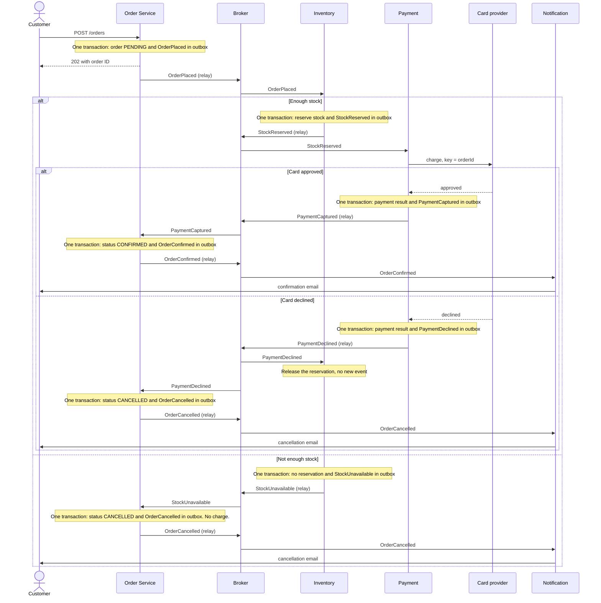

# Order fulfilment (event-driven)

Today `POST /orders` calls Inventory, Payment and Notification one after another inside the request. A slow service times out checkout, and customers have been charged for stock we did not hold. The new flow saves the order and an event in one transaction, then returns `202 Accepted`. Each service reads events from one shared topic, does its own step, and publishes its result. A slow service no longer holds up the customer's request, and the card is charged only after stock is reserved.

## Terms

- **Broker**: the message system that stores events and hands them to readers. We use one topic, `order-events`.
- **Event**: a message that says something happened. Every event has an `eventId` (unique), an `orderId` and a `type`. Each event also carries the fields in the table below.
- **Partition**: a lane inside the topic. Events with the same key go to the same lane, in the order they were published. The key is the `orderId`, so one order's events stay in order.
- **Consumer group**: a named reader of the topic. Each group gets its own copy of every event. Inventory, Payment and Notification each have one, and each has its own database.
- **Position**: how far a consumer group has read in a partition. It moves on only after the group handles, skips or dead-letters a message.
- **Ack (acknowledgement)**: the broker's confirmation that it has stored a message.
- **Outbox**: a table in a service's own database that holds events waiting to be sent. Its rows are written in the same transaction as the data change, so an event exists only if the change was saved.
- **Relay**: a loop in each service with an outbox. It reads unsent outbox rows and publishes them to the broker. Delivery is at-least-once, so an event can arrive more than once.
- **Idempotent**: safe to repeat. Handling the same event twice has the same effect as handling it once.
- **processed_events**: a table in each consumer's database that lists the `eventId`s the consumer has finished handling.
- **Card provider**: the outside service that charges customers' cards.
- **Card reference**: the card detail Payment passes to the provider to charge the customer. Its form is not defined yet (see Open questions).
- **Idempotency key**: an ID sent with a charge. A repeat call with the same key returns the first result and does not charge again. A decline is a normal answer. A timeout or 5xx is an error.
- **Dead-letter queue (DLQ)**: a holding queue for each consumer group. It takes a message the group could not handle after all its retries.
- **On-call**: the engineer who is paged when something needs a person.

| Event | Published by | Consumed by | Meaning | Carries besides `eventId`, `orderId`, `type` |
|---|---|---|---|---|
| OrderPlaced | Order | Inventory | Order accepted, stock needed | Items (product and quantity), amount, card reference |
| StockReserved | Inventory | Payment | Stock is held for this order | Amount, card reference (copied from OrderPlaced) |
| StockUnavailable | Inventory | Order | Not enough stock | None |
| PaymentCaptured | Payment | Order | Card charged | None |
| PaymentDeclined | Payment | Inventory, Order | Card refused | None |
| OrderConfirmed | Order | Notification | Final status: CONFIRMED | None |
| OrderCancelled | Order | Notification | Final status: CANCELLED | None |

Each consumer reads every event on the topic and ignores the types it does not handle.

## Diagram

## Steps

1. **Customer places an order.** Trigger: `POST /orders`. In one transaction, Order Service saves the order with status `PENDING`, its items, amount and card reference, and an `OrderPlaced` outbox row. It then returns `202` with the order ID. The request handler never contacts the broker, so a slow or down broker does not slow checkout. If the transaction fails, nothing is saved and the customer gets an error and retries.

2. **Relay sends the event.** Trigger: a poll every 500 ms. The relay reads unsent outbox rows, oldest first. It publishes each one to `order-events` with the `orderId` as key. It marks a row sent only after the broker acks it. A row that is not acked stays unsent, and the next poll tries again. If the relay crashes after the ack but before it marks the row, the next poll publishes the row again. Consumers skip the repeat by `eventId`.

3. **Inventory handles OrderPlaced.** Trigger: a message for its consumer group. It reads the items from the event. If there is enough stock, it holds the stock and, in one transaction, writes `StockReserved` to its outbox, copying in the amount and card reference. If not, it writes `StockUnavailable` and holds nothing. Inventory keeps its stock reservations in its own database. Its relay then sends the row, as in step 2.

4. **Payment handles StockReserved.** Trigger: `StockReserved`. Only this event can lead to a charge. Payment calls the card provider with the idempotency key `orderId`, the amount and the card reference. The key is the order ID, not the `eventId`, so it stays the same if the same order's `StockReserved` is redelivered or republished under a new `eventId`. The provider call runs before Payment's database transaction, not inside it, so no transaction stays open during a slow call. Then, in one transaction, Payment saves the result and writes `PaymentCaptured` or `PaymentDeclined` to its outbox. Nothing is published until the result is saved. Payment keeps the charge result for each order. A declined order is never charged again, because a repeat call with the same key returns the same decline. A new attempt needs a new order.

5. **Inventory releases on decline.** Trigger: `PaymentDeclined`. Inventory releases the reservation in its own database and publishes no new event. If there is no reservation, the release does nothing. Inventory reserves only once, when it handles `OrderPlaced`. `StockReserved` is always published before `PaymentDeclined` on the same partition, so in the normal flow a release always follows its reservation.

6. **Order sets the final status.** Trigger: an event for an order that Order Service handles:
   - `PaymentCaptured`: set status `CONFIRMED` and write `OrderConfirmed`.
   - `PaymentDeclined` or `StockUnavailable`: set status `CANCELLED` and write `OrderCancelled`.

   Order Service is the only service that changes order status, and it changes status only from `PENDING`. If the order is not `PENDING` when an event arrives, Order changes nothing and writes no event. It still records the `eventId` as handled, so a repeat is skipped. This should not happen in the normal flow. Payment charges only after a reservation, and `StockUnavailable` means no reservation and no charge.

7. **Notification sends the email.** Trigger: `OrderConfirmed` or `OrderCancelled`. It sends a confirmation or a cancellation email. Because the email is triggered by Order's final status events, it always matches the stored status. Notification sends the email first and saves the `eventId` second. Notification keeps only `processed_events`. Email is best-effort: a failed send never changes the order status.

### Where state is written

| Service | Its own database holds | Its outbox sends |
|---|---|---|
| Order | Order status (`PENDING`, `CONFIRMED`, `CANCELLED`), items, amount, card reference | OrderPlaced, OrderConfirmed, OrderCancelled |
| Inventory | Stock reservations | StockReserved, StockUnavailable |
| Payment | Charge result for each order | PaymentCaptured, PaymentDeclined |
| Notification | processed_events only | Nothing |

## Shared rules

- **Duplicates.** Every consumer checks `processed_events` first and skips an `eventId` it has already handled. A skipped duplicate counts as handled, so the consumer's position moves past it. The consumer saves its effects and the `eventId` in one transaction, so a crash leaves both or neither. A message that ends in the DLQ is not saved, so a later DLQ replay handles it again. A consumer moves its position past a message only after it handles the message, skips it as a duplicate, or sends it to the DLQ. A crash before that means the message is read again. Payment's charge is protected separately, by the idempotency key.
- **Errors and retries.** When handling a message throws, the consumer group retries it after 1 s, then 10 s, then 60 s. That is four attempts in total. The consumer retries in place and takes no later message on that partition until the retries end. This keeps one order's events in order. The retries are not a separate queue. If the fourth attempt fails, the message goes to that group's DLQ, on-call is paged, and the consumer moves on. Nothing else is undone. The order keeps its current status, and any reserved stock stays reserved.

## What happens when things fail

| Where | What goes wrong | What happens |
|---|---|---|
| Order, step 1 | The transaction fails | Nothing is saved. The customer gets an error and retries. |
| Relay, step 2 | The broker does not ack | The row stays unsent. The next poll retries. During a long outage, new orders still get `202`, their rows wait in the outbox, and they go out oldest first when the broker returns. |
| Relay, step 2 | Crash after the ack, before the row is marked | The row is sent again. Consumers skip it by `eventId`. |
| Any consumer | Handling throws | Retried after 1 s, 10 s, 60 s. After the fourth failure: DLQ, on-call paged, consumer moves on. The `eventId` is not saved. |
| Payment, step 4 | Provider timeout or 5xx | An error. The same `StockReserved` is retried with the same key under the retry rule. The order stays `PENDING` and the stock stays reserved while it waits. |
| Payment, step 4 | Crash after the charge, before the result is saved | Nothing is saved. The retry sends the same key, and the provider returns the first result, so the customer is charged once. |
| Order, step 6 | Event arrives for an order that is not `PENDING` | Order changes nothing and writes no event. It records the `eventId`. |
| Notification, step 7 | Email send fails | The status does not change. The failure follows the retry and paging rule (see Open questions). |
| Notification, step 7 | Crash after sending, before the `eventId` is saved | The retry sends the email again. This is a rare duplicate (see Open questions). |
| Any consumer | Crash before the position moves | The message is read again. `processed_events` skips it if it was already handled. |

## Open questions

- **Dead-letter messages.** The brief does not say who fixes these, or how a DLQ message is replayed.
  - If a Payment message lands in the DLQ, the order stays `PENDING` and its stock stays reserved.
  - If an Inventory message for `PaymentDeclined` lands in the DLQ, the order is `CANCELLED` but its stock stays reserved.
  - If an Order message for `PaymentCaptured` lands in the DLQ, the customer is charged but the order stays `PENDING`, and its stock stays reserved.
- **Charge with no open order.** If a `PaymentCaptured` reaches an order that is not `PENDING`, the charge has no open order to match. The brief does not say how it is refunded. The normal flow should not produce this case.
- **Idempotency key lifetime.** The brief does not say how long the card provider keeps a key. If a key expires, a late retry could charge the customer twice.
- **Duplicate email.** Fixing a duplicate email after a crash needs an idempotency key at the email provider. It is unknown whether the provider supports one.
- **Order status for the customer.** The customer learns the final result from the email. The brief does not say how the customer reads the status before then. We assume a status read from Order Service, but whether that endpoint exists is unknown.
- **Order fields and card reference.** The brief does not define the order's fields. The plan assumes each order has items, an amount and a card reference. The form of the card reference, and how it is protected in events, is unknown.
- **Outbox waits.** The brief does not limit how long outbox rows may wait during a broker outage, and it does not say what alerts on a stuck relay.
- **Partition blocking.** While one message waits for up to 71 s of retries, later events on that partition wait too, including events for other orders. Confirm this is acceptable.
- **Email failures.** Email failures follow the same retry and paging rule. Confirm that they should page on-call, or whether they should go to a lower-priority alert instead.