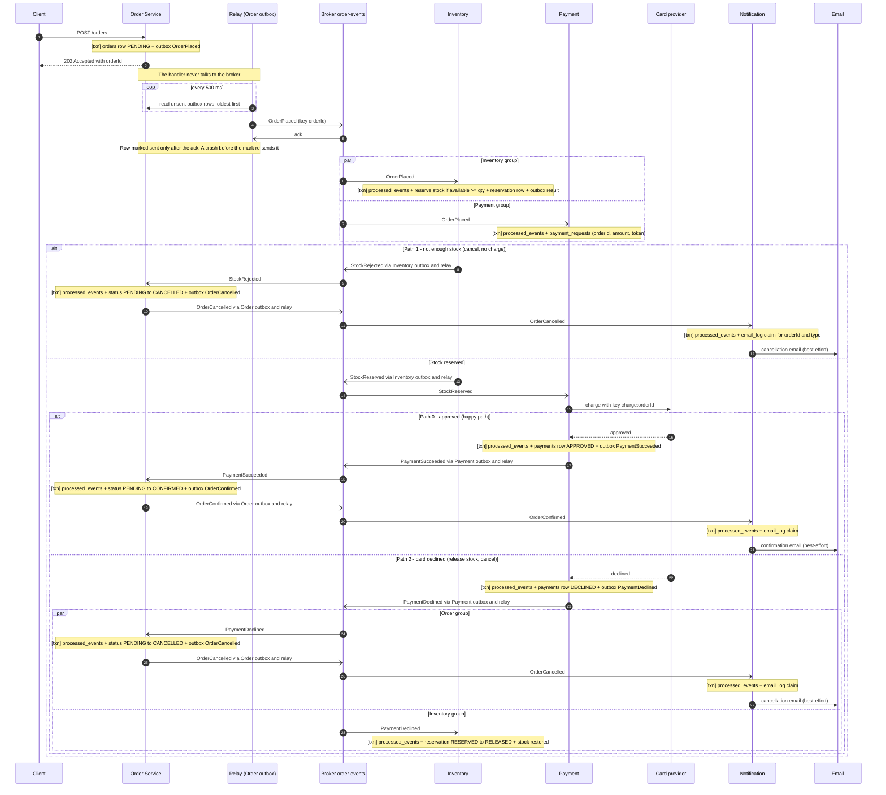
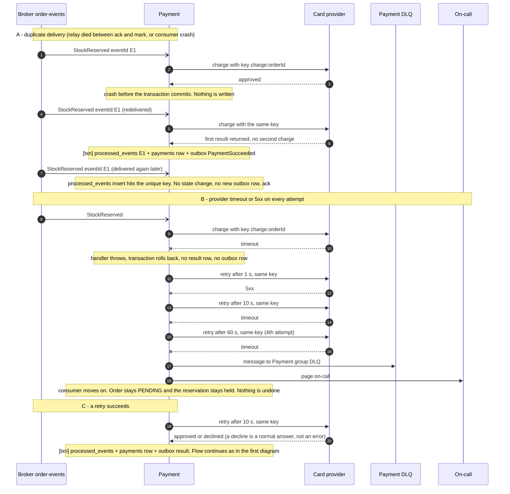

# Order fulfilment: checkout as an event flow

Today `POST /orders` calls Inventory, Payment and Notification one after another inside the request. When one of them is slow, checkout times out, and customers have been charged for stock we did not hold. In the new design the request only saves the order and returns `202 Accepted`. Each service then reacts to events on one broker topic and publishes its own result as a new event. Order Service is the only service that changes order status, and it does so when it hears the outcome. The shape is chosen so that no service waits on another, every message can safely arrive twice, and the card is charged only after stock is reserved.

## Terms

- **Outbox.** A table in a service's own database. A service writes the event it wants to publish there, in the same transaction as its state change, so the change and the event are saved together or not at all.
- **Relay.** A background job per service that polls its outbox every 500 ms, publishes unsent rows oldest first, and marks a row sent only after the broker acknowledges it. If it dies between the ack and the mark, the row goes out again on the next poll. Delivery is therefore at-least-once.
- **Broker and topic.** One topic, `order-events`, keyed by `orderId`. Each consumer group receives one order's events in the order they were published.
- **Consumer group and offset.** Each service has one consumer group and its own database. A service may run several instances. The broker gives each partition to one instance of the group, so one order's events are handled by one instance at a time. The group's offset records, per partition, the last message the service has finished handling.
- **Event.** Every event carries a unique `eventId`, the `orderId` and a type.
- **`processed_events`.** A table `processed_events(eventId PRIMARY KEY)` in every consumer's own database. Inserting the `eventId` is how a consumer notices it has seen an event before.
- **DLQ.** Dead-letter queue. Each consumer group has its own. A message goes there after its fourth failed attempt.
- **Idempotency key.** A value sent to the card provider. A repeat call with the same key returns the first result and does not charge again.
- **`[txn]`.** In the diagrams, one database transaction in that service's own database.
- **Via outbox and relay.** In the diagrams, the event is written to the service's outbox in the `[txn]` and published by its relay.

## Fixed by the brief

- **Accepting an order.** Order Service writes the order (status `PENDING`) and an `OrderPlaced` outbox row in one transaction, then returns `202 Accepted` with the order ID. The request handler never talks to the broker.
- **Business rules.** The card is never charged unless stock is reserved. Not enough stock: no charge, order cancelled. Card declined: the reservation is released and the order cancelled. Only Order Service changes order status. The final statuses are `CONFIRMED` and `CANCELLED`.
- **Card provider.** A decline is a normal answer. A timeout or 5xx is an error.
- **Errors.** When a handler throws, the consumer retries after 1 s, 10 s and 60 s. If the fourth attempt fails too, the message goes to that group's DLQ, on-call is paged and the consumer moves on. Nothing else is undone: the order keeps whatever status it has.
- **Email.** The customer gets a confirmation or cancellation email. A failed send never changes the order status.

## Events on `order-events`

`OrderPlaced` also carries `item`, `qty`, `amount` and `paymentToken`, which Order Service takes from the `POST /orders` body. `OrderConfirmed` and `OrderCancelled` also carry `customerEmail`, copied from the `orders` row, so Notification needs no lookup.

| Type | Published by | Consumed by (acts on it) |
|---|---|---|
| `OrderPlaced` | Order Service | Inventory (reserve), Payment (record amount and token) |
| `StockReserved` | Inventory | Payment (charge) |
| `StockRejected` | Inventory | Order Service (cancel) |
| `PaymentSucceeded` | Payment | Order Service (confirm) |
| `PaymentDeclined` | Payment | Order Service (cancel), Inventory (release) |
| `OrderConfirmed` | Order Service | Notification (email) |
| `OrderCancelled` | Order Service | Notification (email) |

Each group reads every event on the topic, including its own service's events, and ignores the types it does not act on. For an ignored event it advances its offset and writes nothing.

## Flow: happy path and both cancellation paths

### Notes on the steps

1. **Accept.** Trigger: `POST /orders`. Order Service stores the `orders` row (with the customer email and the request's `requestId`) and the `OrderPlaced` outbox row in one transaction. If that transaction fails, neither exists, the handler returns a 5xx and the client may retry. After a `202` the client learns the outcome only from the email, because there is no status endpoint (see the open questions).
2. **Same request twice.** The client puts a `requestId` in the body, and `orders` has a unique key on it. A repeat with the same `requestId` creates nothing and returns `202` with the original `orderId`. This stops a retry or double click from creating two orders and two charges.
3. **Inventory reserves.** On `OrderPlaced`, Inventory runs one conditional update: `UPDATE stock SET available = available - qty WHERE item = ? AND available >= qty`. The check and the decrement are one statement, so two orders arriving at once cannot oversell. If a row was updated, it also writes a `reservations` row and a `StockReserved` outbox row. If zero rows were updated, it writes only `processed_events` and a `StockRejected` outbox row: no reservation row, no stock change.
4. **Payment records the order.** On `OrderPlaced`, Payment stores `(orderId, amount, paymentToken)` in `payment_requests` and writes `processed_events`. The topic is ordered per order, so Payment normally sees `OrderPlaced` before `StockReserved`.
5. **Payment charges.** Trigger: `StockReserved`, and only that, which is how "never charge without reserved stock" is enforced. The key is `charge:{orderId}`. It comes from the order, not the event, so a retry, a redelivery and a replayed DLQ message all send the same key. Payment calls the provider first, with no transaction open. After the provider answers, it opens one transaction and writes `processed_events`, a `payments` row and the outbox row (`PaymentSucceeded` or `PaymentDeclined`). If no `payment_requests` row exists for that `orderId` (for example, `OrderPlaced` went to the DLQ), the handler throws, goes through retry and the DLQ, and no charge is made.
6. **Order Service learns the outcome.** It consumes `StockRejected`, `PaymentSucceeded` and `PaymentDeclined`. In one transaction it updates `orders.status` from `PENDING` to `CONFIRMED` or `CANCELLED`, inserts `processed_events`, and writes an `OrderConfirmed` or `OrderCancelled` outbox row. On a decline the order is cancelled by `PaymentDeclined`, not by the stock release. The customer's outcome is decided by the decline, and the release is a separate job: if it fails, the order stays cancelled and on-call replays the release from the DLQ.
7. **Inventory releases.** On `PaymentDeclined`, Inventory changes a reservation only if it is `RESERVED`. It sets it to `RELEASED`, restores stock and writes `processed_events` in one transaction. If the reservation is already `RELEASED` or missing, it only inserts `processed_events` and acks. It does not throw, since a throw would only page on-call for a harmless duplicate.
8. **Email.** Notification consumes `OrderConfirmed` and `OrderCancelled`. Order Service publishes them after the status commit, so an email never goes out for a status that was not saved. Notification inserts an `email_log` row with a unique key on `(orderId, type)` and commits it, together with `processed_events`, before it calls the mail provider. A repeated event hits the unique key and sends nothing.

## Flow: duplicates and failures

Payment is the example because it is the riskiest consumer. The same retry and DLQ rules apply to every consumer group.

## What happens when things fail

| Failure | What happens |
|---|---|
| Duplicate event (same `eventId`) | The `processed_events` insert hits its unique key. The handler changes nothing, writes no outbox row and acks. |
| Same event under a new `eventId` | A second guard on the business key stops it: one reservation and one payment per `orderId`, and status changes only from `PENDING`. |
| Handler throws | Nothing it wrote is committed, including `processed_events`. The retry repeats the whole handler with the same provider key. This includes a commit failure after the provider already answered: the same key returns the first result. Any throw counts as one attempt. |
| Retries | Attempts happen at once, then after 1 s, 10 s and 60 s. The consumer process does the waiting, so that partition is blocked for that group for up to about 71 s. Other groups are not affected. |
| Fourth attempt fails | The message goes to that group's DLQ and on-call is paged. The group commits its offset past it, and later events for any order, including the same one, are handled normally. No compensating action runs and the order keeps its status. After a retry succeeds, the partition resumes in order and the waiting messages are handled one after another. |
| DLQ replay | The DLQ holds the original event (`eventId`, `orderId`, type) and says nothing about reservations or payments. On-call finds it by `orderId` and replays it to that group's consumer only, not back onto `order-events`. |
| Provider result | A decline is a normal answer and produces `PaymentDeclined`. A timeout or 5xx is an error and goes through retry. |
| Order Service gets an event for an order that is not `PENDING` | The update is `WHERE status = 'PENDING'` and changes zero rows. The handler still inserts `processed_events` and acks, and does not throw. In the normal flow this cannot happen to a payment result for a cancelled order, because Inventory emits only one of `StockReserved` or `StockRejected` per order and Payment charges only after `StockReserved`. |
| Mail send fails | Notification logs it and returns normally. There are no retries and no DLQ entry, and order status is never touched. |
| Crash after the `email_log` claim, before the send | That email is lost. This is the accepted trade for never sending duplicates. |

## Where state is written

| Service | Own database holds | Written in one transaction |
|---|---|---|
| Order Service | `orders`, `outbox`, `processed_events` | Accept: `orders` and `outbox` (`OrderPlaced`). Outcome: `processed_events`, `orders.status`, `outbox` (`OrderConfirmed` or `OrderCancelled`). |
| Inventory | `stock`, `reservations`, `outbox`, `processed_events` | Reserve: `processed_events`, `stock`, `reservations`, `outbox` (`StockReserved`), or only `processed_events` and `outbox` (`StockRejected`). Release: `processed_events`, `reservations`, `stock`. |
| Payment | `payment_requests`, `payments`, `outbox`, `processed_events` | On `OrderPlaced`: `processed_events`, `payment_requests`. After a provider answer: `processed_events`, `payments`, `outbox`. |
| Notification | `email_log`, `processed_events` | `processed_events` and `email_log`, committed before the send. |
| Broker | `order-events`, one DLQ per consumer group | n/a |

Inventory and Payment publish through the same outbox and relay pattern as Order Service, to `order-events` keyed by `orderId`, so all events for one order stay in one partition.

## Open questions

1. **Payment DLQ leaves an order stuck.** The order stays `PENDING` with stock held. If the provider charged the card but the answer was lost, the customer may be charged for an order that never confirms. The brief says nothing else is undone, so there is no timeout sweeper. On-call replays the DLQ message, and the same key returns the original result. Who is on call and how they learn which order to replay is not decided.
2. **Key lifetime.** The idempotency key is safe to replay only while the provider remembers it. Confirm the provider's retention window. If it is shorter than the time on-call may take, a replay could charge again.
3. **Inventory DLQ.** On the reserve step, the order stays `PENDING` and no card is charged. On the release step, the order is `CANCELLED` but stock stays reserved until on-call replays the message.
4. **Customer visibility.** Nothing tells the customer or client that an order is stuck in `PENDING`. A status endpoint or a stuck-order email needs its own decision.
5. **`processed_events` growth.** Each table needs a retention policy longer than the longest DLQ replay window.
6. **Personal data on the broker.** `OrderPlaced` carries a payment-method token and amount, not card numbers, and the outcome events carry the customer's email. Confirm with security that this is acceptable.
7. **Payment result for an already cancelled order.** The normal flow prevents it. If it happened (for example after an out-of-order DLQ replay), Order Service would ignore it, the card would stay charged and stock stay reserved. There is no automatic refund. Whether one is needed is not decided.
8. **DLQ replay tooling.** How the tool feeds a message to one group's consumer is not decided. Only the rule that it goes to that group alone is.
9. **Where `amount` comes from.** This design takes it from the request body because the brief names no pricing source. A client-supplied amount is unsafe. Whether Order Service should compute it from a price list is not decided.
10. **Consumer instances.** How many instances each service runs is not decided.
