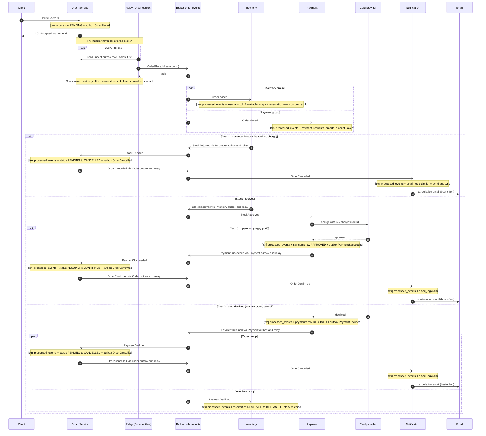
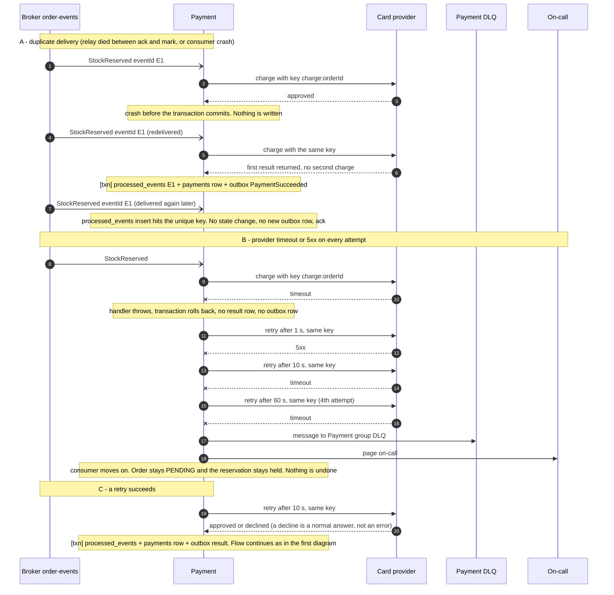

# Order fulfilment: checkout as an event flow

## Decisions

The brief fixes the accept path, relay, broker, retry policy and business rules. This section covers the five points it left open.

| Question | Decision |
|---|---|
| Duplicates in consumers | Every consumer has a `processed_events(eventId PRIMARY KEY)` table in its own database. The handler inserts the `eventId` in the same transaction as its state change and its outbox row. A unique-violation means the event was already handled, so the handler does nothing and acks. A second guard sits on the business key (one reservation per `orderId`, one payment per `orderId`, status changes only from `PENDING`), so a redelivery under a new `eventId` is also harmless. |
| How Inventory and Payment publish results | They use the same outbox and relay pattern as Order Service. Each has an `outbox` table and a relay, and the result row is written in the same transaction as the state change. Both publish to `order-events`, keyed by `orderId`, so all events for one order stay in one partition. |
| How Payment avoids a second charge | The provider idempotency key is `charge:{orderId}`. It is derived from the order, not from the event, so a retry, a redelivery or a replayed DLQ message all send the same key. A repeat call returns the first result. Payment records the result in its own database only after the provider answers. |
| How Order Service learns the outcome | It consumes `StockRejected`, `PaymentSucceeded` and `PaymentDeclined` from the topic. It is the only writer of `orders.status`. In one transaction it updates `PENDING` to `CONFIRMED` or `CANCELLED`, inserts the `processed_events` row, and writes an `OrderConfirmed` or `OrderCancelled` outbox row. |
| What triggers the email | Notification consumes `OrderConfirmed` and `OrderCancelled`. These are published by Order Service after the status commit, so an email never goes out for a status that was not saved. |

Two design points follow from these decisions.

- **Payment learns the amount and card token from `OrderPlaced`.** Payment consumes `OrderPlaced` and stores `(orderId, amount, paymentToken)` in its own database. Because the topic is ordered per order, it always sees `OrderPlaced` before `StockReserved`. Payment charges only on `StockReserved`, which is how "never charge unless stock is reserved" is enforced.
- **The order is cancelled on `PaymentDeclined`, not on the stock release.** The customer's outcome is decided by the decline. Releasing stock is a separate consumer's job, and if it fails the order stays cancelled and on-call replays the release from the DLQ.

### Events on `order-events`

| Type | Published by | Consumed by (acts on it) |
|---|---|---|
| `OrderPlaced` | Order Service | Inventory (reserve), Payment (record amount and token) |
| `StockReserved` | Inventory | Payment (charge) |
| `StockRejected` | Inventory | Order Service (cancel) |
| `PaymentSucceeded` | Payment | Order Service (confirm) |
| `PaymentDeclined` | Payment | Order Service (cancel), Inventory (release) |
| `OrderConfirmed` | Order Service | Notification (email) |
| `OrderCancelled` | Order Service | Notification (email) |

Each group ignores event types it does not act on. It advances its offset without writing anything.

## Flow: happy path and both cancellation paths

In the diagram, `[txn]` means one database transaction in that service's own database. "Relay" means the service's outbox relay, which polls every 500 ms, publishes oldest first and marks a row sent only after the broker acks.

## Flow: duplicates and failures

This diagram uses Payment as the example, because it is the riskiest consumer. The same retry and DLQ rules apply to every consumer group.

## Where state is written

| Service | Own database holds | Written in the same transaction as |
|---|---|---|
| Order Service | `orders`, `outbox`, `processed_events` | Accepting: `orders` (PENDING) and `outbox` (`OrderPlaced`). Outcome events: `processed_events`, `orders.status`, and `outbox` (`OrderConfirmed` or `OrderCancelled`). |
| Inventory | `stock`, `reservations`, `outbox`, `processed_events` | Reserve: `processed_events`, `stock`, `reservations`, and `outbox` (`StockReserved` or `StockRejected`). Release: `processed_events`, `reservations` (RESERVED to RELEASED), and `stock`. |
| Payment | `payment_requests`, `payments`, `outbox`, `processed_events` | On `OrderPlaced`: `processed_events` and `payment_requests`. After a provider answer: `processed_events`, `payments`, and `outbox` (`PaymentSucceeded` or `PaymentDeclined`). |
| Notification | `email_log`, `processed_events` | `processed_events` and `email_log (orderId, type)` are committed before the send is attempted. |
| Broker | `order-events` topic, one DLQ per consumer group | n/a |

## Rules for duplicates and failures

- **Throw means roll back.** If a handler throws, nothing it wrote is committed, including the `processed_events` row. The retry therefore starts clean, with the same provider key where there is one.
- **Retries and DLQ.** Attempts happen at once, then after 1 s, 10 s and 60 s. If the fourth fails, the message goes to that group's DLQ, on-call is paged, and the consumer moves on. No compensating action runs and the order keeps its status.
- **Provider results.** A decline is a normal answer and produces `PaymentDeclined`. A timeout or 5xx is an error and goes through retry.
- **Order Service guard.** Status changes only apply `WHERE status = 'PENDING'`. A late or replayed event for an order that is already `CONFIRMED` or `CANCELLED` does nothing.
- **Email is best-effort.**
  - Notification claims `email_log` and commits it before it calls the mail provider. A repeated event cannot send twice.
  - If the send fails, Notification logs it and returns normally. There are no retries and no DLQ entry for a failed send, and order status is never touched.
  - If the process crashes after the claim and before the send, that email is lost. This is the accepted trade for never sending duplicates.

## Holes to decide before coding

1. **Payment DLQ leaves an order stuck.**
   - The order stays `PENDING` with stock held.
   - If the provider charged the card but the answer was lost, the customer may have been charged for an order that never confirms.
   - The brief says nothing else is undone, so there is no timeout sweeper in this design. On-call needs a runbook: replay the DLQ message, since the same key returns the original result.
2. **DLQ replay and key lifetime.** The idempotency key is only safe to replay while the provider still remembers it. Confirm the provider's key retention window. If it is shorter than the time on-call might take to replay, a replay could charge again.
3. **Inventory DLQ.**
   - On the reserve step, the order stays `PENDING` and no card is charged.
   - On the release step, the order is already `CANCELLED` but stock stays reserved until on-call replays the message.
4. **Customer visibility.** Nothing tells the customer or the client that an order is stuck in `PENDING`. A status endpoint or an email on stuck orders needs its own decision.
5. **`processed_events` growth.** Each table needs a retention policy longer than the longest DLQ replay window.
6. **Card token in events.** `OrderPlaced` carries a payment-method token and amount, not card numbers. Confirm that putting the token on the broker is acceptable to security.
