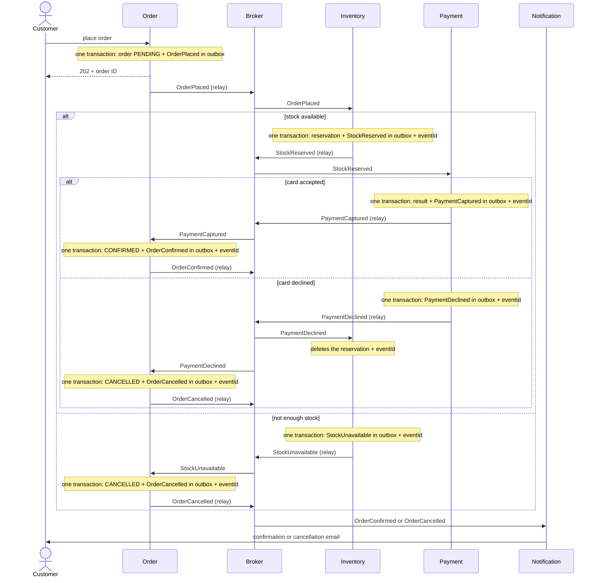

# Order fulfilment (event-driven)

Today `POST /orders` calls Inventory, Payment and Notification one after another inside the request. When one is slow, checkout times out, and customers have been charged for stock we did not hold. In the new flow, Order Service saves the order as `PENDING`, answers `202 Accepted` at once and publishes `OrderPlaced`. Inventory, Payment and Notification react to events on a broker and publish their own results as events, and Order Service listens for those results and sets the final status. Each service saves its state and its outgoing event in one database transaction, so an event is never lost and the card is never charged unless stock is reserved.

## Terms

- **Broker**: the message system. It has one topic, `order-events`, for every event type. Messages are keyed by order ID, so each consumer group sees one order's events in the order they were published.
- **Event**: a message with a unique `eventId`, the `orderId` and a type, such as `OrderPlaced`. It can also carry a payload, such as the ordered items.
- **Consumer group**: one per service (Order, Inventory, Payment, Notification), each with its own database. Each group receives every event on the topic and ignores types it does not handle.
- **Outbox**: a table in a publishing service's own database. The service inserts its outgoing event there in the same transaction as its state change, so a change and its event cannot get out of step. Order, Inventory and Payment each have one.
- **Relay**: a poller in each publishing service. Every 500 ms it reads unsent outbox rows, oldest first, and publishes them. It marks a row sent only after the broker acknowledges it. If it dies between the ack and the mark, the row is published again on the next poll. Delivery is therefore at-least-once, and duplicates are expected. If two instances of a service run, both may publish the same row. The copies carry the same `eventId`, so consumers drop the second. No lock is added, because the brief does not need one.
- **processed_events**: a table in each consumer's own database holding the `eventId`s it has already handled. It is how a service ignores duplicates.
- **Reservation**: a row in Inventory's database, keyed by order ID, that holds the ordered quantity out of available stock. Releasing it deletes the row and returns the quantity.
- **Idempotency key**: a value sent with a charge to the card provider. A repeat call with the same key returns the first result and does not charge again. Payment uses the order ID.
- **DLQ (dead-letter queue)**: a holding queue, one per consumer group, for messages that could not be handled.

## Flow

Every consumer, on every event, first looks the `eventId` up in its own `processed_events`. If it is there, the consumer acknowledges the message and does nothing else. Each service records an `eventId` in its own table, so one event such as `PaymentDeclined` is recorded separately by Inventory and by Order.

## Steps

1. **Accept the order.** Trigger: the customer's request, which carries the ordered items with quantities and the customer's email address. Order Service writes the order (`PENDING`, with the items and email) and an `OrderPlaced` outbox row (payload: items and quantities) in one transaction, then returns `202` with the order ID. The request handler never talks to the broker. `202` means accepted, not confirmed. If the transaction fails, nothing is saved and the customer gets an error.
2. **Reserve stock.** Trigger: `OrderPlaced`. In one transaction in its own database, Inventory either creates the reservation and outboxes `StockReserved`, or, if stock is short, creates nothing and outboxes `StockUnavailable`. It records the `eventId` in the same transaction. If the transaction fails, the message is retried (see Failures).
3. **Charge the card.** Trigger: `StockReserved`. Payment calls the card provider synchronously with the order ID as idempotency key. In one transaction it records the result, outboxes `PaymentCaptured` or `PaymentDeclined`, and records the `eventId`. A decline is a normal answer. A timeout or 5xx is an error: Payment throws and the message is retried.
   - The retry uses the same key, so the provider returns the first attempt's result and cannot charge twice, even if the first attempt charged but crashed before saving. The retry then writes that same result and event.
   - The `processed_events` check is still needed. Without it, a duplicate `StockReserved` would publish a second result event with a new `eventId`, which downstream services could not recognise as a duplicate.
   - Payment charges only on `StockReserved`. Nothing refunds a charge (see Open questions).
4. **Release stock after a decline.** Trigger: `PaymentDeclined`. Inventory deletes the reservation for that order, records the `eventId` and publishes nothing. Order Service handles the same event in step 5.
5. **Set the final status.** Trigger: `PaymentCaptured`, `PaymentDeclined` or `StockUnavailable`. Only Order Service changes order status. In one transaction it sets `CONFIRMED` (after `PaymentCaptured`) or `CANCELLED` (after the other two), outboxes `OrderConfirmed` or `OrderCancelled`, and records the `eventId`. The outgoing event carries the customer's email address in its payload, so Notification needs no lookup in Order's database.
6. **Send the email.** Trigger: `OrderConfirmed` or `OrderCancelled`. Notification sends the matching email to the address in the event, then records the `eventId`. Email is best-effort: a failed send is logged, is not retried and never changes the order status. If Notification crashes after sending but before recording, the redelivery sends the email a second time. This is accepted.

## Failures

| What goes wrong | What happens |
|---|---|
| Relay dies after the broker ack, before marking the row sent | The row is published again. Consumers drop the duplicate by `eventId`. |
| Handling a message throws (database error, provider timeout or 5xx) | The consumer retries after 1 s, 10 s and 60 s. If the fourth attempt fails, the message goes to that group's DLQ, on-call is paged and the consumer moves on to the next message. Nothing is undone: the order keeps whatever status it has. Later events for the same order are still handled. |
| Not enough stock | No reservation, no charge, order `CANCELLED`, cancellation email. |
| Card declined | Reservation released, order `CANCELLED`, cancellation email. |
| Email send fails | Logged. Order status is unchanged. |

## Open questions

- The brief gives customers no way to look up an order's status other than the email. No status endpoint is specified here.
- What on-call does with a DLQ message, and whether an order stuck in `PENDING` is repaired by hand or by a tool, is not decided. Until then it stays as it is. For example, if `PaymentCaptured` lands in Order Service's DLQ, the card has been charged and the order stays `PENDING`.
- The brief has no refund step. A charge is never reversed by this flow.
