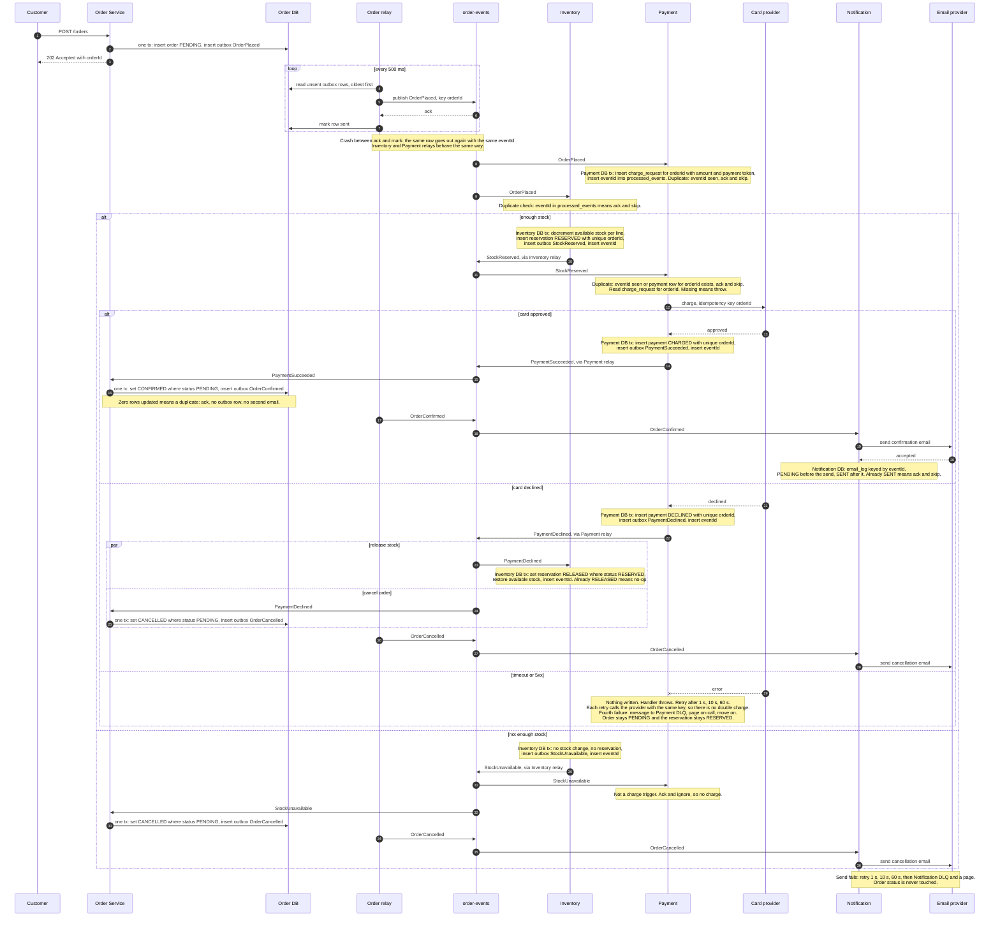

# Order fulfilment: checkout flow on events

## Decisions

1. **Duplicates.** Each consumer writes the event's `eventId` to a `processed_events` table in the same local transaction as its state change. If the `eventId` is already there, the consumer acks and does nothing. On top of that, each state change has a guard that makes it a no-op the second time: one reservation per `orderId`, one payment per `orderId`, and order status changes only `WHERE status = 'PENDING'`.
2. **How Inventory and Payment publish.** They use the same outbox pattern as Order Service. The result row goes into the service's own `outbox` table in the same transaction as the state change. A relay for that service publishes it to `order-events`, keyed by `orderId`. The `eventId` is set when the outbox row is written, so a copy sent again by the relay keeps the same `eventId`.
3. **How Payment avoids a second charge.** The idempotency key sent to the card provider is the `orderId`, so there is one charge per order. The provider is called outside any database transaction. Its result is then stored and the event emitted in a single transaction. If Payment crashes between the call and the commit, the event is delivered again, Payment calls the provider again with the same key, and gets the first result back.
4. **How Order Service learns the outcome.** Order Service has its own consumer group on `order-events`. `PaymentSucceeded` sets the order to `CONFIRMED`. `StockUnavailable` or `PaymentDeclined` sets it to `CANCELLED`. Only Order Service writes order status.
5. **What triggers the email.** Notification acts only on `OrderConfirmed` and `OrderCancelled`. Order Service writes these to its outbox in the same transaction as the status change, and only when the guarded update actually changes a row. Notification never reacts to the earlier events (stock, payment), so an email always matches a final status.

Every consumer group sees every event type on the topic. It acks the types it does not handle and does nothing else with them.

## Sequence

## Where state is written

| Store | Written by | What | In the same transaction as |
|---|---|---|---|
| Order DB `orders` | Order Service | `PENDING` on accept; `CONFIRMED` or `CANCELLED` by a guarded update | the matching outbox row |
| Order DB `outbox` | Order Service, Order relay | `OrderPlaced`, `OrderConfirmed`, `OrderCancelled`; `sent` flag | the order write; the relay marks the flag after the broker acks |
| Inventory DB `stock`, `reservations` | Inventory | decrement and `RESERVED`; restore and `RELEASED` | outbox row and `processed_events` |
| Inventory DB `outbox` | Inventory, Inventory relay | `StockReserved`, `StockUnavailable` | the reservation write |
| Payment DB `charge_requests` | Payment | amount and payment token from `OrderPlaced` | `processed_events` |
| Payment DB `payments`, `outbox` | Payment | `CHARGED` or `DECLINED`, unique per order; `PaymentSucceeded` or `PaymentDeclined` | each other and `processed_events` |
| Notification DB `email_log` | Notification | `PENDING`, then `SENT`, keyed by `eventId` | none (the send sits between the two writes) |
| Card provider | Payment | the charge, under key `orderId` | none (external) |

## Duplicates

- **Relay copies** keep their `eventId`. Every consumer skips them through `processed_events`.
- **Inventory** cannot reserve twice because of the unique reservation per `orderId`. It cannot release twice because the release runs only `WHERE status = 'RESERVED'`.
- **Payment** cannot charge twice. The `payments` row is unique per `orderId`, and the provider key is the `orderId`, which also covers a crash between the provider call and the commit.
- **Order Service** changes status only from `PENDING`. A duplicate outcome updates zero rows and writes no `OrderConfirmed` or `OrderCancelled`, so no second email goes out.
- **Notification**: a crash after the email provider accepts and before `SENT` is written leads to a second email on redelivery. Email is best-effort, so we accept this.

## Failures (after three retries, the message goes to the group's DLQ and on-call is paged)

| Group whose message failed | State left behind | Safe to replay from DLQ? |
|---|---|---|
| Inventory on `OrderPlaced` | order `PENDING`, nothing reserved, nothing charged | yes, it is deduplicated |
| Payment on `StockReserved` | order `PENDING`, stock reserved, charge unknown if the provider timed out | yes, the same key returns the provider's real first result |
| Inventory on `PaymentDeclined` | order `CANCELLED`, stock still reserved | yes, the guarded release |
| Order Service on any outcome | customer may be charged, order still `PENDING` | yes, the guarded update |
| Notification | no email; status unaffected | yes |

## Open points for review

- **Retries hold up the partition.** If retries happen in place, a failing message blocks later events on its partition for about 71 s. That includes other orders that hash to the same partition. A provider outage would slow all of Payment.
- **Idempotency key lifetime.** Replaying from the DLQ is safe only while the provider still remembers the key. We need the provider's key retention window and an on-call runbook that replays well inside it.
- **Orders stuck in `PENDING`.** Under the fixed rules, nothing undoes an order that stalls in `PENDING`. It can hold reserved stock or a charge until on-call acts. Decide whether that is acceptable or whether a timeout sweep is wanted. That would be a change to the fixed rules.
- **Card token in events.** `OrderPlaced` carries a payment-method token so that Payment can charge. It must be a provider token, never card data.
