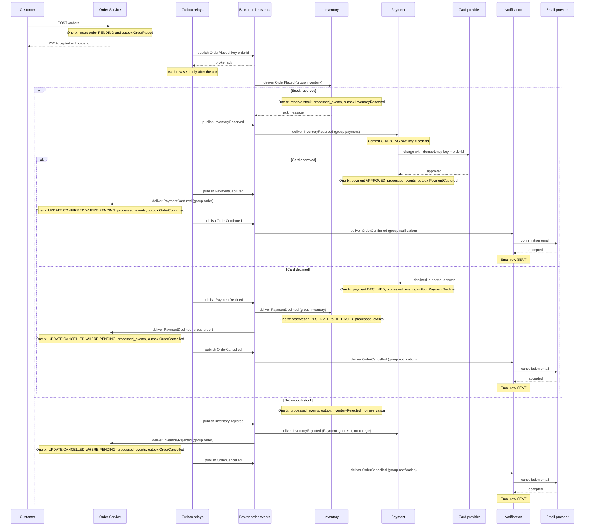

# Order fulfilment: checkout moves to events

Today `POST /orders` calls Inventory, Payment and Notification one after another inside the request. When one of them is slow, checkout times out, and customers have been charged for stock we did not hold. The new flow saves the order and answers `202 Accepted` at once. The services then react to events on one shared broker, and each reaction writes its own result as a new event. Only Order Service sets an order's final status, and the card is charged only after stock is reserved.

## Terms

- **Order status:** `PENDING` when accepted, then `CONFIRMED` or `CANCELLED`. Only Order Service changes it.
- **Service database:** Order Service, Inventory, Payment and Notification each have their own database. No service writes another service's tables.
- **Outbox:** a table in a service's own database where it records the events it will publish. The event row is written in the same transaction as the state change, so an event exists only if the change was saved.
- **Relay:** a background process that reads unsent outbox rows and publishes them to the broker.
- **Broker and topic:** the message system. All events go to one topic, `order-events`.
- **Event:** a message with a unique `eventId`, an `orderId` and a type, such as `OrderPlaced`.
- **Key by orderId:** every event for one order uses the same key, so the broker keeps that order's events in publish order for each consumer group.
- **Consumer group:** a named subscriber: `inventory`, `payment`, `order` or `notification`. Each group receives every event on the topic.
- **At-least-once:** an event may arrive more than once, so every consumer must handle repeats safely.
- **processed_events:** a table in each consumer's database that lists the `eventId`s it has already handled.
- **Reservation:** Inventory's hold on stock for one order. It is `RESERVED` until released, then `RELEASED`.
- **Idempotency key:** a key sent with each card charge. A repeat call with the same key returns the first result and does not charge again. A card decline is a normal answer. A timeout or 5xx is an error.
- **Conditional update:** an `UPDATE` that changes a row only if the row still has the expected value, here `WHERE status = 'PENDING'`.
- **Dead-letter queue (DLQ):** a holding queue, one per consumer group, for a message that failed every retry.

## Flow

## Steps

Each step starts on its trigger. The diagram shows the order; the steps add what starts each step, what it writes and what keeps the data.

1. **Order accepted.** Trigger: `POST /orders`. Order Service writes the order (`PENDING`) and an `OrderPlaced` outbox row in one transaction, then returns `202 Accepted` with the order ID. The request handler never calls the broker or any other service.
2. **Relay publishes.** Trigger: every 500 ms. Each outbox has exactly one active relay, so events leave in commit order. The relay publishes unsent rows oldest first, keyed by `orderId`, and stops at the first failed publish so order holds. It marks a row sent only after the broker acknowledges it. The `eventId` is set when the row is inserted, so a re-send carries the same ID. Delivery is therefore at-least-once.
3. **Inventory reserves or rejects.** Trigger: `OrderPlaced` in the `inventory` group. In one transaction, Inventory either reserves stock and writes `InventoryReserved`, or writes `InventoryRejected` with no reservation. Either way it records the `eventId` in `processed_events`. Only Inventory writes its reservations.
4. **Payment charges.** Trigger: `InventoryReserved` in the `payment` group. Payment does not consume `InventoryRejected`, so no reserved stock means no charge. Payment first commits a `CHARGING` row, then calls the card with idempotency key `orderId`, which gives one charge per order. In one transaction after the answer, it saves `APPROVED` or `DECLINED`, the `processed_events` row and a `PaymentCaptured` or `PaymentDeclined` outbox row. Only Payment writes its payment state.
5. **Inventory releases.** Trigger: `PaymentDeclined` in the `inventory` group. One transaction changes the reservation from `RESERVED` to `RELEASED` and records the `eventId`. Inventory always sees `InventoryReserved` before `PaymentDeclined`, because both events for an order arrive in publish order. It therefore never releases a reservation it did not make.
6. **Order sets the final status.** Trigger: `PaymentCaptured`, `PaymentDeclined` or `InventoryRejected` in the `order` group. One transaction runs a conditional update, `WHERE status = 'PENDING'`: to `CONFIRMED` on `PaymentCaptured`, to `CANCELLED` on `PaymentDeclined` or `InventoryRejected`. It also records the `eventId` and writes `OrderConfirmed` or `OrderCancelled` to the outbox. If the update matches no row, the order already has a final status and the event does nothing more. Only Order Service changes status.
7. **Notification emails.** Trigger: `OrderConfirmed` or `OrderCancelled` in the `notification` group. Email follows only a final status, and it cannot change one. Notification writes a `SENDING` record before the send and `SENT` or `FAILED` after it. Where the email provider supports idempotency keys, Notification sends the `eventId` as the key.

Every consumer that does not act on an event records its `eventId` as processed and moves on.

## Where state is written

| State | Owner | Where | When |
|---|---|---|---|
| Order status `PENDING` | Order Service | orders | On `POST /orders`, same transaction as `OrderPlaced` |
| `OrderPlaced` | Order Service | outbox | Same transaction as the order |
| Stock reservation `RESERVED` or `RELEASED` | Inventory | reservations | Reserve when stock is available; release on `PaymentDeclined` |
| `InventoryReserved` or `InventoryRejected` | Inventory | outbox | Same transaction as the stock change |
| Payment `CHARGING` | Payment | payments | Committed before the card call |
| Payment `APPROVED` or `DECLINED` | Payment | payments | Committed after the card answer |
| `PaymentCaptured` or `PaymentDeclined` | Payment | outbox | Same transaction as the payment result |
| Order status `CONFIRMED` or `CANCELLED` | Order Service | orders | Conditional update, only from `PENDING` |
| `OrderConfirmed` or `OrderCancelled` | Order Service | outbox | Same transaction as the status change |
| `processed_events` | Each consumer | its own database | Same transaction as its effect |
| Email send record `SENDING`, then `SENT` or `FAILED` | Notification | its own database | Before and after the send |
| Outbox `sent` flag | Relay | outbox | After the broker ack |

## Duplicates

- **Repeat `eventId` at any consumer.** The consumer finds the `eventId` in `processed_events`, acknowledges the message and does nothing. The effect and the processed record commit together, so a duplicate cannot apply twice.
- **Two cancelling events at Order Service.** `InventoryRejected` and `PaymentDeclined` can both cancel an order. Only the first conditional update from `PENDING` changes it. The second matches no row.
- **Repeated charge.** Payment sends the same key on every attempt. The provider returns the first result, so a retry after a timeout cannot charge twice.
- **Repeated email.** If Notification crashes after the provider accepts the email but before it records `SENT`, the customer may get a second email. The `eventId` idempotency key closes this window where the provider supports it.

## What happens when things fail

| Failure | What happens | What is kept |
|---|---|---|
| Request transaction fails | Neither the order nor its outbox row is saved. | Nothing |
| Consumer throws (database down, card timeout or 5xx, and so on) | The same message is retried after 1 s, 10 s and 60 s, with the same `eventId` and the same charge key. | The processed record and the effect commit together, so a failed attempt leaves nothing behind. |
| Fourth attempt fails | The message goes to that group's DLQ, on-call is paged, and the consumer moves on. Nothing else is undone. | The order keeps its status. A payment DLQ can leave an order `PENDING` with its stock still `RESERVED`. Replaying the DLQ message resumes the flow, because no processed record was written. Operators need a view of old `PENDING` orders to find these. |
| Crash after an approved charge, before Payment commits | The retry sends the same key. The provider returns `APPROVED` without charging again, and Payment commits the result. | The single charge |
| Relay crash between ack and mark | The row is re-sent, and consumers dedupe it. | The `eventId` |
| Broker down | Relays stop, outboxes grow, and orders stay `PENDING`. No card is charged, because Payment sees no new events. | All written state |
| Email failure | Email never changes order status. Notification retries, then uses the same DLQ and paging path. The send record shows `FAILED`. | The order status. Resending is a manual step. |

## Open questions

- Should an email failure page on-call or only raise a ticket? The brief's rule pages on every exhausted retry, so this needs a decision.