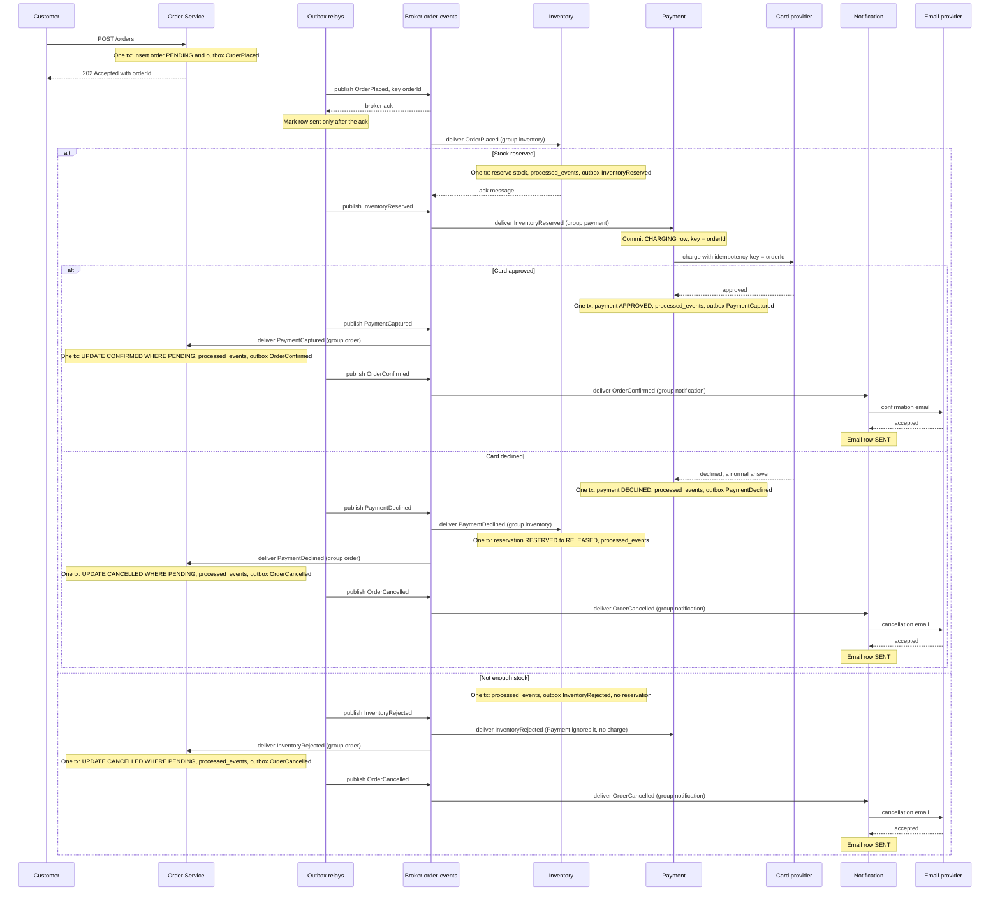

# Order fulfilment: checkout moves to events

## Design decisions

- **Duplicates.** Every consumer has a `processed_events` table keyed by `eventId`. It writes the row in the same local transaction as its effect. A redelivered `eventId` is acknowledged and skipped. `eventId` is set when the outbox row is inserted, so relay re-sends carry the same ID.
- **Results.** Inventory and Payment publish their own outcomes (`InventoryReserved`, `InventoryRejected`, `PaymentCaptured`, `PaymentDeclined`) through their own outboxes, in the same transaction as their state change. No one else writes their state.
- **Payment dedupe.** The card idempotency key is the `orderId`, so there is one charge per order. Payment commits a `CHARGING` row before calling the card, then commits the result in a transaction after the call. A retry reuses the key, and the provider returns the first result without charging again.
- **Outcome to Order Service.** Order Service consumes the Inventory and Payment results in its own consumer group. Every status change is a conditional update (`WHERE status = 'PENDING'`). Order Service is the only writer of order status. Each change writes an `OrderConfirmed` or `OrderCancelled` row to its outbox.
- **Email trigger.** Notification consumes `OrderConfirmed` and `OrderCancelled`. Email therefore only follows a final status, and it cannot change one.
- **Ordering.** Because events are keyed by `orderId`, each group sees one order's events in publish order. Inventory therefore always sees `InventoryReserved` before `PaymentDeclined`, so it never releases a reservation it has not made.

## Flow

## Notes on the flow

- **Request path.** The handler writes the order and the outbox row in one transaction and returns `202`. It never calls the broker, Inventory, Payment or Notification.
- **Relay.** Each outbox has one active relay, so commit order holds. It publishes oldest first and stops at the first failed publish to keep order. It marks a row sent only after the broker acks it. A crash between ack and mark re-sends the row, and the consumers dedupe it.
- **No charge without a reservation.** Payment consumes only `InventoryReserved`, so it cannot charge unless stock is reserved.
- **Consumers ignore events they do not act on.** Every group sees every event on the topic. A consumer records the `eventId` as processed and moves on.

## Where state is written

| State | Owner | Where | When |
|---|---|---|---|
| Order status `PENDING` | Order Service | orders | On `POST /orders`, same transaction as `OrderPlaced` |
| `OrderPlaced` | Order Service | outbox | Same transaction as the order |
| Stock reservation `RESERVED` or `RELEASED` | Inventory | reservations | Reserve when stock is available; release on `PaymentDeclined` |
| `InventoryReserved` or `InventoryRejected` | Inventory | outbox | Same transaction as the stock change |
| Payment `CHARGING` | Payment | payments | Committed before the card call |
| Payment `APPROVED` or `DECLINED` | Payment | payments | Committed after the card answer |
| `PaymentCaptured` or `PaymentDeclined` | Payment | outbox | Same transaction as the payment result |
| Order status `CONFIRMED` or `CANCELLED` | Order Service | orders | Conditional update, only from `PENDING` |
| `OrderConfirmed` or `OrderCancelled` | Order Service | outbox | Same transaction as the status change |
| `processed_events` | Each consumer | its own database | Same transaction as its effect |
| Email send record `SENDING`, then `SENT` or `FAILED` | Notification | its own database | Before and after the send |
| Outbox `sent` flag | Relay | outbox | After the broker ack |

## Duplicates

- **Duplicate delivery to any consumer.** The `processed_events` lookup finds the `eventId`, so the consumer acks and does nothing. Because the effect and the processed record commit together, a duplicate can never apply twice.
- **Duplicate status events at Order Service.** Both `InventoryRejected` and `PaymentDeclined` can cancel an order, but only the first conditional update from `PENDING` changes it. The second matches no row and does nothing.
- **Duplicate charge.** Payment sends the same key on every attempt. The provider returns the first result, so a retry after a timeout cannot charge twice.
- **Duplicate email.** Notification dedupes on `eventId`. If it crashes after the provider accepts the email but before it records `SENT`, the customer may get a second email. Where the provider supports idempotency keys, Notification sends the `eventId` as the key to close that window.

## Failures

- **Consumer throws** (database down, card timeout or 5xx, and so on). The same message is retried after 1 s, 10 s and 60 s, with the same `eventId` and the same charge key. The processed record and the effect are in one transaction, so a failed attempt leaves nothing behind.
- **Fourth attempt fails.** The message goes to that group's dead-letter queue, on-call is paged, and the consumer moves on. Nothing is undone. The order keeps its status, so a payment DLQ can leave an order `PENDING` with its stock still `RESERVED`. Replaying the DLQ message resumes the flow, because no processed record was written. Operators need a view of old `PENDING` orders to find these.
- **Crash after an approved charge but before Payment commits.** The retry sends the same key, the provider returns `APPROVED` without charging again, and Payment commits the result.
- **Relay crash between ack and mark.** The row is re-sent and the consumers dedupe it.
- **Broker down.** The relays stop, the outboxes grow, and orders stay `PENDING`. No card is charged because Payment sees no new events.
- **Email failure.** Email never changes order status. Notification retries and then uses the same DLQ and paging path. The send record shows `FAILED`, and resending is a manual step.
- **Open question.** Whether an email failure should page on-call or only raise a ticket. The brief's rule pages on every exhausted retry, so this needs a decision.