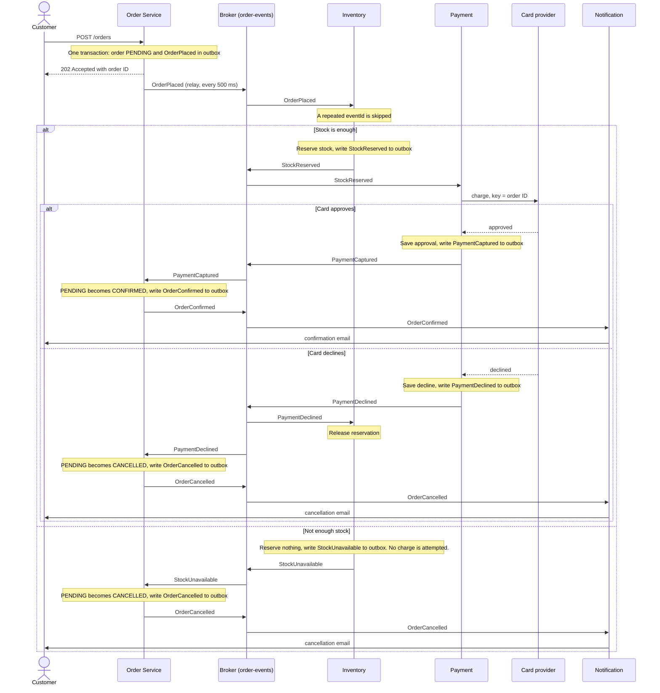

# Order fulfilment (event-driven)

## Summary

Today `POST /orders` calls Inventory, Payment and Notification one after another inside the request. A slow service makes checkout time out, and customers have been charged for stock we did not hold. In the new design the request only saves the order and returns `202 Accepted`. Each service then reacts to events on one shared topic and publishes its own result. Order Service is the only service that sets the final status, `CONFIRMED` or `CANCELLED`, and the card is charged only after stock is reserved.

## Terms

- **Event**: a message with a unique `eventId`, an `orderId` and a `type`, such as `OrderPlaced`.
- **Outbox**: a table in a service's own database. A service writes its event there in the same transaction as its data change, so the change and the event are saved together or not at all.
- **Relay**: a background job that reads unsent outbox rows every 500 ms, oldest first, and publishes them to the broker. It marks a row sent only after the broker confirms it.
- **Broker topic `order-events`**: one shared channel for all order events. Events are keyed by order ID, so each consumer group receives one order's events in the order they were published.
- **Consumer group**: one service's subscription to the topic. Inventory, Payment and Notification each have their own, so each gets its own copy of every event.
- **Inbox**: a table in a consumer's database that lists the `eventId`s it has already handled.
- **Idempotency key**: a token sent with a card charge. The card provider returns the first answer for a repeated key and does not charge again.
- **Reservation**: stock held for one order and not yet sold.
- **Dead-letter queue (DLQ)**: a holding queue for messages that failed every retry.

## Diagram

## Notes on the diagram

**Who writes what.** Each service writes only to its own database. Order Service is the only writer of order status. It changes an order only from `PENDING`, so a late event for an order that already has a final status is recorded and ignored.

**Duplicates.** Every consumer first checks its inbox for the event's `eventId`. If it is there, the consumer skips the event. If not, it does the work and records the `eventId` in the same transaction. Payment cannot put the card call inside that transaction, so for the card it relies on the idempotency key below.

**Payment and the card.** Payment uses the order ID as the idempotency key, so each order is charged at most once. If Payment crashes after the card has answered, the retry sends the same key and gets the same answer. A decline is a normal answer and is final, so Payment never tries to charge again after a decline. A timeout or a 5xx is an error, and the retry rule in the table below applies.

**Who learns the outcome.** Order Service consumes `StockUnavailable`, `PaymentCaptured` and `PaymentDeclined` and sets the status from them. Notification consumes only `OrderConfirmed` and `OrderCancelled`. So each final status sends one email, and only the order's own final-status event triggers it.

**Results are published the same way.** Inventory and Payment publish their results through their own outbox and relay, as Order Service does, so a result is never lost when the service's data changes.

## What goes wrong

| Where | What goes wrong | What happens | What is left behind |
|---|---|---|---|
| Accepting an order | The database transaction fails | Nothing is saved. The customer gets an error and no `202`. | Nothing |
| Relay | The broker does not confirm a row | The row stays unsent and the next poll tries again. | Unsent outbox row |
| Relay | It crashes after the broker confirms but before it marks the row sent | The row is sent again. The consumer skips the repeat by `eventId`. | Event handled once |
| Any consumer | Its handler throws | Retry after 1 s, 10 s and 60 s. If the fourth attempt fails, the message goes to that group's DLQ, on-call is paged and the consumer moves on. | Nothing is undone. The order keeps its status. |
| Inventory | Not enough stock | No reservation and no charge. The order is cancelled. | Order `CANCELLED` |
| Payment | The card declines | The reservation is released. The order is cancelled. | Order `CANCELLED` |
| Payment | The card times out or returns 5xx | The handler throws, so the retry rule applies. Each retry uses the same key, so the card cannot charge twice. | Order stays `PENDING` if the retries fail |
| Notification | The email send fails | The email is not sent again. The order status does not change. | Order status unchanged |

## Open questions

- An order whose messages all end in a DLQ stays `PENDING`. The brief does not say who resolves it or how.
- If Payment ends in the DLQ, the stock reservation stays held. The brief does not say who releases it.
- A failed email does not page on-call and is not retried. The brief does not say whether it should page.
- The brief does not say how long events and inbox rows are kept.