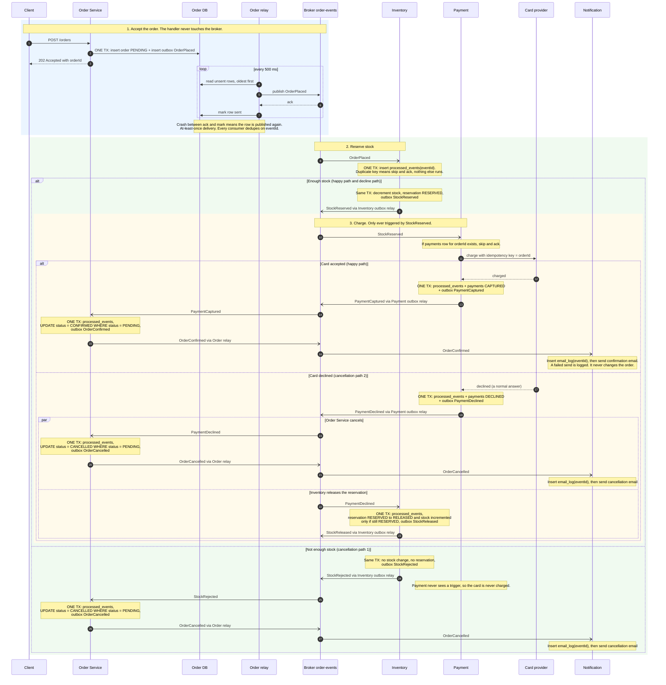
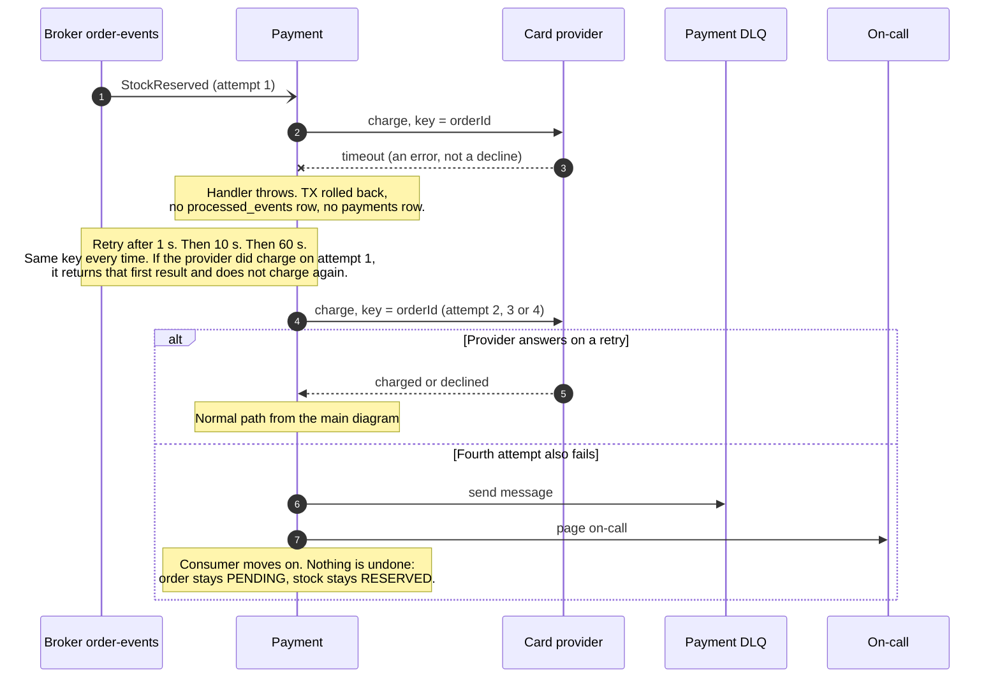

# Order fulfilment: move checkout to events

Today `POST /orders` calls Inventory, Payment and Notification one after another inside the request. When one is slow, checkout times out, and customers have been charged for stock we did not hold. This design replaces those calls with events. Order Service saves the order and returns at once. Each service then reacts to the previous service's event, and Order Service sets the final status from the outcome. Every state change is saved together with the event announcing it, so nothing is lost or done twice when messages repeat.

## Terms

- **Broker / topic.** The message system. There is one topic, `order-events`. Every event is keyed by `orderId`, so each consumer group receives one order's events in the order they were published.
- **Consumer group.** One service's reader of the topic. Inventory, Payment, Notification and Order Service each have their own group, and each service except Notification has its own database (Notification has `email_log`).
- **Event.** A message on the topic. It always carries a unique `eventId`, the `orderId` and a type.
- **Outbox.** A table in a service's own database. A service writes its outgoing event there in the same transaction as its state change, and never talks to the broker from a request handler or event handler.
- **Relay.** A background process per service that publishes that service's unsent outbox rows. Order Service's relay polls every 500 ms, publishes unsent rows oldest first, and marks a row sent only after the broker acknowledges (acks) it. If it dies between the ack and the mark, the row is published again on the next poll. Delivery is therefore **at-least-once**: any consumer can see the same event twice.
- **`processed_events`.** A table in each service: `processed_events(eventId PRIMARY KEY)`. It is how a service recognises an event it has already handled.
- **Idempotency key.** A value sent to the card provider. A repeat call with the same key returns the first result and does not charge again. A decline is a normal answer. A timeout or 5xx is an error.
- **DLQ (dead-letter queue).** Each consumer group's parking place for messages that kept failing.
- **Partition.** A slice of the topic. Events with the same key go to the same partition and are read in order.

## Business rules

- The card is never charged unless stock is reserved.
- Not enough stock: no charge, order cancelled.
- Card declined: the reservation is released and the order cancelled.
- Only Order Service changes order status. Statuses are `PENDING`, then a final `CONFIRMED` or `CANCELLED`.
- Email is best-effort: the customer gets a confirmation or a cancellation email, and a failed send never changes the order status.

## Decisions

| Question | Decision |
|---|---|
| Duplicate handling in consumers | The handler inserts the `eventId` into `processed_events` in the **same transaction** as its state change and its result row. A primary-key conflict means the event was already handled, so the handler skips it and acks. If the handler throws, the transaction rolls back, including the `processed_events` row, so a retry starts clean. |
| How Inventory and Payment publish results | Same outbox pattern as Order Service. The handler writes its result to its own `outbox` inside the handling transaction, and that service's relay publishes it. A state change can never be committed without its event, or the reverse. A duplicate input event creates no second result event. |
| How Payment avoids a second charge | Payment charges only on `StockReserved`. The idempotency key is the `orderId`, which is the same on every redelivery and retry. Payment calls the provider first, then writes `payments`, `processed_events` and the outbox row in one transaction. If it crashes or times out after the provider charged, the retry calls the provider with the same key and gets the first result back. A `payments` row for the `orderId` is also checked up front as a cheap short-circuit. |
| How Order Service learns the outcome | It consumes `StockRejected`, `PaymentCaptured` and `PaymentDeclined`. The status update is guarded with `WHERE status = 'PENDING'`, so a duplicate or out-of-order event cannot move a final status. In the same transaction it writes an `OrderConfirmed` or `OrderCancelled` outbox row. |
| What triggers the email | Notification consumes `OrderConfirmed` and `OrderCancelled`, which Order Service publishes only after the status is final. The email therefore always matches the real status. |

### Events and who reacts

Each service ignores the types it does not act on, including its own results.

| Event | Reacted to by |
|---|---|
| `OrderPlaced` | Inventory |
| `StockReserved` | Payment |
| `StockRejected` | Order Service |
| `PaymentCaptured` | Order Service |
| `PaymentDeclined` | Order Service (cancels), Inventory (releases) |
| `OrderConfirmed`, `OrderCancelled` | Notification |
| `StockReleased` | Nobody. It is informational, for audit. |

### Where state lives

| Service | Tables |
|---|---|
| Order Service | `orders`, `outbox`, `processed_events` |
| Inventory | `stock`, `reservations` (`orderId` PK, `RESERVED` or `RELEASED`), `outbox`, `processed_events` |
| Payment | `payments` (`orderId` PK, status, provider result), `outbox`, `processed_events` |
| Notification | `email_log` (`eventId` PK, status). It doubles as the dedupe table. |

## Sequence diagram: happy path and both cancellation paths

Steps 1 to 3 in the diagram: accept the order, reserve stock, charge. Each service's relay behaves like the Order relay shown at the top; later steps show only "via outbox relay".

## Failure handling

**Retries.** When a handler throws, the consumer retries the message after 1 s, then 10 s, then 60 s. If the fourth attempt fails too, the message goes to that group's DLQ, on-call is paged and the consumer moves on. Nothing else is undone: the order keeps whatever status it has. The same rules apply to every consumer. The diagram below shows a card provider timeout, the most likely case.

| Situation | What happens |
|---|---|
| Relay dies between broker ack and mark | The row is published again with the same `eventId`. Each consumer's `processed_events` insert conflicts, so it skips and acks. |
| Consumer crashes after committing but before acking | The broker redelivers. The dedupe insert conflicts, so the handler skips and acks. The result event is already in the outbox, so the flow is not lost. |
| Consumer crashes before committing | The transaction is gone, so redelivery processes the event as new. |
| Duplicate `OrderPlaced` | Inventory skips it: no second unit reserved, no second result event. |
| Duplicate `StockReserved` | Payment skips it: no second provider call, no second result event. |
| Duplicate `PaymentDeclined` | Inventory's release is guarded on `RESERVED`, so stock is not incremented twice. |
| Duplicate result event at Order Service | The `WHERE status = 'PENDING'` guard makes the update a no-op. |
| Provider timeout or 5xx | The handler throws and the retry schedule applies. The same idempotency key makes retries safe. A decline is different: it is a normal answer. |
| Dead-lettering | Message goes to that service's own DLQ, on-call is paged, the consumer moves on. No compensation runs. |
| Email send fails | Notification catches the error, marks the `email_log` row `FAILED` and does not throw. No retry, no DLQ, no page, order status untouched. |
| Notification crashes between claiming and sending | The `email_log` row already exists, so redelivery skips it. This risks one lost email but never a duplicate. |

## Open questions and trade-offs to confirm

1. **Cancellation on decline does not wait for the stock release.** Order Service cancels as soon as it sees `PaymentDeclined`, and Inventory releases in parallel. The customer is told promptly. The cost: if Inventory's release is dead-lettered, the order is `CANCELLED` but stock stays reserved until on-call fixes it. The alternative is to cancel on `StockReleased`, which keeps the books consistent, but a dead-lettered release then leaves the order `PENDING`.
2. **Retries block the partition.** While one message is in its 1 s, 10 s and 60 s retries, later events for the same order key wait behind it, which preserves per-order ordering. Other keys on other partitions are unaffected. Up to about 71 s of delay per poison message is the price.
3. **A dead-lettered message can leave an order `PENDING` indefinitely.** That is the specified behaviour, and recovery is manual through the DLQ. If this becomes frequent, a later reconciliation job could be added, but it is out of scope here.
