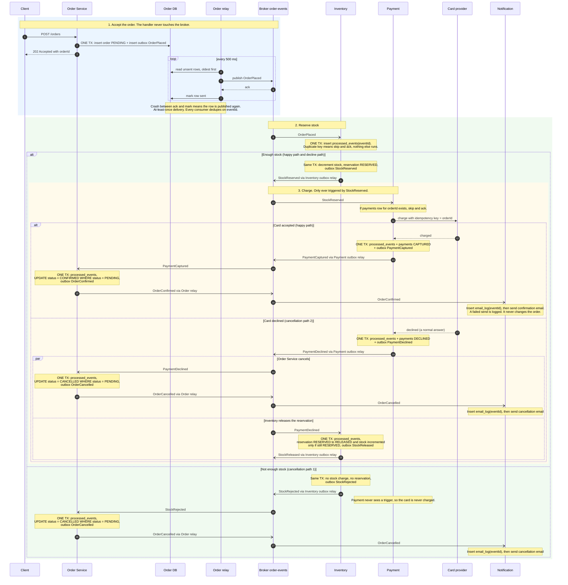
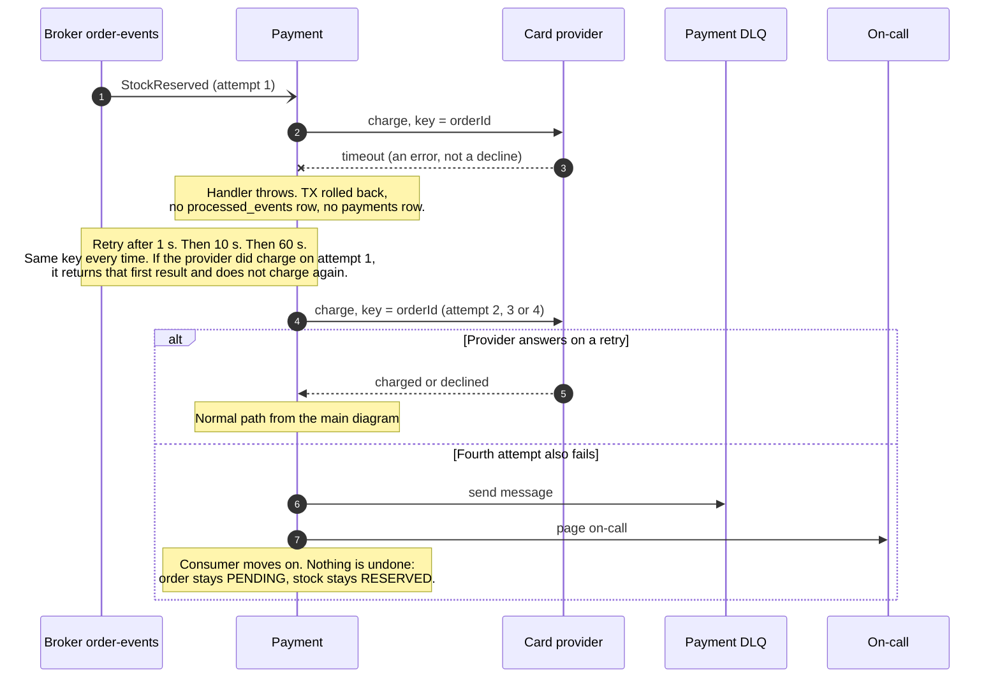

# Order fulfilment: move checkout to events

This is the design for the event-driven flow that replaces the synchronous `POST /orders` calls. It has the decisions, one sequence diagram for the happy path and both cancellation paths, and a second diagram for the failure behaviour.

## Decisions

| Question | Decision |
|---|---|
| Duplicate handling in consumers | Each service keeps a `processed_events(eventId PRIMARY KEY)` table in its own database. The handler inserts the `eventId` in the **same transaction** as its state change and its result row. A primary-key conflict means the event was already handled, so the handler skips it and acks. If the handler throws, the transaction rolls back, including the `processed_events` row, so a retry starts clean. |
| How Inventory and Payment publish results | Each uses the same outbox pattern as Order Service. The handler writes its result to its own `outbox` table inside the handling transaction, and that service's relay publishes it to `order-events`. No handler talks to the broker directly, so a state change can never be committed without its event, or the reverse. Because the result event is created inside the transaction, a duplicate input event creates no second result event. |
| How Payment avoids a second charge | Payment charges only on `StockReserved`. The idempotency key is the `orderId`, which is stable across redeliveries and retries. Payment calls the provider first, then writes `payments`, `processed_events` and the outbox row in one transaction. If it crashes or times out after the provider charged, the retry or redelivery calls the provider with the same key and gets the first result back. It never charges twice. A `payments` row for the `orderId` is also checked up front as a cheap short-circuit. |
| How Order Service learns the outcome | It consumes `StockRejected`, `PaymentCaptured` and `PaymentDeclined` in its own consumer group. It is the only writer of `orders.status`. The update is guarded with `WHERE status = 'PENDING'`, so a duplicate or out-of-order event can never move a final status. In the same transaction it writes an `OrderConfirmed` or `OrderCancelled` outbox row. |
| What triggers the email | Notification consumes `OrderConfirmed` and `OrderCancelled`, which Order Service publishes only after the status is final. The email therefore always matches the real status and never anticipates it. |

### Event types on `order-events`, all keyed by `orderId`

`OrderPlaced`, `StockReserved`, `StockRejected`, `PaymentCaptured`, `PaymentDeclined`, `StockReleased`, `OrderConfirmed`, `OrderCancelled`.

Every event carries `eventId`, `orderId` and `type`.

Each service ignores the types it does not act on, including its own results.

Which service reacts to which event:

| Event | Reacted to by |
|---|---|
| `OrderPlaced` | Inventory |
| `StockReserved` | Payment |
| `StockRejected` | Order Service |
| `PaymentCaptured` | Order Service |
| `PaymentDeclined` | Order Service (cancels), Inventory (releases) |
| `OrderConfirmed` | Notification |
| `OrderCancelled` | Notification |
| `StockReleased` | Nobody. It is informational and exists for audit. |

### Where state lives

| Service | Tables |
|---|---|
| Order Service | `orders`, `outbox`, `processed_events` |
| Inventory | `stock`, `reservations` (`orderId` PK, `RESERVED` or `RELEASED`), `outbox`, `processed_events` |
| Payment | `payments` (`orderId` PK, status, provider result), `outbox`, `processed_events` |
| Notification | `email_log` (`eventId` PK, status). It doubles as the dedupe table. |

## Sequence diagram

Each service's relay behaves like the Order relay shown at the top. For readability, later steps show only "publish via outbox relay".

## Duplicates and failures

This second diagram shows one failure path, a card provider timeout, followed by exhaustion into the dead-letter queue. The same retry rules apply to every consumer.

### Duplicate and failure behaviour

| Situation | What happens |
|---|---|
| Relay dies between broker ack and mark | The row is published again with the same `eventId`. Each consumer's `processed_events` insert conflicts, so it skips and acks. |
| A consumer crashes after committing but before acking | The broker redelivers. The dedupe insert conflicts, so the handler skips and acks. The result event is already in the outbox, so the flow is not lost. |
| A consumer crashes before committing | The transaction is gone, so redelivery processes the event as new. |
| Duplicate `OrderPlaced` | Inventory skips it, so it reserves no second unit and writes no second result event. |
| Duplicate `StockReserved` | Payment skips it, so it makes no second provider call and writes no second result event. |
| Duplicate `PaymentDeclined` | Inventory's release is guarded on `RESERVED`, so stock is not incremented twice. |
| Duplicate result event at Order Service | The `WHERE status = 'PENDING'` guard makes the update a no-op. |
| Provider timeout or 5xx | The handler throws and the retry schedule applies. The same idempotency key makes retries safe. This is distinct from a decline. |
| Dead-lettering | The message goes to that service's own DLQ, on-call is paged, and the consumer moves on. No compensation runs. The order stays at whatever status it has. |
| Email send fails | Notification catches the error, marks the `email_log` row `FAILED` and does not throw. There is no retry, no DLQ and no page, and the order status is untouched. |
| Notification crashes between claiming and sending | The `email_log` row already exists, so redelivery skips it. This risks one lost email but never a duplicate. |

## Trade-offs to confirm

1. **Cancellation on decline does not wait for the stock release.** Order Service cancels as soon as it sees `PaymentDeclined`, and Inventory releases in parallel.
   - The customer is told promptly.
   - The cost is that if Inventory's release is dead-lettered, the order is `CANCELLED` but the stock stays reserved until on-call fixes it.
   - The alternative is to cancel on `StockReleased`. That keeps the books consistent, but a dead-lettered release leaves the order `PENDING`.
2. **Retries block the partition.** While one message is in its 1 s, 10 s and 60 s retries, later events for the same order key wait behind it, which preserves per-order ordering. Other keys on other partitions are unaffected. Up to about 71 s of delay per poison message is the price.
3. **A dead-lettered message can leave an order `PENDING` indefinitely.** That is the specified behaviour, and recovery is manual through the DLQ. If this becomes frequent, a later reconciliation job could be added, but it is out of scope here.
