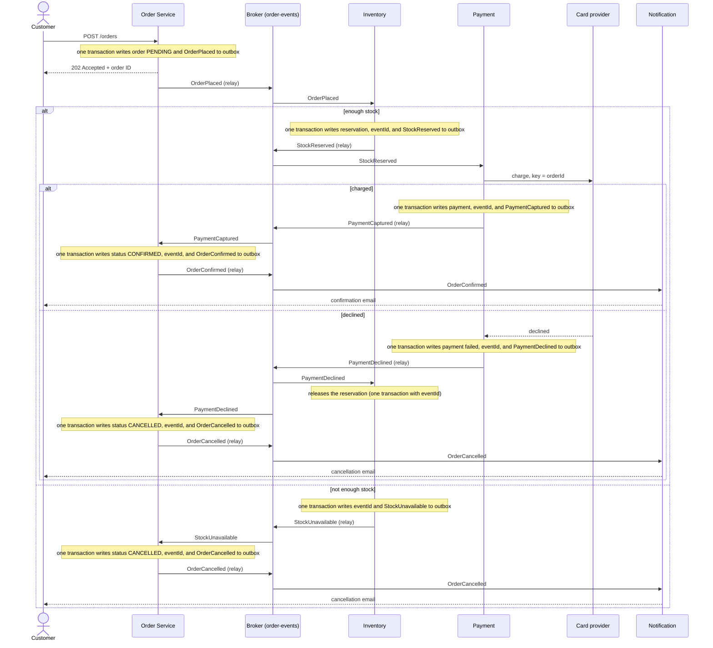

# Order fulfilment (event-driven)

Today `POST /orders` calls Inventory, Payment and Notification synchronously inside the request. When one is slow, checkout times out, and customers have been charged for stock we did not hold. This design replaces that with events. Order Service saves the order and answers `202` at once. Inventory, Payment and Notification then react to events on one broker topic, each recording its own results, and Order Service sets the final status from those results. Every event is written to a database outbox in the same transaction as the state change it describes, and every consumer remembers the events it has handled, so repeated delivery is harmless.

## Terms

- **Order Service**: owns the order and is the only service that changes order status. Statuses: `PENDING`, then the final `CONFIRMED` or `CANCELLED`.
- **Broker topic `order-events`**: the single topic all events go through, keyed by order ID. Each consumer group sees one order's events in the order they were published. Every event carries a unique `eventId`, the `orderId` and a type.
- **Consumer group**: Inventory, Payment, Notification and Order Service each read the topic as their own group, so each gets its own copy of every event. Each of the four ignores event types it does not act on.
- **Outbox**: a table in a service's own database. A service writes the event row in the same database transaction as its state change. It never publishes to the broker from inside a request or message handler.
- **Relay**: a background poller that publishes unsent outbox rows. It polls every 500 ms, sends oldest first, and marks a row sent only after the broker acknowledges it. If it dies between the ack and the mark, the row is sent again on the next poll. Delivery is therefore at-least-once: an event can arrive twice.
- **Processed-events table** (decision): each consumer's own table of `eventId`s it has already handled. This is how duplicates are made safe.
- **Idempotency key**: a value sent to the card provider. A repeat call with the same key returns the first result and does not charge again.
- **Dead-letter queue (DLQ)**: a per-consumer-group queue for messages that kept failing, kept for people to inspect.

Inventory, Payment and Notification each have their own database, their own outbox where they publish (Notification publishes nothing) and their own processed-events table.

## Rules that hold everywhere

- The card is never charged unless stock is reserved.
- Not enough stock: no charge, order cancelled.
- Card declined: the reservation is released and the order cancelled.
- The card provider treats a decline as a normal answer. A timeout or a 5xx is an error.
- Email is best-effort. A failed send never changes the order status.

## Diagram

## Steps

1. **Accept the order.** Trigger: `POST /orders`. Order Service writes the order (`PENDING`) and an `OrderPlaced` outbox row in one transaction, then returns `202` with the order ID. If the transaction fails, the customer gets an error and nothing exists. The handler never talks to the broker.
2. **Reserve stock.** Trigger: `OrderPlaced`. Inventory, in one transaction, records the event as processed and either reserves stock and writes `StockReserved` to its outbox, or, if stock is short, writes `StockUnavailable`. A duplicate `OrderPlaced` is found in the processed-events table and skipped, so stock is reserved once.
3. **Charge the card.** Trigger: `StockReserved`. Payment first checks its processed-events table; a duplicate is skipped. Otherwise it calls the card provider with the order ID as the idempotency key. Then, in one transaction, it records the payment and the event as processed and writes `PaymentCaptured` (charged) or `PaymentDeclined` (declined) to its outbox. If the call times out or returns a 5xx, the handler throws and the message is retried. Each retry uses the same key, so the card is never charged twice, even if Payment crashes after the provider charged but before it saved.
4. **Release stock after a decline.** Trigger: `PaymentDeclined`. Inventory releases the reservation and records the event as processed in one transaction. A duplicate is skipped.
5. **Set the final status.** Trigger: `PaymentCaptured`, `PaymentDeclined` or `StockUnavailable`. Order Service, in one transaction, records the event as processed, sets the status (`CONFIRMED` for `PaymentCaptured`, `CANCELLED` for the other two) and writes `OrderConfirmed` or `OrderCancelled` to its outbox. A duplicate is skipped.
6. **Email the customer.** Trigger: `OrderConfirmed` or `OrderCancelled`. Notification sends the matching email and records the event as processed. If the send fails, it logs the failure and moves on. It does not throw, so there is no retry and no DLQ entry, and the order status is not touched.
7. **Publish.** Every service's relay moves its outbox rows to the broker as described under Relay above. The outbox is where each event waits until the broker has it.

## When things fail

| Where | What happens |
|---|---|
| Order transaction fails (step 1) | Customer sees an error. No order, no event. |
| Relay dies or the broker is down | Rows stay unsent in the outbox and go out on a later poll. Duplicates are possible and are handled by the consumers. |
| Duplicate event at any consumer | Found in the processed-events table, skipped, acknowledged. |
| Handler throws (steps 2 to 5) | Retried after 1 s, 10 s and 60 s. If the fourth attempt also fails, the message goes to that group's DLQ, on-call is paged and the consumer moves on. Nothing else is undone: the order keeps whatever status it has, for example `PENDING`. |
| Card timeout or 5xx (step 3) | Counts as a handler throw. Retries reuse the same idempotency key. |
| Email send fails (step 6) | Logged only. Order status unchanged. |

## Rollout

Not covered here. This document describes only how the flow runs. The cut-over from the synchronous `POST /orders` and the building order belong in a separate plan.

## Open questions

- Who may replay a DLQ message, and how, is not decided. Until it is, an order whose message lands in the DLQ stays in its current status.
- Nothing yet cancels an order that stays `PENDING` after a DLQ entry. The brief says nothing else is undone.
