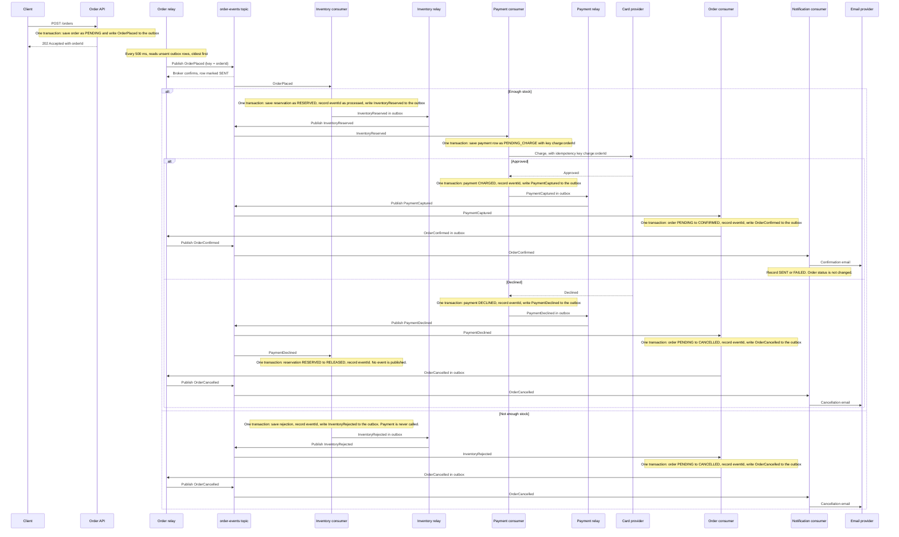
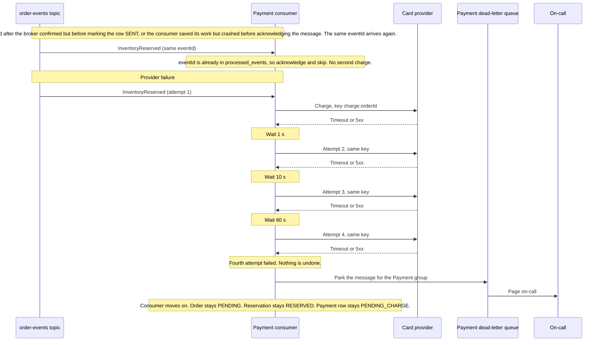

# Order fulfilment: checkout moved to events

Status: design draft for review. No code yet.

## What this changes

Today, `POST /orders` calls the Inventory, Payment and Notification services one after another while the customer waits. If one of them is slow, checkout times out. We have also charged customers for stock we did not hold.

The new design makes `POST /orders` do only one thing: save the order and return `202 Accepted`. Every later step runs in response to a message, called an event, on one shared topic named `order-events`. A service reads the events it cares about, does its own work, and publishes a new event with the result. No service calls another service directly.

In short:

1. The client places an order. Order Service saves it as `PENDING` and returns straight away.
2. Inventory tries to reserve stock. If it cannot, the order is cancelled and no money is taken.
3. If stock is reserved, Payment charges the card. If the card is declined, Inventory releases the stock and the order is cancelled.
4. If the charge succeeds, Order Service marks the order `CONFIRMED`.
5. Notification emails the customer the final outcome. A failed email does not change the order.

## Terms used here

- **Service**: one deployable program with its own database. The services are Order Service, Inventory, Payment and Notification.
- **Event**: a short message saying something happened, such as "payment captured". Every event has a unique `eventId`, an `orderId` and a `type`.
- **Topic**: a named channel that holds events. Here there is one topic, `order-events`, for all services. Each event is published with `orderId` as its key. The broker delivers events with the same key in the order they were published, so the events for one order stay in sequence.
- **Consumer**: the code in a service that reads events from the topic and reacts to them. Each service has its own consumer group, which is the set of workers that read the topic for that service. Because each group gets its own copy of every event, the services do not compete with each other for messages.
- **Outbox**: a table in a service's own database. When a service changes its state, it also writes the event to the outbox, in the same database transaction. A transaction either saves both or saves neither, so a state change can never exist without its event, or the reverse.
- **Relay**: a separate process in each publishing service. It reads unsent outbox rows, oldest first, and publishes them to the topic. It marks a row as sent only after the broker confirms it has the event. If the relay crashes after the broker confirms but before it marks the row, the row is sent again on the next poll. So delivery is **at-least-once**: an event can arrive more than once, but it is not lost.
- **Processed events**: a table in each consumer's database that lists the `eventId`s the consumer has already handled. The consumer writes the `eventId` in the same transaction as its state change. If the same event arrives again, the consumer finds the `eventId` here and skips the event.
- **Idempotency key**: a label sent with a card charge. If the card provider gets a request with a key it has already seen, it returns the first result and does not charge again.
- **Dead-letter queue (DLQ)**: a holding area for a message that keeps failing, so a person can inspect it later.
- **Order statuses**: `PENDING` (accepted, outcome not yet known), `CONFIRMED` and `CANCELLED`. The last two are the only final statuses.

## Event catalogue

Every event has `eventId` (a UUID), `orderId` and `type`. Every event is published to `order-events` with `orderId` as its key.

| Type | Published by | Meaning |
|---|---|---|
| `OrderPlaced` | Order Service | Order accepted, status `PENDING` |
| `InventoryReserved` | Inventory | Stock held for the order |
| `InventoryRejected` | Inventory | Not enough stock, nothing held |
| `PaymentCaptured` | Payment | Card charged |
| `PaymentDeclined` | Payment | Card declined by the provider |
| `OrderConfirmed` | Order Service | Status changed to `CONFIRMED` |
| `OrderCancelled` | Order Service | Status changed to `CANCELLED` |

## Happy path and both cancellation paths

### Reading the diagram

- **No charge without a reservation.** Payment acts only on `InventoryReserved`. It writes its `PENDING_CHARGE` row only after that event arrives, so the card is never charged for stock that was not held.
- **State and event are saved together.** Each service writes its state change, its `processed_events` row and its outbox row in one transaction.
- **Only Order Service changes the order status.** Inventory, Payment and Notification publish facts about what they did. Order Service turns those facts into `CONFIRMED` or `CANCELLED`.
- **The card call is outside the database transaction.** Payment calls the provider first, then saves the result. If the provider approves the charge and Payment crashes before saving, the retry sends the same idempotency key, so the provider does not charge again (see below).
- **Email follows only the final status.** Notification reacts only to `OrderConfirmed` and `OrderCancelled`. Order Service publishes these only after its status change is committed.

## Duplicates and failures

### Reading the duplicates and failures

- **Duplicates.** Each consumer checks `processed_events` for the `eventId` in the same transaction as its state write. If the `eventId` is already there, the consumer acknowledges the message and skips it. As a second guard, each order can have only one reservation and one payment row, enforced by a unique key on `orderId`.
- **Retries.** A handler that throws is retried after waits of 1 s, 10 s and 60 s, which makes four attempts in total. Every retry uses the same `eventId` and the same idempotency key. The retry happens in place, so later messages for that consumer wait behind it. This keeps the events for each order in sequence.
- **Card provider.** A repeat call with `charge:orderId` returns the first result and does not charge again. A decline is a normal answer and leads to `PaymentDeclined`. A timeout or 5xx is an error and goes to the retry policy.
- **Email.** If sending fails, the Notification handler catches the error, records `FAILED` and acknowledges the message. It does not rethrow, so there is no retry and no page. Order status never depends on email.
- **Retries run out.** After the fourth failed attempt, the message goes to that consumer's DLQ, on-call is paged, and the consumer moves on to the next message. Nothing is rolled back, so the order keeps its current status.

## Where state is written

| Step | Service | Store | State written |
|---|---|---|---|
| Accept | Order Service | `orders`, `outbox` | Order `PENDING` and the `OrderPlaced` event, in one transaction |
| Reserve | Inventory | `reservations`, `processed_events`, `outbox` | `RESERVED` or `REJECTED`, plus the result event |
| Charge | Payment | `payments`, `processed_events`, `outbox` | `PENDING_CHARGE` (with the idempotency key) before the provider call, then `CHARGED` or `DECLINED`, plus the result event |
| Decide | Order Service | `orders`, `processed_events`, `outbox` | `CONFIRMED` or `CANCELLED`, plus the final event |
| Release | Inventory | `reservations`, `processed_events` | `RESERVED` to `RELEASED`. No event is published. |
| Email | Notification | `notifications`, `processed_events` | `SENT` or `FAILED`. Order status is never written here. |

## Decisions made

1. **Duplicates.** Each consumer keeps a `processed_events` table, keyed by `eventId`, and writes to it in the same transaction as its state change. A unique key on `orderId` is a backup. We rejected relying on exactly-once delivery from the broker, because we do not have it.
2. **Publishing results.** Inventory, Payment and Order Service each have their own outbox and relay, the same mechanism as Order Service. No service publishes straight after its commit, because a crash at that point would lose the event.
3. **No double charge.** Payment saves the key `charge:orderId` on its payment row before calling the provider. Retries and redeliveries reuse the key, and the provider returns the first result. If the crash happens after approval but before Payment commits, the redelivered message calls the provider with the same key and records the stored result.
4. **How Order Service learns the outcome.** Order Service has its own consumer group. It consumes `PaymentCaptured`, `PaymentDeclined` and `InventoryRejected`. It changes status only from `PENDING`. Any other transition is ignored and logged.
5. **What triggers email.** Only `OrderConfirmed` and `OrderCancelled`. Email is best-effort: each attempt is recorded, a failure is never retried, and nobody is paged.
6. **Inventory release.** Triggered by `PaymentDeclined`. It does nothing if there was no reservation.

## Open holes to review before code

- **Stranded orders.** Suppose Payment uses up its retries after the provider has charged the card, but before Payment saved the result. The customer is charged, the order stays `PENDING` and the stock stays reserved. The brief says nothing is undone, so this needs a DLQ runbook and a reconciliation step against the provider.
- **Stuck PENDING orders.** Nothing times out a `PENDING` order, and the client has no agreed way to learn the outcome. Polling `GET /orders/{id}` is assumed but not specified.
- **Email duplicates.** A crash between sending the email and recording it can send the email twice. This is safe only if the email provider accepts an idempotency key (we would use `eventId`). Not yet confirmed.
- **Blocking retries.** The in-place 60 s wait stalls its consumer and adds lag. Separate retry topics would avoid the stall, but they would change the ordering guarantee.
- **Relay ordering.** A relay must stop at a failed publish instead of skipping that row. Otherwise the per-order ordering breaks.