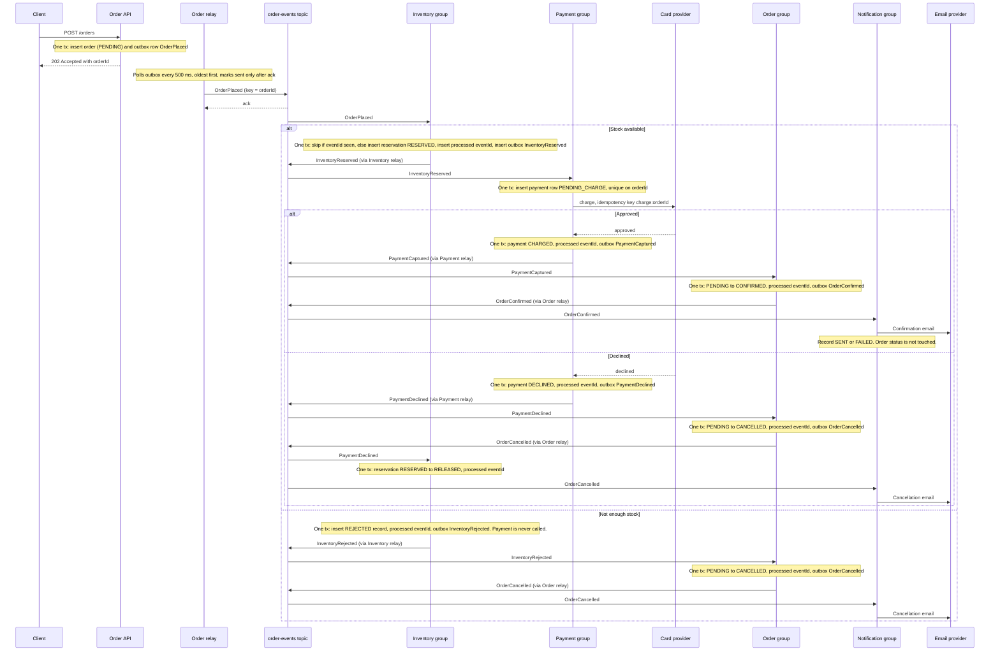
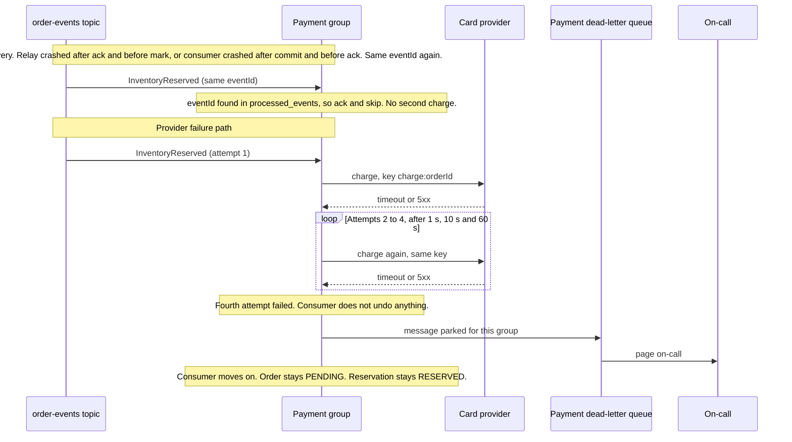

# Order fulfilment: checkout moved to events

Status: design draft for review. No code yet.

Checkout stops calling Inventory, Payment and Notification inside `POST /orders`. Order Service accepts the order and returns 202. Every later step happens through `order-events` and the outbox pattern.

## Event catalogue

Every event has `eventId` (UUID), `orderId`, `type`, and is published to `order-events` with key `orderId`.

| Type | Published by | Meaning |
|---|---|---|
| `OrderPlaced` | Order Service | Order accepted, status PENDING |
| `InventoryReserved` | Inventory | Stock held for the order |
| `InventoryRejected` | Inventory | Not enough stock, nothing held |
| `PaymentCaptured` | Payment | Card charged |
| `PaymentDeclined` | Payment | Card declined by the provider |
| `OrderConfirmed` | Order Service | Status changed to CONFIRMED |
| `OrderCancelled` | Order Service | Status changed to CANCELLED |

## Happy path and both cancellation paths

### Notes on the diagram

- **No charge without a reservation.** Payment consumes only `InventoryReserved`. The `PENDING_CHARGE` row is written only after that event, so the card cannot be charged for stock that was never held.
- **Writes happen in the same transaction as the event.** Each service writes its state change, its `processed_events` row and its outbox row in one transaction. A crash cannot leave a state change without its event, or an event without its state change.
- **Only Order Service changes status.** Inventory, Payment and Notification publish facts. Order Service turns those facts into `CONFIRMED` or `CANCELLED`.
- **The card call sits outside the database transaction.** A crash after the provider approves but before Payment commits is handled by the idempotency key (see below).
- **Email is driven by final status events only.** Notification reacts to `OrderConfirmed` and `OrderCancelled`, which Order Service emits after the status change commits.

## Duplicates and failures

- **Duplicates.** Each consumer checks `processed_events` for the `eventId` in the same transaction as its state write. A repeat is acknowledged and skipped. The business rules are a second guard: one reservation and one payment row per `orderId`, both unique.
- **Retries.** A handler that throws is retried after 1 s, 10 s and 60 s with the same `eventId` and the same idempotency key. A retry runs in place, so later messages for that group wait behind it. This keeps per-order ordering.
- **Card provider.** A repeat call with `charge:orderId` returns the first result and does not charge again. A decline is a normal answer and proceeds to `PaymentDeclined`. A timeout or 5xx is an error and goes to the retry policy.
- **Email.** A send failure is caught inside the Notification handler, recorded as FAILED and acknowledged. It is not rethrown, so there is no retry and no page. Order status never depends on it.
- **Retry exhaustion.** The message goes to that group's DLQ, on-call is paged, and the consumer moves on. No compensation runs.

## Where state is written

| Step | Service | Store | State written |
|---|---|---|---|
| Accept | Order Service | `orders`, `outbox` | Order PENDING, `OrderPlaced` (one tx) |
| Reserve | Inventory | `reservations`, `processed_events`, `outbox` | RESERVED or REJECTED, result event |
| Charge | Payment | `payments`, `processed_events`, `outbox` | PENDING_CHARGE before the call, then CHARGED or DECLINED, result event |
| Decide | Order Service | `orders`, `processed_events`, `outbox` | CONFIRMED or CANCELLED, final event |
| Release | Inventory | `reservations`, `processed_events` | RESERVED to RELEASED |
| Email | Notification | `notifications`, `processed_events` | SENT or FAILED. Order status is never written here. |

## Decisions made

1. **Duplicates.** Inbox table `processed_events` (primary key `eventId`), written in the same transaction as the state change. Business uniqueness on `orderId` backs it up. Rejected alternative: relying on broker exactly-once, which we do not have.
2. **Publishing results.** Inventory, Payment and Order Service each have their own outbox and relay. This is the same mechanism as Order Service, so no service publishes straight after commit, where a crash could lose the event.
3. **No double charge.** Payment stores the key `charge:orderId` on its payment row before calling the provider. Retries and redeliveries reuse the key. The provider returns the first result. Crash after approval but before commit is safe: the redelivered message calls the provider with the same key and records the stored result.
4. **How Order Service learns the outcome.** Order Service has its own consumer group. It consumes `PaymentCaptured`, `PaymentDeclined` and `InventoryRejected`. It moves status only from PENDING, and ignores and logs any other transition.
5. **What triggers email.** `OrderConfirmed` and `OrderCancelled` only. Email is best-effort and recorded, never retried, never paged.
6. **Inventory release.** Triggered by `PaymentDeclined`. It is a no-op when there was no reservation.

## Open holes to review before code

- **Stranded orders.** If Payment exhausts its retries after the provider has charged but before Payment recorded it, the customer is charged, the order stays PENDING and the stock stays held. The brief says nothing is undone, so this needs a DLQ runbook and a reconciliation step against the provider.
- **Stuck PENDING orders.** Nothing times out a PENDING order. The client has no decided way to see the outcome, so polling `GET /orders/{id}` is assumed but not specified.
- **Email duplicates.** A crash between sending the email and recording it can send twice. Safe only if the email provider accepts an idempotency key (use `eventId`). Unconfirmed.
- **Blocking retries.** The 60 s in-place retry stalls its consumer group, which adds lag. Retry topics would avoid the stall but change the ordering story.
- **Relay ordering.** A relay must stop at a failed publish rather than skip the row, or per-order ordering breaks.
