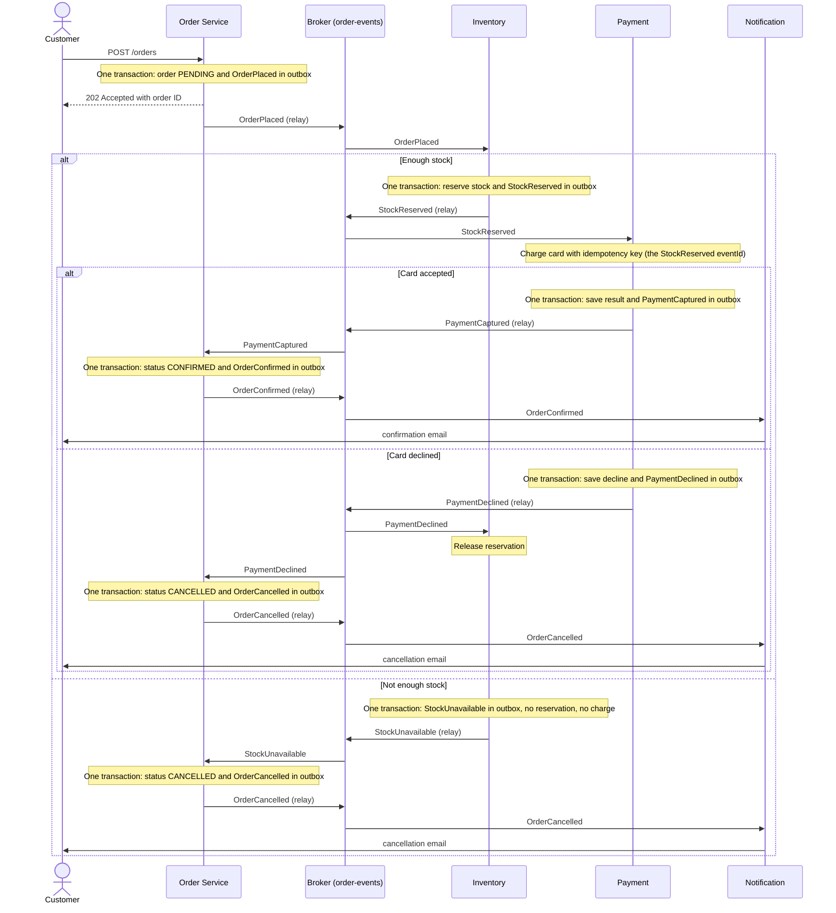

## Order fulfilment (event-driven)

**Why.** Today `POST /orders` calls Inventory, Payment and Notification one after another, inside the customer's HTTP request. If one of them is slow, checkout times out. Customers have also been charged for stock we did not hold.

The new flow fixes both problems. The customer's request finishes as soon as the order is saved. The other services then do their work in the background. Each service reacts to a message, called an **event**, that it reads from a shared channel. No service waits on another service's answer.

**Services and what they own**
- **Order Service** owns orders and their status. It is the only service that changes an order's status.
- **Inventory** reserves stock. It has its own database.
- **Payment** charges the customer's card through the card provider, an outside payment service. It has its own database.
- **Notification** sends the customer emails. It has its own database.
- **Broker topic `order-events`** is the shared channel for all order events. The broker is the messaging system that stores events and hands them to services. Every event is keyed by order ID. So all events for one order stay in order, and each consumer group receives one order's events in the order they were published.

**Terms used below**
- **Event:** a message that records a fact that already happened, such as `OrderPlaced` or `StockReserved`. Every event has a unique `eventId`, the `orderId` it belongs to, and a `type`.
- **Publish:** send an event to the broker.
- **Transaction:** a group of database writes that all succeed or all fail together.
- **Outbox:** a table in a service's own database that holds events waiting to be published. A service never publishes directly. It writes each event into its outbox in the same transaction as the data change the event describes. So the event exists if and only if the change does.
- **Relay:** a separate process that reads the outbox every 500 ms, oldest row first, and publishes each unsent row to the broker. It marks a row as sent only after the broker confirms (acknowledges) it.
- **Consumer group:** the name a service uses when it reads the topic. Each service has its own group name, so each service gets its own copy of every event.
- **Consumer / handler:** the code in a service that reads an event and acts on it.
- **Idempotent:** handling the same message twice has the same result as handling it once.
- **Dead-letter queue (DLQ):** a holding queue, one per consumer group, for messages that still fail after all retries.
- **Idempotency key:** a unique key sent with a card charge. If the card provider gets a repeat call with the same key, it returns the first result and does not charge again.

**Delivery guarantee.** Delivery is at-least-once. Every event arrives at least once, but it may also arrive more than once. The design assumes duplicates will happen and handles them (see Duplicates).

**Who reads which event**

| Service | Reads | Does |
|---|---|---|
| Inventory | `OrderPlaced` | Reserves stock |
| Inventory | `PaymentDeclined` | Releases the reservation |
| Payment | `StockReserved` | Charges the card |
| Order Service | `StockUnavailable` | Cancels the order |
| Order Service | `PaymentCaptured` | Confirms the order |
| Order Service | `PaymentDeclined` | Cancels the order |
| Notification | `OrderConfirmed` | Sends the confirmation email |
| Notification | `OrderCancelled` | Sends the cancellation email |

Order Service learns the outcome of stock and payment by reading the events that Inventory and Payment publish. It never asks them directly.

**The rule behind both cancellations:** the card is never charged unless stock is reserved first.

**Happy path (the order is confirmed)**
1. The customer places an order. Order Service writes the order with status `PENDING` and an `OrderPlaced` row in its outbox, in one transaction. It returns `202 Accepted` with the order ID. The request handler never talks to the broker, so a slow service cannot slow the customer's request.
2. The relay publishes `OrderPlaced`.
3. Inventory reserves stock and writes `StockReserved` to its outbox, in one transaction with the reservation.
4. The relay publishes `StockReserved`. Payment charges the card and writes `PaymentCaptured` to its outbox. It charges only after stock is reserved.
5. Order Service sets the status to `CONFIRMED` and writes `OrderConfirmed` to its outbox.
6. Notification sends the confirmation email.

**Cancellation 1: not enough stock**
Inventory writes `StockUnavailable`. It makes no reservation, so there is no charge. Order Service sets the status to `CANCELLED` and writes `OrderCancelled`. Notification sends the cancellation email.

**Cancellation 2: card declined**
Payment writes `PaymentDeclined`. Inventory releases the reservation it made earlier. Order Service sets the status to `CANCELLED` and writes `OrderCancelled`. Notification sends the cancellation email.

**How to read the diagram.** Each arrow to or from the broker is one event moving through the relay. Notes describe what a service does in one transaction. The `alt` blocks split the flow into the confirmed path and the two cancellation paths.

**Where state is written**

| Service | Writes | When |
|---|---|---|
| Order Service | Order status (`PENDING`, then `CONFIRMED` or `CANCELLED`). Outbox rows `OrderPlaced`, `OrderConfirmed`, `OrderCancelled` | Order placed (`PENDING`). After `PaymentCaptured` (`CONFIRMED`). After `StockUnavailable` or `PaymentDeclined` (`CANCELLED`) |
| Inventory | Stock reservation, and its release. Outbox rows `StockReserved`, `StockUnavailable` | On `OrderPlaced`. On `PaymentDeclined` (release) |
| Payment | Payment result (captured or declined). Outbox rows `PaymentCaptured`, `PaymentDeclined` | On `StockReserved`, after the card provider answers |
| Notification | Record that each email was sent, by `eventId` | After `OrderConfirmed` or `OrderCancelled` |

Every consumer also writes the `eventId` of each event it has handled into its own database, in the same transaction as its own change.

Only Order Service changes order status. The other services only publish facts about what they did.

**Duplicates**
- The same event can arrive twice. The relay sends a row again if it crashes after the broker acknowledges the row but before it marks the row sent. The broker can also redeliver on its own.
- Each consumer keeps a log of the `eventId`s it has handled, in its own database. The log entry and the consumer's change are written in one transaction, so they succeed or fail together. When a repeat arrives, the consumer finds the `eventId` in the log and does nothing.
- Order Service works the same way. A repeated `PaymentCaptured` does not write a second `OrderConfirmed`.
- Payment uses the `eventId` of `StockReserved` as its idempotency key. Suppose the first attempt reached the card provider, but the service crashed before saving the result. The retry sends the same key, so the provider returns the first result and does not charge again. Payment also logs the `eventId`, so it never charges twice for the same reservation.
- Notification logs each sent email by `eventId`, so a redelivered event does not send a second email.

**Failures**
- **Email is best-effort.** If a send fails, the order status does not change. Email is never an input to any order decision.
- **A card decline is a normal answer, not an error.** It leads to Cancellation 2 above.
- **A card provider timeout or 5xx is an error, not a decline.** The handler throws. The consumer then retries the message after 1 s, 10 s and 60 s. Each retry reuses the same idempotency key, so the card is charged at most once. While it retries, the consumer stays on that message and does not skip ahead, so later events for the same group are not handled first.
- **If the fourth attempt also fails** (the first attempt plus three retries), the message goes to that consumer group's DLQ, on-call is paged, and the consumer moves on to the next message. Nothing else is undone. The order keeps whatever status it has, for example `PENDING`. On-call decides what to do with the message and the order.