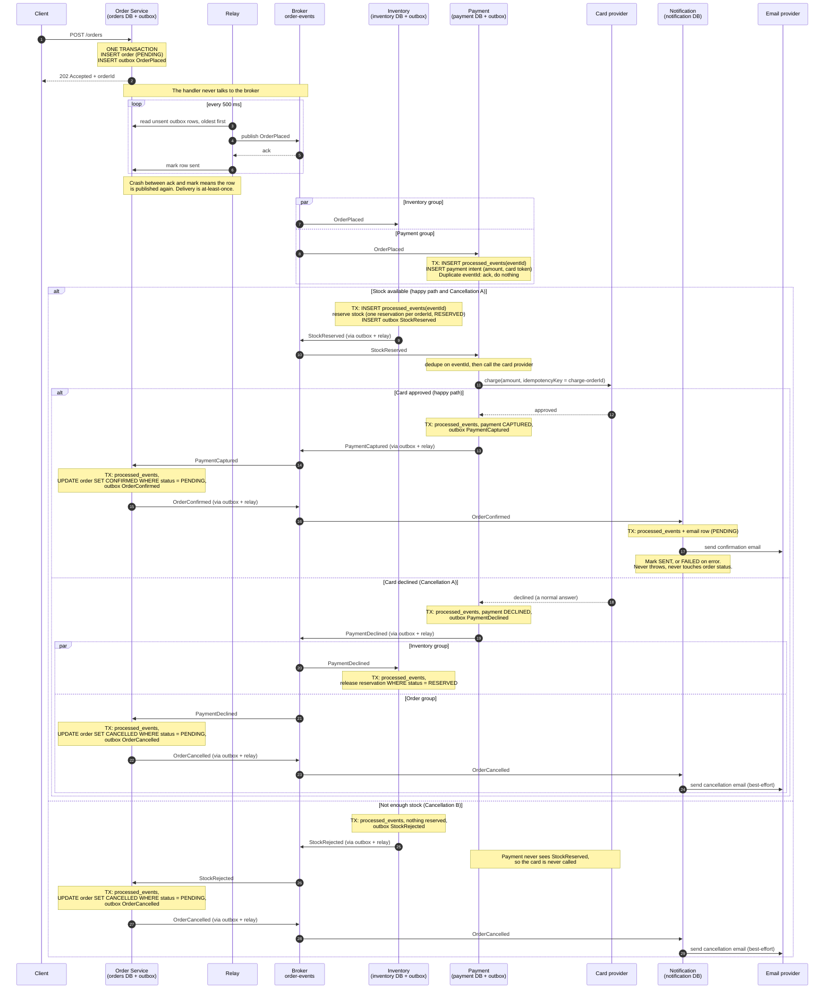
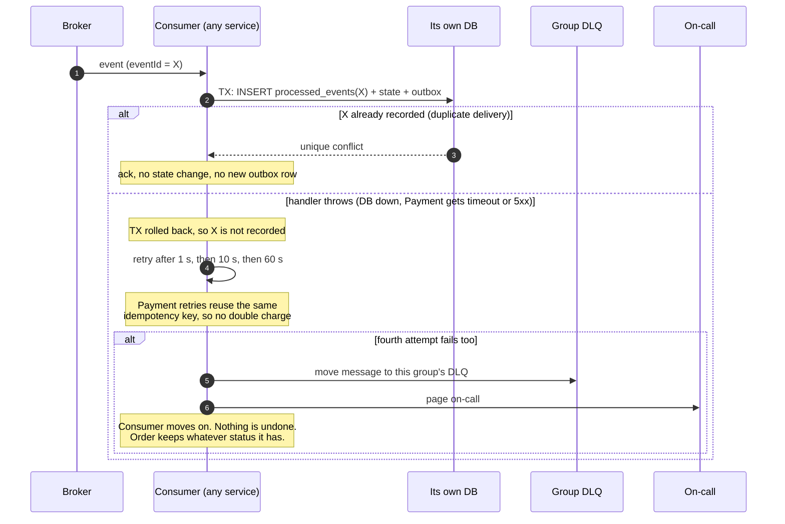

# Order fulfilment: move checkout to events

## Overview

`POST /orders` used to call Inventory, Payment and Notification inside the request. If any of them was slow, checkout timed out. Customers were also charged for stock we did not hold. Now the request only records the order and returns. The other services react to events sent through a message broker.

A service never publishes an event directly. It writes the event to a table in its own database, and a separate process publishes it from there. This is the outbox pattern, defined below.

The flow, in short:

1. The order starts as `PENDING`.
2. Inventory reserves stock.
3. Only after the reservation exists does Payment charge the card.
4. Order Service marks the order `CONFIRMED` or `CANCELLED`. It is the only service that changes order status.
5. Notification emails the customer.

### Terms

- **TX:** a database transaction. Everything written in one TX is saved together or not at all.
- **Outbox:** a table in a service's own database. The service writes an event row to it in the same TX as its state change. A state change and its event therefore cannot be saved separately.
- **Relay:** a process that polls an outbox every 500 ms and publishes unsent rows, oldest first. It marks a row sent only after the broker acknowledges (acks) the publish. If it dies between the ack and the mark, the row is published again on the next poll. Delivery is therefore at-least-once: an event may arrive more than once, but never zero times.
- **Topic, partition, key:** all events go to one broker topic, `order-events`. The topic is split into partitions. Events with the same key always land in the same partition, in the order they were published. Every event is keyed by `orderId`, so one order's events stay in order.
- **Consumer group:** each service reads `order-events` as its own group, so every group gets its own copy of every event. A consumer acks a message once it has handled it, and the group then moves on to the next message.
- **DLQ:** dead-letter queue. Each group has one. It holds messages that failed every retry.
- **Idempotency key:** a value sent to the card provider. A repeat call with the same key returns the first result and does not charge again.
- **Payment intent:** a row in Payment's database holding the amount and card token for an order. Payment needs it to charge the card.

## Decisions

These are the points the brief left open.

| Question | Decision |
|---|---|
| Duplicates | Every consumer has a `processed_events(eventId PRIMARY KEY)` table in its own database. The consumer inserts the `eventId` in the same TX as its state change and outbox row. If the insert conflicts, the event was already handled: the consumer acks the message and does nothing else. Business rules back this up: one reservation per `orderId`, one payment per `orderId`, and Order Service changes status only `WHERE status = 'PENDING'`. |
| How Inventory and Payment publish | The same way as Order Service. Each writes its result event to its own `outbox` table in the TX that records the result, and its own relay publishes it. No handler publishes directly. |
| Chaining | Inventory reacts to `OrderPlaced`. Payment reacts to `StockReserved`, so a charge is only attempted after a reservation exists. Payment also reads `OrderPlaced`, to store the payment intent. Payment sees `OrderPlaced` before `StockReserved` because Inventory publishes `StockReserved` only after consuming `OrderPlaced`, so `OrderPlaced` is already on the broker. Both events have the same key, so they sit on the same partition in that order. |
| Avoiding a second charge | The idempotency key sent to the card provider is derived from `orderId`, for example `charge-<orderId>`. It is the same on every attempt: redelivery, retry, or manual replay from the DLQ. The `processed_events` check is the first guard and the provider key is the last. The key covers a crash after the provider charged but before Payment's TX committed. |
| How Order Service learns the outcome | It consumes `StockRejected`, `PaymentCaptured` and `PaymentDeclined`. |
| What triggers the email | Order Service writes `OrderConfirmed` or `OrderCancelled` to its outbox in the same TX as the status change. Notification consumes only those two events, so an email always follows a status that is already committed. |
| Releasing stock on decline | Inventory consumes `PaymentDeclined` and releases the reservation if its status is `RESERVED`. A repeat is a no-op. |

### Events on `order-events`

All events are keyed by `orderId` and carry a unique `eventId`, the `orderId` and a type.

| Event | Published by | Consumed by |
|---|---|---|
| `OrderPlaced` | Order Service | Inventory, Payment |
| `StockReserved` | Inventory | Payment |
| `StockRejected` | Inventory | Order Service |
| `PaymentCaptured` | Payment | Order Service |
| `PaymentDeclined` | Payment | Order Service, Inventory |
| `OrderConfirmed` | Order Service | Notification |
| `OrderCancelled` | Order Service | Notification |

Each group ignores event types it does not consume: it acks the message and writes nothing.

## Flow: happy path and both cancellation paths

The three outcomes are:

- **Happy path:** stock is reserved and the card is approved.
- **Cancellation A:** stock is reserved but the card is declined.
- **Cancellation B:** there is not enough stock.

How to read the diagram:

- Every service has its own outbox and relay. To stay readable, the diagram draws one relay (R) and shows it in detail only for Order Service.
- Every arrow from a service to the broker goes through that service's outbox and relay, even where it is drawn as a direct arrow.
- "dedupe" means the `processed_events` check.
- `par` blocks show groups that receive the same event independently.

### Where state is written

Each row is one service's database. Every consumer's `processed_events` row is written in the same TX as the rest of its writes.

| Store | Written when handling | Written in the same TX as |
|---|---|---|
| Order Service: `orders`, `outbox` | The `POST /orders` request, then each outcome event (`StockRejected`, `PaymentCaptured`, `PaymentDeclined`) | The `orders` row (or status change) and the outbox row, plus `processed_events` for consumed events |
| Inventory: `reservations`, `stock`, `outbox` | `OrderPlaced`, `PaymentDeclined` | `processed_events` and the result event |
| Payment: `payment_intents`, `payments`, `outbox` | `OrderPlaced`, `StockReserved` | `processed_events` and the result event. The card provider is called before the TX, and the TX records its result. |
| Notification: `processed_events`, `emails` | `OrderConfirmed`, `OrderCancelled` | The dedupe row and the email row. The email is sent after the commit. |

## Duplicates and failures

When a consumer's handler throws, the consumer makes up to four attempts in total: the first, then retries after 1 s, 10 s and 60 s. If the fourth attempt fails too, the message goes to the DLQ.

| Situation | What happens |
|---|---|
| Relay crashes between ack and mark | The event is published again. Every consumer ignores the copy through `processed_events`. |
| Same event delivered twice | The unique conflict on `eventId` turns it into an ack. A second `OrderPlaced` cannot create a second reservation or intent. A second `PaymentDeclined` cannot release twice or cancel twice. |
| Card provider returns a decline | This is a result, not an error. It is recorded and published as `PaymentDeclined`, with no retry. |
| Card provider timeout or 5xx | The handler throws and the retry schedule applies. The provider may have charged anyway. The next attempt carries the same key and gets the first result back. |
| Payment crashes after the charge, before commit | The event is redelivered and the same key returns the original result, which is then recorded. |
| `StockReserved` arrives before the payment intent exists | This should not happen, because both events share a key and so stay in order. If it does, the handler throws and the retry schedule applies. |
| Email send fails | The error is caught, the `emails` row is set to `FAILED`, and the message is acked. There is no retry, no page and no effect on order status. If Notification crashes after sending but before marking, redelivery may send a second email. This is the one accepted duplicate. |
| Cancel and confirm racing | They cannot both win. Order Service updates only `WHERE status = 'PENDING'`, and `CONFIRMED` and `CANCELLED` are final. |

## Gaps the brief does not close

These follow from "nothing else is undone" and are not decided here.

1. **A message in the DLQ leaves the order half-done.**
   - If Payment's `StockReserved` handling dies, the order stays `PENDING` and the stock stays reserved.
   - If Inventory's release on `PaymentDeclined` dies, the order is `CANCELLED` but the stock is still held.
   - If Order Service's outcome handling dies, the order stays `PENDING` even though the card may already have been charged.

   Recovery is a manual replay from the DLQ, which is safe because every step is idempotent. There is no timeout or sweeper for stuck `PENDING` orders. Decide whether one is wanted.
2. **A DLQ'd email event is never retried automatically.** This happens only when Notification's own handling fails, for example its database is down. The customer gets no email unless someone replays the event.
3. **Retries block the partition.** If retries happen inside the consumer, later events on the same partition wait up to 71 s (1 + 10 + 60 s) behind the failing one. Confirm this is acceptable. If not, retries need a separate retry topic, but that breaks the per-order ordering that Payment relies on.
4. **Outbox growth.** Sent outbox rows need a cleanup job, and so does `processed_events`. Keep each at least as long as the broker's maximum redelivery window.
