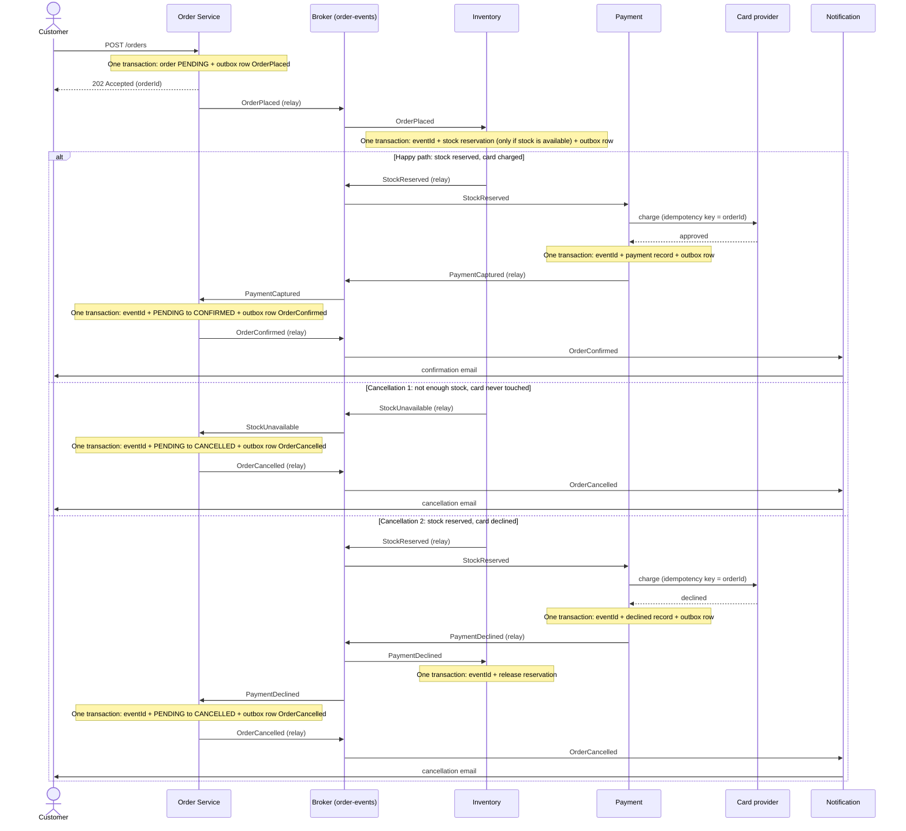

## Order fulfilment (event-driven)

### Overview

`POST /orders` no longer calls other services. Order Service saves the order and returns `202 Accepted`. Everything after that happens through events on one broker topic, `order-events`. Each service reacts to events and publishes result events of its own.

Participants:

- **Order Service** owns order status: `PENDING`, then `CONFIRMED` or `CANCELLED`. Nobody else changes it.
- **Inventory** reserves and releases stock.
- **Payment** charges the card through the **card provider** (an external service).
- **Notification** sends the customer email.
- **Broker** holds the single topic `order-events`. Messages are keyed by order ID, so each consumer group receives one order's events in the order they were published.

Every service has its own database and its own consumer group (a set of consumers that together receive one copy of every message on the topic). A consumer ignores event types it does not care about. Every event carries a unique `eventId`, the `orderId` and a type.

### Rules every service follows

**1. Publishing: outbox plus relay.** A service never publishes to the broker from inside a request or event handler. Instead, in the same database transaction as its state change, it inserts a row into its own `outbox` table. Because both writes commit together, an event exists if and only if its state change does.

A separate relay process polls the `outbox` table every 500 ms and publishes unsent rows, oldest first. It marks a row sent only after the broker acknowledges it. If the relay dies between the acknowledgement and the mark, the row is published again on the next poll. Delivery is therefore at-least-once: an event may arrive more than once, so duplicates are normal. In the diagram, "(relay)" on an arrow means this mechanism.

**2. Receiving: duplicates are skipped.** Each consuming service has a `processed_events` table keyed by `eventId`. In one transaction, the handler inserts the `eventId`, makes its state change and writes its outbox row. If the insert finds the `eventId` already there, the event was handled before, so the handler does nothing and acknowledges the event.

**3. Failures: retry, then dead-letter.** If a handler throws, its transaction rolls back and the consumer retries the message after 1 s, 10 s and 60 s. That makes four attempts in total. If the fourth attempt also fails, the message goes to that group's dead-letter queue (DLQ), on-call is paged, and the consumer moves on to the next message. Nothing already done is undone. The order keeps whatever status it has, which is usually `PENDING`.

### Flow

The diagram does not draw retries or duplicates. Rules 2 and 3 apply to every consuming arrow.

In the declined case, Inventory and Order Service each receive `PaymentDeclined` independently. Releasing stock and cancelling the order do not wait for each other.

### How each decision works

**Where state is written.** Every state change is committed in one transaction with its outbox row, as the diagram notes show. Order status lives only in Order Service, reservations only in Inventory, and payment records only in Payment.

**Order Service learns the outcome by consuming events.** It handles `PaymentCaptured`, `StockUnavailable` and `PaymentDeclined`. It changes status only if the order is still `PENDING`, so a late or repeated event cannot overwrite a final status. The `OrderConfirmed` or `OrderCancelled` event goes into the outbox in the same transaction as the status change.

**The card is never charged without stock.** Payment acts only on `StockReserved`, which Inventory publishes only after the reservation is committed.

**Payment never charges twice.** Payment calls the card provider with the order ID as the idempotency key. A repeat call with the same key returns the first result and does not charge again. This covers the risky case where Payment charges the card and then crashes before committing its transaction. The message is retried, Payment calls the provider again with the same key, receives the original result, and commits it. Each provider response is handled as follows:

- Approved: publish `PaymentCaptured`.
- Declined: this is a normal answer, so publish `PaymentDeclined`.
- Timeout or 5xx: this is an error, so the handler throws. The retry and DLQ rules above apply, and the order stays `PENDING`.

**Email is triggered by `OrderConfirmed` and `OrderCancelled`.** These are Order Service's final events, so Notification never has to infer the outcome. Email is best-effort. If a send fails, Notification logs it and acknowledges the event, with no retry and no effect on order status. The send happens outside the database transaction. If Notification sends an email and crashes before recording the `eventId`, the event is redelivered and the email goes out again. The duplicate check in rule 2 cannot prevent this, so a customer may occasionally receive the same email twice.