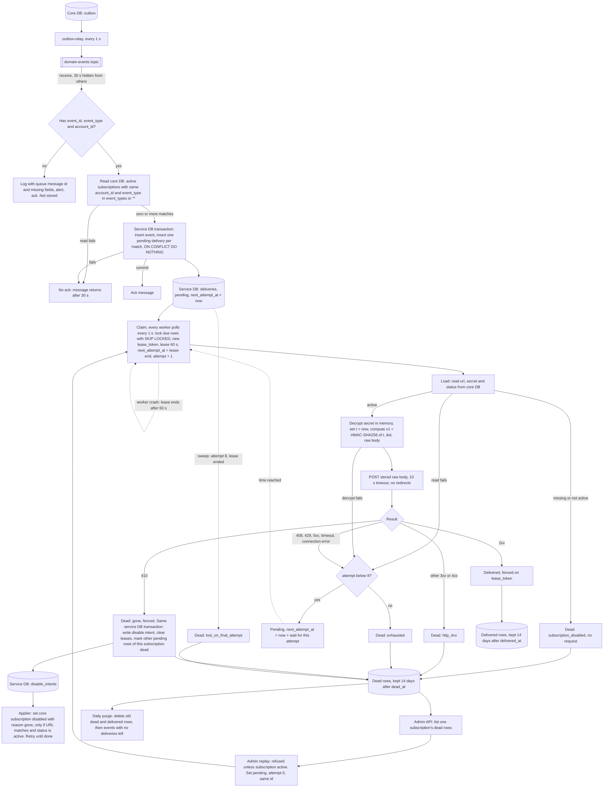

# Outbound webhooks: delivery service

This service sends signed HTTP requests to customer endpoints when business events happen. Today the core app writes each event to an `outbox` table in the same transaction as the change, and `outbox-relay` publishes each new row to the `domain-events` queue. This service reads those events, writes one delivery row per matching subscription into its own Postgres database, and sends each row as an HTTP POST. A failed send is retried on a fixed backoff, then dead-lettered. Postgres holds the schedule because the queue can delay a message by at most 15 minutes and the backoff reaches 6 hours. Dead letters are rows, not the queue's dead-letter topic, because support must list and replay them by id.

## Terms

- **Outbox**: a table in the core database. The core app writes one row in the same transaction as each business change. Existing and not changed here.
- **outbox-relay**: an existing service. Every 1 s it publishes up to 200 unpublished outbox rows to `domain-events`, one message per row, then marks them published. If it crashes between those two steps, it publishes the row again.
- **domain-events**: the queue topic. Each message is JSON with `event_id`, `event_type`, `account_id`, `occurred_at` and `payload`. A message is at most 256 KB. Delivery is at least once, with no ordering.
- **Core DB**: the core app's Postgres. This service reads one table in it and may update two columns.
- **Service DB**: this service's own Postgres. It holds events, deliveries and disable intents.
- **Subscription**: a customer's endpoint, a row in the core table `webhook_subscriptions`. It holds the URL (always https), the event types (exact names, or `*` for all), the encrypted secret, and `status` (`active` or `disabled`). The dashboard API sets `status` when a customer disables an endpoint. The applier sets it when a receiver returns 410.
- **Delivery**: one row meaning "send this event to this subscription". Each (event, subscription) pair has exactly one. Its `id` is sent as `X-Webhook-Id`.
- **Attempt**: one try to send a delivery. It is counted when the row is claimed, before the send. There are at most 8.
- **Statuses**: a delivery is `pending` (waiting to be sent), `delivered`, or `dead`. Dead means it will not be sent again unless support replays it. A dead delivery is a dead letter.
- **Backoff**: the wait before the next attempt after a failed one.
- **Worker**: one running copy of this service. Several run at once. Each runs the intake, delivery, applier and sweep loops.
- **Visibility timeout**: after a worker receives a queue message, other workers cannot see it for this long. The default is 30 s; the maximum is 12 h.
- **Ack**: a worker's confirmation to the queue that it has handled a message. If no ack arrives in time, the message becomes visible again.
- **Lease**: a 60 s claim on a delivery row, stored as `lease_token` and `lease_until`. The worker keeps the token in memory until its outcome write.
- **Fencing**: an outcome write applies only if `lease_token` still matches the row. A worker whose lease has ended cannot overwrite a newer claim.
- **SKIP LOCKED**: a Postgres option that lets a SELECT skip rows another worker has locked, so two workers never claim the same row.
- **Sweep**: a step that marks rows which used their last attempt and were never answered. It sends nothing.
- **Applier**: the loop that applies disable intents to the core DB.
- **Disable intent**: a note in the service DB that a subscription's URL should be disabled in the core DB.
- **Replay**: a support action that sets a dead delivery back to `pending` with a fresh set of 8 attempts.
- **Idempotent**: safe to repeat. Running it twice has the same effect as running it once.
- **HMAC-SHA256**: a keyed hash. The sender and the receiver share the secret. The receiver recomputes the hash to check that a request is genuine and unchanged.
- **libs/secrets.decrypt**: a shared core library function that turns `secret_ciphertext` into the plaintext secret. This design does not choose its key.

## Flow

Notes on the diagram: the solid arrows are the normal path. Dotted arrows are the paths that happen later, on a timer or after a crash. The queue carries only events. Postgres holds every delivery from the moment it is stored.

## Where state lives

- **Core DB**: this service reads `webhook_subscriptions`. Its database role may update only `status` and `disabled_reason`. Nothing is added to the core database.
- **Service DB**, which is its own Postgres:
  - `events`: `event_id` (primary key) and the raw message bytes, exactly as received. Every attempt sends and signs the same bytes.
  - `deliveries`: `id` (the `X-Webhook-Id`), `event_id`, `subscription_id`, `event_type`, `status` (`pending`, `delivered` or `dead`), `attempt`, `next_attempt_at`, `lease_token`, `lease_until`, `last_status`, `last_error`, `dead_reason`, `dead_at`, `delivered_at`. It is unique on (`event_id`, `subscription_id`). It has a partial index on `next_attempt_at` where `status = 'pending'`, and an index on (`subscription_id`, `status`) for support lists.
  - `disable_intents`: `subscription_id`, the URL that failed, and `applied_at`.
- **Queue**: transport only. A message is acked only after its service DB commit.
- **Secrets**: the ciphertext is read from the core DB on each attempt and decrypted in memory. No plaintext is stored.
- **Why Postgres schedules retries**: the queue delay is capped at 15 minutes, and the backoff goes up to 6 hours. Replays also select a row by id, which the queue cannot do.

## Steps

Intake runs for each message on `domain-events`, on any worker.

1. **Receive.** Trigger: a message arrives on `domain-events`. The worker takes it, and the queue hides it from other workers for 30 s. If the body lacks `event_id`, `event_type` or `account_id`, the worker writes an error log line with the queue message id and the missing fields, raises an alert, and acks. The body is not stored and no delivery is made.
2. **Match.** The worker reads the core DB, read only, for subscriptions with the same `account_id`, `status` `active`, and `event_types` that contains the `event_type` or `*`. It reads `id`, `account_id`, `status` and `event_types`. Zero matches is valid. If the read fails, the worker does not ack, and the message returns after 30 s.
3. **Store.** One service DB transaction inserts the raw message into `events`, then one `pending` delivery per match with `next_attempt_at = now`. Both inserts use ON CONFLICT DO NOTHING, so a repeated message creates nothing new. If the transaction fails, the worker does not ack.
4. **Ack.** The worker acks only after the commit succeeds.

Delivery runs on every worker, which polls every 1 s.

5. **Claim.** Trigger: the poll. A row is due when it is `pending`, its `next_attempt_at` has passed, and its `attempt` is below 8. In one commit, the worker locks due rows with SKIP LOCKED. For each one it writes a new random `lease_token`, sets `lease_until = now + 60 s` and `next_attempt_at = lease_until`, and adds 1 to `attempt`. The attempt is counted here, before the send. Because `next_attempt_at` moves to the end of the lease, no other worker sees the row as due until the lease ends. The worker keeps the token in memory until its outcome write. A new event is usually claimed 1 to 3 s after it is published: relay poll (up to 1 s), queue, consume, then claim poll (up to 1 s).
6. **Load.** The worker reads `url`, `secret_ciphertext` and `status` from the core DB, read only. It does this on every attempt, with no cache, because a cache would delay disable detection. If the read fails, it sends nothing, sets `last_error = 'core_db_read_failed'`, and takes the retryable path in the outcome step. If the subscription is missing or not `active`, the row is dead with `subscription_disabled`, and nothing is sent.
7. **Sign and send.** The worker decrypts the secret in memory with `libs/secrets.decrypt`. If decryption fails, it sends nothing, sets `last_error = 'decrypt_failed'`, and takes the retryable path. Otherwise it sets `t` to the current unix seconds, computes `v1` as HMAC-SHA256 over `t`, a dot, and the stored raw body, and POSTs the stored raw body to the URL it just read. The request has a 10 s timeout and no redirects. `X-Webhook-Id` is the delivery id. `X-Webhook-Signature` is `t=<t>,v1=<hex>`. Every attempt signs again at send time, because receivers reject a `t` older than 5 minutes.
8. **Record the outcome.** Every write is fenced: it applies only to a row whose `lease_token` equals the worker's token. If no row matches, the worker drops its result and does nothing else, because a newer claim owns the row. Every write that applies also clears `lease_token` and `lease_until`.
   - **2xx**: `delivered`, with `delivered_at` set.
   - **410**: `dead` with `gone`. In the same service DB transaction, write a disable intent, mark this subscription's other `pending` rows `dead` with `subscription_disabled`, and clear their leases. Clearing their leases makes any in-flight write on those rows match nothing, so it is dropped.
   - **Any other 3xx or 4xx**: `dead` with `http_4xx`. Redirects are not followed, because the signed target must not change.
   - **408, 429, any 5xx, a timeout, a connection error, or a failed Load or decrypt**: if `attempt` is below 8, set `pending` with `next_attempt_at = now + wait`. Otherwise set `dead` with `exhausted`. The wait uses the attempt just made: after attempt 1 wait 30 s, after 2 wait 2 min, after 3 wait 10 min, after 4 wait 30 min, after 5 wait 1 h, after 6 wait 3 h, after 7 wait 6 h. After the 8th failure the row is dead.
   - Record `last_status` for an HTTP result and `last_error` otherwise.
9. **Applier.** Trigger: a loop that every worker runs. It reads `disable_intents` where `applied_at` is null, and runs `UPDATE webhook_subscriptions SET status = 'disabled', disabled_reason = 'gone' WHERE id = <subscription> AND url = <failed url> AND status = 'active'`. It then sets `applied_at`. If the update fails, `applied_at` stays null and the next pass tries again. An update that changes zero rows still counts as applied, because the subscription is already disabled or the customer has changed the URL, so it is not disabled again. Concurrent passes are harmless, because the update is idempotent.
10. **Sweep.** Trigger: every worker, on each delivery pass. It finds `pending` rows with `attempt` = 8 and `next_attempt_at` in the past, which means their final lease has ended. It marks them `dead` with `lost_on_final_attempt` and sends nothing. The claim never takes them, because claim needs `attempt` below 8.
11. **Support and replay.** Trigger: a call to the Admin API. Support lists one subscription's dead rows with `attempt`, `last_status`, `last_error`, `dead_reason` and `dead_at`. A replay is refused unless the subscription is `active`. Otherwise it sets `pending`, `attempt = 0`, `next_attempt_at = now`, clears the dead fields, and keeps the same id. The next claim makes it attempt 1, so the row gets the full 8 attempts again.
12. **Purge.** Trigger: daily. It deletes dead rows 14 days after `dead_at`, and delivered rows 14 days after `delivered_at`. Then it deletes events that have no deliveries left. The brief sets no retention for delivered rows, so keeping them 14 days is a choice.

## Rules that always hold

- Each (event, subscription) pair has exactly one delivery, and a duplicate message never adds one.
- Delivery is at least once. Events have no ordering.
- A delivery is stored before its message is acked, so a crashed worker cannot lose it. A lease that expires makes the row due again.
- `X-Webhook-Id` stays the same on every attempt and every replay, so receivers can dedupe.
- The service changes only `status` and `disabled_reason` in the core DB.

## What happens when things fail

| Case | What happens |
|---|---|
| Bad message (missing fields) | Logged and alerted, then acked. Not stored. |
| Duplicate `domain-events` message | Inserts create nothing new. The message is acked. |
| Consumer crashes before ack | The message returns after 30 s. The idempotent inserts repeat harmlessly. |
| Intake takes longer than 30 s | Another worker may receive the message. Both run the same inserts, so each pair still has one row. Intake must finish well inside 30 s. |
| Core or service DB down during intake | No ack. The message is redelivered. |
| Worker crashes during a send | The lease ends 60 s after the claim. The lease must exceed the 10 s timeout plus a margin. The row is due again at that point with no extra wait, and the attempt was already counted. The receiver may have seen the first request, so it can get a duplicate with the same `X-Webhook-Id`. |
| Stale worker | Its outcome write matches no row and is dropped. Its request still reached the receiver and counts there. The same `X-Webhook-Id` lets the receiver dedupe. The newer claim decides the row's state. |
| Outcome write fails after a 2xx (DB down) | The row stays `pending` with its lease unchanged. The lease ends, the row is claimed again, and the request is sent again with the same `X-Webhook-Id`. The worker does not retry the write itself; lease expiry is the recovery. If this was attempt 8, the sweep marks the row `lost_on_final_attempt` although the receiver got it. The row stays visible and replayable. |
| Slow outcome write on attempt 8 (over 60 s) | The sweep may mark the row dead first. The late write is dropped. The receiver still got the request, and replay can send it again with the same id. |
| Crash on the final attempt | The sweep marks the row `dead` with `lost_on_final_attempt`. It stays visible and replayable. |
| Receiver returns 410 | The subscription is disabled through the applier. Waiting rows are dead-lettered in the same transaction, not left to wait out their backoff. Requests already in flight are dropped on their outcome write. |
| Customer disables in the dashboard | Each attempt re-reads the status. Sends stop at the next attempt, with `subscription_disabled`. Rows that are waiting stay `pending` until they come due, then die with no request. |
| Core DB read fails at Load | No request. Retryable with `core_db_read_failed`, on the wait for that attempt. |
| Decrypt fails | No request. Retryable with `decrypt_failed`, on the wait for that attempt. |
| Applier's core DB update fails | `applied_at` stays null. Retried on each pass until it succeeds. |
| Replay of a subscription that is not active | Refused. |

## Decisions

- **3xx responses** are not followed, because the signed target must not change. They are dead-lettered as `http_4xx`. The brief does not cover 3xx, so this is a choice.
- **Matching happens at intake**, not at send. Per-attempt reads of the subscription add one core-DB query per send. A cache would delay disable detection, so no cache is used.
- **Delivered rows** are kept on the same 14-day schedule as dead rows. The brief sets no retention for them.
- **Ordering**: none. Deliveries are independent. A per-subscription concurrency cap can be added later to protect slow receivers.

## Open questions

- Matching happens at intake, so a subscription created after publication but before consumption receives the event. A `created_at <= occurred_at` filter would close this gap, but it changes the brief's matching rule, so it is left open.
- A failed core DB read at Load uses up an attempt, so a long core-DB outage can exhaust all 8 attempts with no request sent. Should that attempt be refunded?
- A crashed worker's row waits only for the 60 s lease, not the backoff schedule, because a crash is not a recorded failure. Is that acceptable?
- Whether the queue accepts an ack that arrives after the visibility timeout. Correctness does not depend on it.
- How many worker instances run. How the Admin API is authenticated, and who may call it.
- How a customer first receives the secret. The brief does not say.
- Which key `libs/secrets.decrypt` uses.
- Which alerting system receives the bad-message alert.
- Events are unordered. A per-subscription concurrency cap can be added later to protect slow receivers.