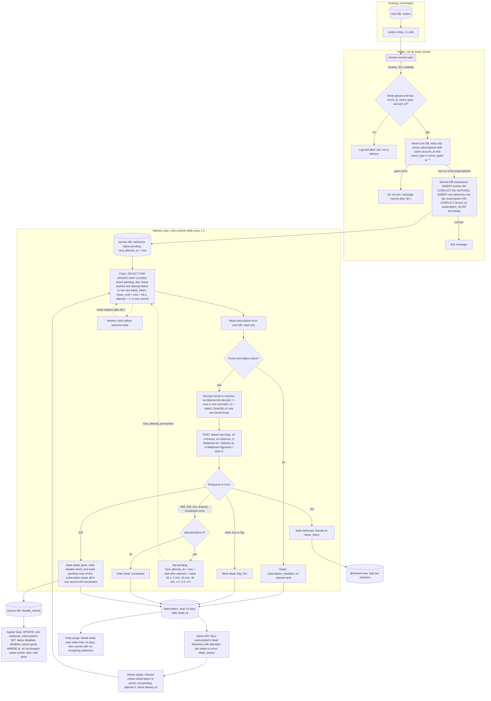

# Outbound webhooks: delivery service

The service has two loops. An intake loop turns each `domain-events` message into delivery rows in its own Postgres database and then acks the message. A delivery loop, run by every worker, claims due rows from Postgres, sends them, and records the outcome. Postgres is the scheduler and the source of truth. The queue only carries events.

## Where state lives

- **Core DB.** The service's role has `SELECT` on `webhook_subscriptions` and a column-level `UPDATE` on `status` and `disabled_reason` only. Nothing is added to the core database.
- **Service DB** (its own Postgres):
  - `events`: `event_id` primary key and the raw message bytes, stored exactly as received so every attempt sends and signs the same bytes.
  - `deliveries`: `id` (the `X-Webhook-Id`), `event_id`, `subscription_id`, `event_type`, `status` (`pending`, `delivered`, `dead`), `attempt`, `next_attempt_at`, `lease_token`, `lease_until`, `last_status`, `last_error`, `dead_reason`, `dead_at`, `delivered_at`. Unique on `(event_id, subscription_id)`. Partial index on `next_attempt_at` where `status = 'pending'`. Index on `(subscription_id, status)` for support lists.
  - `disable_intents`: `subscription_id`, the URL that failed, `applied_at`.
- **Queue.** Transport only. A message is acked only after its service DB commit.
- **Secrets.** Ciphertext is read from the core DB at each attempt and decrypted in memory. No plaintext is stored.
- **Why Postgres schedules retries.** Queue delay is capped at 15 minutes and backoff goes up to 6 hours. Replays also need selection by id, which the queue cannot do.

## Failure handling

- **Duplicate messages.** Conflicting inserts create nothing new, and the message is acked.
- **Consumer crash before ack.** The message returns after 30 s and the idempotent insert repeats harmlessly.
- **Core or service DB down during intake.** No ack, so the message is redelivered.
- **Worker crash during a send.** The lease expires after 60 s. This must exceed the 10 s timeout plus margin. The attempt was already counted at claim, so the row is claimed again without waiting for a backoff. The receiver may have seen the first request, so it can get a duplicate with the same `X-Webhook-Id`.
- **Stale worker.** Outcome writes match on `lease_token`, so a worker that lost its lease cannot overwrite a newer claim.
- **Crash on attempt 8.** Normal claims require `attempt` below 8. A row that is past its final attempt with an expired lease is marked dead with `dead_reason = 'lost_on_final_attempt'`. It stays visible and replayable.
- **Disable intent.** It is written in the same service transaction as the 410 dead-letter. The applier runs `UPDATE ... WHERE status = 'active' AND url = <failed url>`, so it is idempotent. It does not re-disable an endpoint the customer already fixed and re-enabled.
- **Disabled subscriptions.** Waiting deliveries are dead-lettered in the 410 transaction and are not left to wait out their 6-hour backoff. Each attempt also re-reads the status, so a dashboard disable stops sends at the next attempt, with `dead_reason = 'subscription_disabled'`. Replay is refused while the subscription is not active.
- **Timing of attempt 1.** Relay poll up to 1 s, then queue, consume, and claim poll up to 1 s. Typically 1 to 3 s.

## Decisions and open points

- Waits are indexed by the attempt just made: after attempt 1 fails the wait is 30 s, and after attempt 7 it is 6 h.
- 3xx responses are not followed (the signed target must not change) and are dead-lettered as `http_4xx`. The brief does not cover 3xx, so this is a choice.
- Matching happens at intake. A subscription created after publication but before consumption receives the event. A redelivered old message can therefore match a subscription created since then. A `created_at <= occurred_at` filter would close this gap but deviates from the brief's matching rule, so it is left as an open question.
- Per-attempt reads of the subscription add one core-DB query per send. Caching would delay disable detection, so no cache is used.
- Delivered rows are kept on the same 14-day schedule as dead rows. The brief does not set a retention for them.
- Ordering: none. Deliveries are independent. A per-subscription concurrency cap can be added to protect slow receivers.