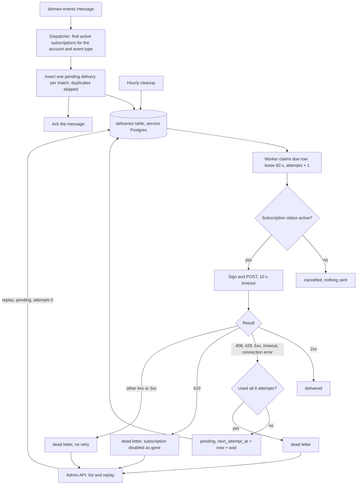

# Webhook delivery service

Today the core app stores each customer's webhook endpoint in `webhook_subscriptions`, and the outbox relay publishes every business event to the `domain-events` topic. This service sits between the two. It turns each event into signed HTTP POSTs to the matching endpoints, retries failures on a fixed schedule, and keeps the deliveries that still fail as dead letters that support can list and replay.

A Dispatcher reads each event and writes one `deliveries` row for each matching subscription. Workers poll those rows, sign and send them, and record the result. A row ends as `delivered`, `dead` or `cancelled`. The Postgres table is the work queue, not the message queue, because the message queue cannot hold a delivery for 6 hours (its maximum delay is 15 minutes) and cannot be queried for dead letters.

## Terms

- **Event**: one message on `domain-events`. It has `event_id`, `event_type`, `account_id` and a JSON `payload`.
- **Subscription**: one customer endpoint in `webhook_subscriptions`. It has a URL (always https), a list of event types, a secret and a `status`. The core app owns it. This service reads it and changes only `status` and `disabled_reason`.
- **Delivery**: one row in this service's `deliveries` table, for one event and one subscription. Its id is sent as `X-Webhook-Id`.
- **Attempt**: one POST to the subscription URL.
- **Delivery states**: `pending` means waiting to be sent or retried. `delivered` means a 2xx came back. `dead` means it has stopped retrying. `cancelled` means its subscription was disabled before it was sent.
- **Dead letter**: a delivery in state `dead`. It is kept for 14 days.
- **Replay**: putting a dead delivery back to `pending` so it starts a new set of attempts.
- **Lease**: a short claim on a row. A worker that takes a row sets `lease_until`, and other workers skip the row until that time passes.
- **Ack**: the queue's confirmation that a message is handled. An unacked message is delivered again after its visibility timeout (default 30 s).
- **Dispatcher**: the process that receives `domain-events` messages and creates deliveries.
- **Worker**: a process that claims due deliveries and sends them. Several run at once.
- **Retryable failure**: a result that may succeed later. **Permanent failure**: a result that will not succeed on retry.
- **HMAC-SHA256**: a keyed fingerprint. The worker computes it over text with the subscription's secret, and the receiver computes it again to check the sender.
- **`FOR UPDATE SKIP LOCKED`**: a Postgres query clause that lets each worker take rows that no other worker has locked, without waiting.

## Flow

Where state lives:

- The `deliveries` table, in this service's own Postgres database, holds all delivery state. Each row keeps a copy of the event body, so a worker sends without reading the queue or the core database.
- The core database is read for `webhook_subscriptions`. This service writes only `status` and `disabled_reason` there, and adds no tables to it.
- The message queue holds an event only until the Dispatcher acks it.

## Steps

1. **Dispatcher receives an event.**
   - Trigger: a message arrives on `domain-events`.
   - What it does: it finds the active subscriptions with the event's `account_id` whose `event_types` contains the event type or `'*'`. Only subscriptions active at this moment match. It inserts one `pending` delivery per match, with `next_attempt_at = now` and a copy of the event body. The unique key on (`event_id`, `subscription_id`) means each pair gets exactly one delivery, so a duplicate message inserts nothing. Then it acks the message.
   - Data kept in: the `deliveries` table.
   - If it fails: if it crashes before the ack, the queue delivers the message again and the inserts do nothing new. If Postgres is unavailable, it does not ack, so the message comes back, and workers retry their poll.

2. **A worker claims due deliveries.**
   - Trigger: each worker polls about once per second.
   - What it does: it selects up to a batch of `pending` rows whose `next_attempt_at` has passed and whose lease is empty or expired. `FOR UPDATE SKIP LOCKED` means two workers never take the same row. It sets `lease_until = now + 60 s` and adds 1 to `attempts`. Because the poll runs about every second, attempt 1 goes out within a few seconds of the event.
   - Data kept in: the `deliveries` table.
   - If it fails: if the worker dies, the lease expires after 60 s and another worker claims the row. The attempt was already counted, so a row that keeps crashing still stops at 8 attempts.

3. **The worker checks the subscription and sends.**
   - What it does: it reads the subscription. If its `status` is not `active`, the row becomes `cancelled` and nothing is sent. Otherwise it decrypts the secret with `libs/secrets.decrypt()`, sets `t` to the current Unix time in seconds, and computes HMAC-SHA256 over `<t>.<raw body>` with that secret. It then POSTs the event JSON to the subscription URL with a 10 s timeout.
   - Headers: `X-Webhook-Id` is the delivery id. It stays the same on every attempt and every replay, so receivers can dedupe. `X-Webhook-Signature` is `t=<t>,v1=<hex>`.
   - Sign on every attempt. Receivers reject a `t` older than 5 minutes, so a signature made at enqueue time would fail on a late attempt.
   - Data kept in: `webhook_subscriptions` is read. The `deliveries` row is not changed in this step.
   - If it fails: if the worker dies during the POST, the lease expires after 60 s. Another worker POSTs again with the same `X-Webhook-Id`, so a receiver may get the event twice.

4. **The worker records the result.**
   - What it does: it stores the status code or error text in `last_status_code` or `last_error`, then clears the lease. Then it acts on the result:
     - **2xx**: state becomes `delivered`.
     - **408, 429, any 5xx, a timeout or a connection error**: retryable. If the delivery has used fewer than 8 attempts, it stays `pending` with `next_attempt_at` set to the wait below. If it has used all 8, it becomes `dead`.
     - **410**: state becomes `dead` now. The worker also sets the subscription to `disabled`, with `disabled_reason = 'gone'`.
     - **Any other 4xx, or a 3xx redirect**: state becomes `dead` now, with no retry. Redirects are not followed. A redirect is not a success, and following it would send the signed body to a host the customer did not register.
   - The waits: after attempt 1 fails, wait 30 s before attempt 2. After attempt 2, wait 2 min. After attempt 3, 10 min. After attempt 4, 30 min. After attempt 5, 1 h. After attempt 6, 3 h. After attempt 7, 6 h. Then attempt 8.
   - Data kept in: the `deliveries` table. For a 410, also the subscription's `status` and `disabled_reason`.
   - If it fails: if the worker dies before it records the result, step 2 applies: the lease expires and another worker claims the row.

5. **Dead letters and replay.**
   - Trigger: support lists a subscription's dead deliveries, or an admin replays one.
   - What it does: a dead delivery stays in `deliveries` with `dead_at` set. Support can list a subscription's dead deliveries with each one's last status code or error. The admin API replays one by setting it to `pending`, with `attempts = 0` and `next_attempt_at = now`. The delivery id stays the same, so the replay starts a fresh cycle of 8 attempts and receivers can still dedupe on it.
   - A replay of a delivery whose subscription is disabled is refused.
   - Data kept in: the `deliveries` table.

6. **Cleanup.**
   - Trigger: once an hour.
   - What it does: it deletes `dead` deliveries whose `dead_at` is more than 14 days old. It deletes nothing else.
   - If it fails: the rows stay, and the next hourly run deletes them.

## Disabled subscriptions

A subscription can be disabled by a 410 (step 4) or by the core app. Its `pending` deliveries are not sent. Each one becomes `cancelled` when a worker next claims it, with no POST. A send already in flight finishes. New events do not match the subscription, because the Dispatcher matches only active subscriptions.

## Rules this design keeps

- Delivery is at-least-once. A crash can cause a repeat send, but never a lost delivery.
- There is no ordering between events.
- Several worker instances run at once. They share work through the table and leases.
- The service has its own Postgres database. It adds no tables to the core database, reads `webhook_subscriptions`, and changes only `status` and `disabled_reason`.

## Open questions

- Are `delivered` and `cancelled` rows ever deleted? The requirements say only that dead deliveries are kept for 14 days.