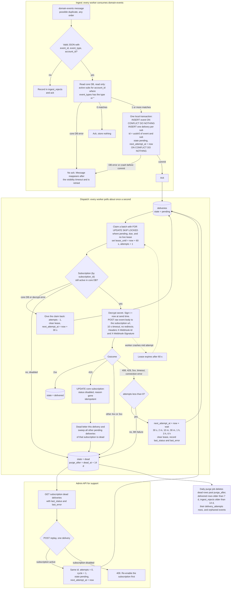

## Outbound webhooks: delivery service design

This service turns business events into signed HTTP calls to customers' webhook endpoints. Today the outbox relay already publishes every event to the `domain-events` topic of a managed queue, and customers already register endpoints in the core database. Each service instance (a worker) reads events from the topic and stores one delivery row per matching subscription in the service's own Postgres. The same workers then poll that table, send due deliveries, retry failures on a schedule, and mark the ones that cannot succeed as dead. Postgres holds the schedule, the dead letters and the replay state because the queue cannot delay a message by more than 15 minutes (the 3 h and 6 h waits need more) and its dead-letter topic cannot be queried or replayed one message at a time, and support needs both.

### Terms

- **Event**: one JSON message `{ event_id, event_type, account_id, occurred_at, payload }`. The outbox relay publishes it to `domain-events`, once or more (duplicates are possible). The same JSON is what we send to customers.
- **Queue**: the managed message service that carries `domain-events`. Delivery is at-least-once with no ordering. A consumer must ack each message. An un-acked message becomes visible again after the visibility timeout (default 30 s, which we keep).
- **Subscription**: a row in the core database table `webhook_subscriptions`, written by the dashboard API. It holds the customer's `url` (always https), `event_types` and an encrypted secret.
- **Delivery**: one event going to one subscription. Its `id` is also the `X-Webhook-Id` header, so receivers can dedupe.
- **Worker**: one service instance. All workers run the same two loops: ingest (read the queue) and dispatch (poll for due deliveries). There is no leader.
- **Lease**: `lease_until` and `locked_by` on a delivery row. A worker that claims a row owns it until the lease runs out. The lease is 60 s, longer than the 10 s timeout plus decryption and database time.
- **Cycle**: one run of up to 8 attempts. A replay starts a new cycle on the same delivery.
- **Dead**: a delivery that will not be retried automatically. Support can list it and replay it.
- **Core database**: the existing app database. It is not ours: we add nothing to it.

### Where state lives

Service database (our own Postgres), four tables.

| Table | Contents |
|---|---|
| `events` | `event_id` (PK) and `body` (the exact JSON text received, stored once and sent byte-for-byte), plus `account_id`, `event_type` and `received_at`. |
| `deliveries` | `id` (PK) is the `X-Webhook-Id`. It is a UUIDv5 of `event_id` and `subscription_id`, so it is stable. `event_id` and `subscription_id` are columns; `subscription_id` is how a worker finds the url and secret at send time. `UNIQUE (event_id, subscription_id)` gives exactly one delivery per pair. The other columns are `state` (`pending`, `delivered` or `dead`), `attempts`, `cycle`, `next_attempt_at`, `lease_until`, `locked_by`, `last_status`, `last_error`, `dead_at` and `purge_after`. Index on `(next_attempt_at) WHERE state='pending'`. Index on `(subscription_id, state)`. |
| `delivery_attempts` | One row per attempt: `delivery_id`, `cycle`, `attempt_no`, `started_at`, `duration_ms`, `status_code` and `error`. This is the audit trail. |
| `ingest_rejects` | Messages that could not be parsed: the raw body, the reason and `received_at`. Engineers query it. |

Core database, read-only apart from one write:

- The service reads `webhook_subscriptions` through a dedicated role. It uses `id`, `account_id`, `url`, `event_types`, `secret_ciphertext` and `status`.
- `event_types` is a list of exact event names, or `'*'` meaning every event.
- `status` is `'active'` or `'disabled'`, and nothing else.
- The role has `UPDATE` granted only on `status` and `disabled_reason`. The service never reads or writes anything else there.
- The secret is decrypted with `libs/secrets.decrypt()` at send time. It is never copied into the service database.

### Flow

### Steps in detail

The diagram shows the order. These notes add what it cannot show.

**1. Ingest (trigger: a message arrives).**
- The order is: read the core DB, commit the local transaction, then ack. The two databases cannot share a transaction, so the core read comes first.
- The queue hides an un-acked message from other workers until the visibility timeout ends, so normally one worker handles it. If a message is handled twice anyway (a relay duplicate or a crash before the ack), both inserts use `ON CONFLICT DO NOTHING` and the second run adds nothing.
- A subscription created after the event was read gets nothing for that event.
- A permanently unparseable message goes to `ingest_rejects` and is acked, so it does not loop into the queue's dead-letter topic, which support cannot inspect.
- On a core DB outage the message stays un-acked and reappears every 30 s. The service has no limit of its own. Set the topic's "failed receives" threshold high so a long outage does not push good messages into the dead-letter topic, and alert if that topic's depth is ever above 0.
- Data kept: `events` and `deliveries` rows in the service database.

**2. Claim (trigger: the poll, about once a second).**
- Claiming is one `UPDATE ... WHERE id IN (SELECT ... FOR UPDATE SKIP LOCKED LIMIT n) RETURNING`. Workers never block each other or take the same row. A row that is `pending` with a future `next_attempt_at` is skipped.
- Batch size is bounded and each worker sends a batch with limited concurrency, so one slow endpoint cannot occupy a whole worker.
- `attempts` goes up at claim time, not at completion. The claim that makes it 8 is the 8th attempt and is sent. A delivery that keeps crashing workers therefore still ends after 8 attempts.
- If the claim finds an expired lease and `attempts` is already 8, the 8th attempt was lost mid-flight. The row is dead-lettered with `last_error = 'worker_lost'` and nothing is sent.
- The worker then reads the subscription by `subscription_id`, with a cache of about 30 s at most. If it is disabled, the row is dead-lettered with `last_error = 'subscription_disabled'` and not sent. If the core DB or decryption fails, that is not an attempt: the claim is given back (`attempts - 1`, lease cleared, retry in 30 s), so an outage cannot use up attempts.

**3. Send.**
- First attempt: `next_attempt_at = now()`, so it goes out on the next poll, within about 1 to 2 s.
- The request is `POST` of the stored event body to the subscription `url`, with a 10 s timeout and no redirects.
- `X-Webhook-Id` is the delivery id and never changes, on every attempt and on replays.
- `X-Webhook-Signature: t=<unix seconds>,v1=<hex>`. `v1` is the hex HMAC-SHA256 of `<t>.<raw body>`, keyed with the subscription's secret. The signature is built after the claim, immediately before the request, so every attempt and replay carries a fresh `t`. A receiver recomputes it and rejects a `t` older than 5 minutes.
- Only the status code matters. The response body is never read or stored.
- Outcomes: 2xx is delivered. 408, 429, any 5xx, a timeout or a connection error is retryable. 410 is handled in step 5. Any other 4xx, and any 3xx, is dead at once with no retry.

**4. Record the outcome and schedule retries.**
- The worker that sent the request writes the result with `WHERE id = $id AND state = 'pending' AND locked_by = $me AND lease_until > now()`. The attempt row is inserted in the same transaction. The write clears the lease on every outcome.
- On 2xx it sets `state = 'delivered'` and `last_status`. On a retryable failure it sets `next_attempt_at` and records `last_status` and `last_error`. When the 8th attempt fails it sets `state = 'dead'`.
- The wait after failed attempt n is the nth value in 30 s, 2 min, 10 min, 30 min, 1 h, 3 h, 6 h, measured from when the failure is recorded. A jitter of up to 10% is added. A `Retry-After` header on a 429 or 503 may lengthen the wait, capped at 6 h, and never shortens it.
- If the lease was lost, or the row was already swept to dead, the result and its attempt row are discarded and the current state stands. This can cause a duplicate send, which at-least-once allows and the stable `X-Webhook-Id` lets receivers dedupe. If the row is still `pending`, another worker claims and sends again, and that later result decides the final state.
- If the service DB is down when the result is written, nothing is recorded. The lease expires, another worker sends again, and the attempt counts.

**5. Crash recovery.**
- A worker that dies mid-attempt leaves a `pending` row with an expiring lease. Another worker claims it after at most 60 s. Nothing is held only in memory, so a crash cannot lose a delivery.

**6. 410 and disabled subscriptions.**
- On 410 the worker first updates the core subscription (`status = 'disabled'`, `disabled_reason = 'gone'`). This update is idempotent. Then it dead-letters the delivery locally with `last_status = 410` and `last_error = 'gone'`, and sweeps every other pending row of that subscription to dead with `last_error = 'subscription_disabled'`.
- The sweep includes rows leased by other workers. Such a worker may finish its send, but its result is discarded because the row is no longer `pending`.
- If the worker crashes, or the local write fails, after the core update, the row stays `pending` and the lease expires. The next claim finds the subscription disabled and dead-letters it as `subscription_disabled` without sending. That row's `last_error` may read `subscription_disabled` rather than `gone`. If the core DB is down at the 410, nothing is finished and the attempt is retried the same way.
- A manual disable (someone sets `status = 'disabled'` in the core DB) has no sweep. Each waiting delivery is noticed only when it is next claimed. Until then it stays `pending` for up to its wait (at most 6 h), and it is never sent.
- Rows dead for a disabled subscription keep their 14-day window. If the customer fixes and re-enables the endpoint, support can replay them.

**7. Dead letters and replay (trigger: support calls the admin API).**
- Listing a subscription's dead deliveries is a query on `(subscription_id, state='dead')`. It returns `last_status`, `last_error`, `dead_at` and the attempt history.
- Replay is one delivery per call. There is no bulk replay. It is a conditional `UPDATE ... WHERE state='dead'`, so a double click replays once.
- Replay keeps `id`, so `X-Webhook-Id` is unchanged. It sets `attempts = 0`, `cycle + 1` (so the attempt log tells cycles apart), `state = 'pending'`, `next_attempt_at = now`, and clears `lease_until`, `dead_at` and `purge_after`. `last_status` and `last_error` stay until the next attempt overwrites them.
- Replay is refused with a 409 if the subscription is disabled at that moment. If it is disabled after the replay but before the claim, the claim dead-letters the row again as `subscription_disabled`, with a new `dead_at` and `purge_after`.

**8. Retention (trigger: a daily purge job).**
- Dead rows are kept 14 days from when they died (`purge_after = dead_at + 14 d`). A replay restarts that clock only if the delivery dead-letters again.
- Deleting a delivery deletes its `delivery_attempts` rows too, so support then sees nothing about it.
- Delivered rows and their attempts are deleted after 7 days, and `ingest_rejects` after 14 days. An event is deleted only when no delivery still references it.

### What happens when things fail

| Failure | Effect |
|---|---|
| Worker crash during ingest | Message not acked and redelivered. The idempotent insert absorbs it. |
| Worker crash during a send | Lease expires, another worker retries. The attempt counts. |
| Service DB down | Ingest stops acking and the queue holds messages. Dispatch pauses. Nothing is lost. A result write that fails after a send is lost, so the row is sent again after the lease expires. |
| Core DB down | Ingest not acked, so messages wait. Dispatch cannot read secrets or status, so each claim is given back without using an attempt and retried in 30 s. |
| Receiver slow or erroring | Retried on the schedule, then dead-lettered. |

### Assumptions to confirm

- A 3xx response is a permanent failure like other 4xx, and redirects are not followed. The brief only covers 2xx, 4xx and 5xx.
- The 60 s lease, the 7-day retention of delivered rows, the 14-day retention of `ingest_rejects` and the 10% jitter are my defaults.
- "Other 4xx" means no retry, even for codes like 401 or 404. Support replays after the customer fixes the endpoint.

### Open questions

- How the admin API authenticates its callers is not specified by the brief or the existing files.
- How receivers obtain the subscription secret is not specified. It is presumably shown by the dashboard when the subscription is created.
- Who re-enables a disabled subscription is not specified. The dashboard API writes `webhook_subscriptions`, so presumably the customer, but the brief does not say whether support can too.
- How long the managed queue keeps an un-acked message, and the exact "failed receives" threshold to set, are not in the queue facts. A core DB outage longer than that retention could lose messages.
