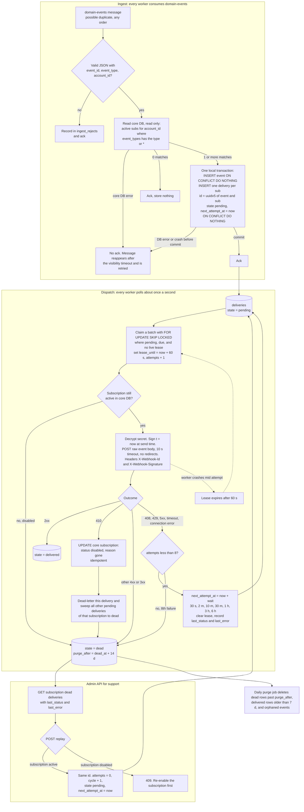

## Outbound webhooks: delivery service design

### Decisions

- **The queue is only the intake.** The queue can't delay a message by more than 15 minutes, and the 6 h and 3 h waits exceed that. Its dead-letter topic also can't be queried or replayed one message at a time, and support needs both. So the retry schedule, dead letters and replay all live in the service's own Postgres.
- **Each worker is a consumer and a dispatcher.** All instances run the same two loops. One reads `domain-events`, and the other polls Postgres for due deliveries. There is no leader and no extra coordination service.
- **Postgres rows do the coordination.** `FOR UPDATE SKIP LOCKED` plus a lease column shares the work between instances and recovers from crashes.

### Where state lives

Service database, three tables.

| Table | Contents |
|---|---|
| `events` | `event_id` (PK) and `body` (the exact JSON text received, stored once and sent byte-for-byte), plus `account_id`, `event_type` and `received_at`. |
| `deliveries` | `id` (PK) is the `X-Webhook-Id`. It is a UUIDv5 of `event_id` and `subscription_id`, so it is stable. `UNIQUE (event_id, subscription_id)` gives the exactly-once-per-pair guarantee. The other columns are `state` (`pending`, `delivered` or `dead`), `attempts`, `cycle`, `next_attempt_at`, `lease_until`, `locked_by`, `last_status`, `last_error`, `dead_at` and `purge_after`. Index on `(next_attempt_at) WHERE state='pending'`. Index on `(subscription_id, state)`. |
| `delivery_attempts` | One row per attempt: `delivery_id`, `cycle`, `attempt_no`, `started_at`, `duration_ms`, `status_code` and `error`. This is the audit trail. |

Core database, read-only apart from one write:

- The service reads `webhook_subscriptions` through a dedicated role.
- That role has `UPDATE` granted only on `status` and `disabled_reason`.
- The service never reads or writes anything else there.
- The secret is decrypted with `libs/secrets.decrypt()` at send time. It is never copied into the service database.

### Flow

### How the pieces work

**Duplicates and fan-out.**
- The ingest transaction is idempotent, so a duplicate message or a redelivery after a crash adds nothing. Both unique keys use `ON CONFLICT DO NOTHING`.
- The message is acked only after commit. A crash before the ack means the message returns and the transaction runs again as a no-op.
- The core database is read before the local transaction, because the two databases cannot share a transaction.
- A subscription created after the event was read gets nothing for that event.
- A message that is permanently unparseable is recorded and acked. It is not left to loop into the queue's dead-letter topic, which support cannot inspect.
- Set the topic's "failed receives" threshold high, so a core DB outage doesn't push good messages into that dead-letter topic. Alert if its depth is ever above 0.

**Sharing work between instances.**
- Claiming is a single `UPDATE ... WHERE id IN (SELECT ... FOR UPDATE SKIP LOCKED LIMIT n) RETURNING`. Instances never block each other or take the same row.
- Batch size is bounded and each worker sends its batch with limited concurrency, so one slow endpoint cannot occupy a whole worker.

**Attempt timing.**
- Attempt 1 has `next_attempt_at = now()`, so it goes out on the next poll, within about 1 to 2 s.
- The signature is built after the claim, immediately before the request, so every attempt and every replay carries a fresh `t`.
- A small jitter of up to 10% on retry waits spreads out retry storms.
- A `Retry-After` header on a 429 or 503 may lengthen the wait, capped at 6 h. It never shortens it.

**Recording the outcome.**
- The result is written with `WHERE id = $id AND locked_by = $me AND lease_until > now()`, and the attempt row is inserted in the same transaction.
- If the lease was lost, the result is discarded and the current holder decides the outcome. This can cause a duplicate send, which at-least-once allows and the stable `X-Webhook-Id` lets receivers dedupe.

**Crash recovery.**
- A worker that dies mid-attempt leaves a `pending` row with an expiring lease, so another worker claims it after at most 60 s.
- The lease is longer than the 10 s timeout plus decryption and database time.
- `attempts` is incremented at claim time, not at completion. A delivery that crashes workers repeatedly therefore still ends after 8 attempts.
- On reclaim, if `attempts` is already 8, the row is dead-lettered with `last_error = 'worker_lost'`.
- Nothing is held only in memory, so a crash cannot lose a delivery.

**410 and disabled subscriptions.**
- The core update runs before the local dead-letter. It is idempotent, so a crash in between is repaired by lease expiry and one more attempt that returns 410 again.
- If the core DB is down at that moment, the row is not finished. The lease expires and the attempt is retried as above.
- Deliveries already waiting for a disabled subscription, whether from a 410 or a manual disable, become `dead` with `last_error = 'subscription_disabled'`. They are not silently dropped, and they are not retried against a subscription the customer turned off.
- Disabling takes effect for waiting deliveries by claim time. The subscription row is read at claim time with a cache of about 30 s at most.
- The 410 path sweeps all other pending rows for that subscription at once.
- These rows keep their 14-day window. If the customer fixes and re-enables the endpoint, support can replay them.

**Dead letters, replay and retention.**
- Listing is a query on `(subscription_id, state='dead')`. It returns `last_status`, `last_error`, `dead_at` and the attempt history.
- Replay keeps `id`, so `X-Webhook-Id` is unchanged. It resets `attempts` to 0 and bumps `cycle`, so the attempt log distinguishes the cycles. It is a conditional `UPDATE ... WHERE state='dead'`, so a double click replays once.
- Dead rows are deleted after `purge_after`, which is 14 days from when they died. A replay restarts that clock only if it dead-letters again.
- The 7-day retention for delivered rows is my own choice, to keep the table small. The brief didn't specify it.
- An event is deleted only when no delivery still references it.

**Failure summary.**

| Failure | Effect |
|---|---|
| Worker crash during ingest | Message not acked and redelivered. The idempotent insert absorbs it. |
| Worker crash during a send | Lease expires, another worker retries. The attempt counts. |
| Service DB down | Ingest stops acking and the queue holds messages. Dispatch pauses. Nothing is lost. |
| Core DB down | Ingest not acked, so messages wait. Dispatch cannot read secrets or status, so due deliveries stay pending and lease expiry returns them. |
| Receiver slow or erroring | Retried on the schedule, then dead-lettered. |

### Assumptions to confirm

- A 3xx response is treated as a permanent failure like other 4xx, and redirects are not followed. The brief only covers 2xx, 4xx and 5xx.
- The 60 s lease, the 7-day retention of delivered rows and the 10% jitter are my defaults.
- The "other 4xx" branch means no retry, as stated, even for codes like 401 or 404. Support replays after the customer fixes the endpoint.
