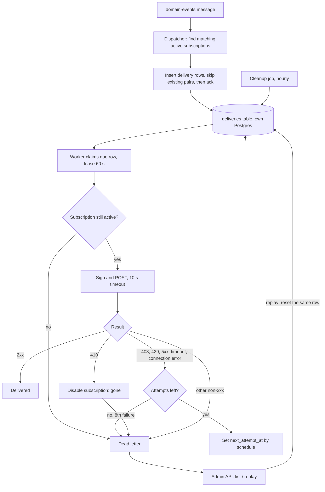

# Webhook delivery plan

Today the core app writes business events to an `outbox` table, and a relay publishes them to the `domain-events` queue topic. Customers register webhook endpoints in `webhook_subscriptions`, but nothing sends them events yet. This service reads each event from `domain-events`, writes one delivery row per matching subscription into its own Postgres database, and several worker instances send those rows as signed HTTPS POSTs. Workers retry on a fixed schedule and dead-letter what keeps failing. Retry state lives in Postgres, not in queue delays, because the queue delays a message by 15 minutes at most and our waits go up to 6 hours.

## Terms

- **Event**: one message on `domain-events`, JSON `{event_id, event_type, account_id, occurred_at, payload}`, at most 256 KB (the queue's limit, so a larger message never arrives). The same `event_id` can arrive more than once, because the queue and the relay are both at-least-once and unordered.
- **Subscription**: a row in the core database table `webhook_subscriptions`, written by the dashboard: `url` (https), `event_types` (exact names or `'*'`), `status` (`active` or `disabled`), `disabled_reason`, and an encrypted secret. This service may read it and may update only `status` and `disabled_reason`.
- **Delivery**: one row in our `deliveries` table for one (event, subscription) pair. Its `id` is the webhook id and never changes.
- **Dispatcher**: the part that consumes `domain-events` and creates deliveries.
- **Worker**: the part that sends deliveries. Every service instance runs the dispatcher, the worker and the cleanup job.
- **Lease**: a worker claims a delivery by pushing its `next_attempt_at` 60 s into the future. A row is claimable only when `status = 'pending'` and `next_attempt_at <= now()`, so a leased row is not due and no other worker takes it. If the worker dies, the row is due again after 60 s. A live worker finishes well inside the lease (see step 2).
- **Dead letter**: a delivery with `status = 'dead'` in the same table. It is not a queue.
- **Queue dead-letter topic**: the queue's own topic for messages that fail to be received N times. It cannot be queried or partly replayed, which is why our dead letters are table rows instead.

`deliveries` columns: `id`, `event_id`, `subscription_id`, `account_id`, `event_type`, `body` (the event JSON exactly as received), `status` (`pending`, `delivered` or `dead`), `attempt_count` (failed attempts so far), `next_attempt_at`, `last_status_code`, `last_error`, `dead_at`, `created_at`. `(event_id, subscription_id)` is unique. A partial index on `next_attempt_at` where `status = 'pending'` keeps the claim query cheap.

## Steps

1. **Dispatch.** Trigger: the dispatcher pulls a `domain-events` message (several instances share the topic). It runs one query against the core database, with no caching and a 5 s timeout: active subscriptions with the event's `account_id` whose `event_types` contains the event type or `'*'`. In one transaction it inserts one `pending` delivery per match (new `id`, `attempt_count = 0`, `next_attempt_at = now()`) with `ON CONFLICT (event_id, subscription_id) DO NOTHING`, then acks the message. With no matches it just acks.
   - Duplicate message: the insert does nothing and the message is acked.
   - Crash after commit, before ack: the queue shows the message again after its visibility timeout, the insert does nothing, the ack follows. Nothing is lost or doubled.
   - Either database is down, the query times out or the transaction fails: no ack, and the queue redelivers.
   - A message that can never be processed (for example invalid JSON) is not acked and nothing else is done with it. After repeated failed receives it lands in the queue dead-letter topic.
2. **Claim.** Trigger: every worker polls about once a second and starts the next poll only after the previous batch has finished. A poll selects up to 20 due pending rows with `FOR UPDATE SKIP LOCKED`, so instances never take the same row, and sets their `next_attempt_at` to `now() + 60 s`. The 20 rows are sent in parallel, so a batch takes about 15 s at worst (5 s subscription read plus 10 s POST), inside the lease. Attempt 1 therefore goes out within about one poll interval of the event, a few seconds.
   - Worker crashes mid-send: the row is due again after 60 s and is sent again with the same `id` and the same attempt number, because `attempt_count` is written only after a result. The receiver may see a duplicate, which at-least-once allows.
3. **Check the subscription.** The worker reads the subscription by the delivery's `subscription_id` from the core database, with a 5 s timeout. It uses the current `status`, `url` and secret, so a changed URL or rotated secret applies to deliveries still waiting.
   - Subscription `disabled` or gone: dead-letter the delivery with `last_error = 'subscription disabled'` and send nothing. This is not an attempt: `attempt_count` and `last_status_code` stay as they were, and the admin list shows the row with that `last_error`. This is how deliveries already waiting for a disabled subscription are handled: each is dead-lettered when it next comes due, and stays replayable.
   - Core database unreadable in time: leave the row alone, `attempt_count` unchanged. The lease expiry makes it due again 60 s later. While the core database stays down this repeats every 60 s, with no limit set.
4. **Send.** The worker decrypts the secret with `libs/secrets.decrypt()`, then POSTs `body` (the whole event JSON) to the subscription URL with `Content-Type: application/json`, a 10 s timeout and no redirect following. Headers:
   - `X-Webhook-Id: <delivery id>`, the same on every attempt and every replay.
   - `X-Webhook-Signature: t=<unix seconds>,v1=<hex>`, where `v1` is HMAC-SHA256 over `<t>.<raw body>` keyed with the secret. The signed bytes are the stored `body` string exactly as sent, never re-serialized JSON. The signature is computed at send time on every attempt, so a resend has the same id but a new `t` and `v1`.

   A receiver recomputes the HMAC over `<t>.` plus the raw request bytes with its copy of the secret, compares it with `v1`, and rejects a `t` older than 5 minutes. It dedupes by remembering processed ids and ignoring repeats; a receiver that remembers ids for good will therefore ignore a replay too. The brief requires the same id on replays, so that is the receiver's choice.
   - Decrypt fails: treat it like an unreadable core database. Leave the row, count no attempt, and let the lease expire so it is tried again after 60 s.
5. **Record the result.** The write applies only if the row is still pending (`WHERE id = ... AND status = 'pending'`), so a stalled worker that finishes after its lease expired and another worker recorded a result changes nothing. At worst the receiver sees a duplicate.
   - 2xx: `delivered`.
   - 408, 429, any 5xx, a timeout or a connection error: add 1 to `attempt_count` and store `last_status_code` or `last_error`. If the new count is below 8, set `next_attempt_at = now() +` the wait for that count: 30 s, 2 min, 10 min, 30 min, 1 h, 3 h, 6 h for counts 1 to 7. At count 8, dead-letter. So the 6 h wait follows failure 7 only.
   - 410: dead-letter now and set the subscription's `status = 'disabled'`, `disabled_reason = 'gone'`. The dead-lettering does not depend on the disable write. If that write fails, the delivery is still dead-lettered, the subscription stays active, and the next event for it will most likely get a 410 and try again.
   - Any other non-2xx, including other 4xx and 3xx: dead-letter now, no retry.
   - Dead-lettering sets `status = 'dead'`, `dead_at = now()` and keeps the last status code or error.
   - The worker cannot write the result: the lease expires and the delivery is sent again with the same attempt number. The receiver sees the same id twice with different signatures (step 4).
6. **Support: list and replay (admin API).** Support staff call it. List takes a subscription id and returns that subscription's dead deliveries with `last_status_code` and `last_error`. Replay takes one delivery id (not a whole subscription) and resets that same row, keeping its `id`: `status = 'pending'`, `attempt_count = 0`, `next_attempt_at = now()`, `dead_at = null`. A fresh cycle of 8 attempts starts.
   - Errors: 404 if the delivery id does not exist. 409 Conflict with a short message if the row is not `dead`, or if its subscription is still disabled (it would be dead-lettered again at once).
7. **Cleanup.** Trigger: hourly on every instance (running twice is harmless). It deletes `dead` rows whose `dead_at` is older than 14 days, and `delivered` rows older than 14 days. Delivered rows are kept that long so a late duplicate event still hits the unique key.

## Rules that hold everywhere

- At-least-once, no ordering between events.
- Matching is decided when the event is dispatched. A subscription created or disabled later does not change deliveries already created, except through step 3.
- New events for a disabled subscription create no delivery. Re-enabling is done in the dashboard, outside this service, and affects only events dispatched afterwards. Support can replay the old dead ones.
- We add nothing to the core database.

## Open questions

- How many failed receives before the queue dead-letters a message that cannot be processed (the value of N)? Not decided.
- Who sets the queue's visibility timeout for the dispatcher? We assume the 30 s default is enough, since dispatch is one query and one transaction. Not confirmed.
- How is the admin API authenticated? Not covered by the brief.
- A delivery that keeps hitting an unreadable core database, a failing decrypt, or a worker crash is retried every 60 s with no limit. No cap is set yet, and whether decrypt can fail or hang is unknown.
- How does a customer get their webhook secret to verify signatures? The dashboard owns the secret; this service does not know how it is shown.
