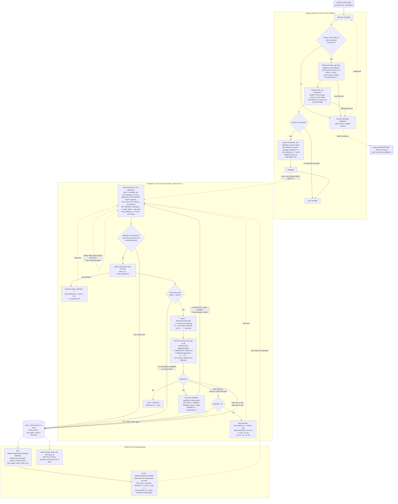

# Outbound webhooks: delivery service

The service turns `domain-events` messages into signed HTTP deliveries. Its own Postgres database (the delivery DB) holds the schedule. The queue only carries messages in. It cannot hold the retries, because its maximum delay is 15 minutes and the longest wait is 6 hours. It cannot hold the dead letters either, because its dead-letter topic cannot be listed by subscription or replayed one message at a time.

## Where state lives

- **Queue (`domain-events`).** Messages are only in transit here. The consumer acks a message only after the delivery DB transaction has committed, or after it finds the event already recorded.
- **Delivery DB (the service's own Postgres).**
  - `events (event_id PK, event_type, account_id, body text, received_at)`: the raw message body, stored once per event and sent byte for byte on every attempt, so the signed bytes are the bytes sent. The row also marks the event as ingested, which is what makes duplicates harmless. An event with no matching subscription still gets a row, with no body.
  - `deliveries (id PK, event_id, subscription_id, account_id, state, attempts, cycle, next_attempt_at, lease_token, last_status_code, last_error, dead_reason, dead_at, delivered_at, created_at, UNIQUE (event_id, subscription_id))`. There is a partial index on `next_attempt_at WHERE state = 'pending'` for claiming, and one on `(subscription_id, dead_at) WHERE state = 'dead'` for the admin list.
  - `delivery_attempts (delivery_id, cycle, attempt_no, started_at, status_code, error, duration_ms)`: one row per attempt, so support can see the history.
  - The schedule is the `next_attempt_at` column. A claim moves it 60 s ahead, which acts as the lease. No in-progress state exists only in a worker's memory.
- **Core DB.** The service has a read-only role on `webhook_subscriptions`, plus a column grant for `UPDATE (status, disabled_reason)` that is used only on a 410. The service adds nothing to the core database. Subscription URL, status and secret are read again at every attempt, so a rotated secret or a disabled endpoint takes effect on the next attempt.

## How instances share the work

All instances are identical and stateless. Each one runs an ingest consumer, and the queue spreads messages across them. Each one also runs a dispatcher. The dispatchers share the delivery DB and claim rows with `FOR UPDATE SKIP LOCKED`, so two instances never claim the same row at the same moment. Each instance claims only as many rows as it has free HTTP slots. Adding instances adds throughput, with nothing to coordinate.

## What happens on failure

- **Duplicate `domain-events` message.** The `events` insert conflicts, no deliveries are created, and the message is acked. The fan-out runs only once per event, so a duplicate cannot pick up a subscription created in between. `UNIQUE (event_id, subscription_id)` is a second guard.
- **Consumer crashes, or a database is down, before the commit.** Nothing is committed and the message is not acked. It reappears after the visibility timeout and is processed again.
- **Consumer crashes after the commit but before the ack.** The message reappears, the duplicate check finds the event, and the message is acked.
- **Malformed message.** It is never acked. After 20 receives the queue moves it to its dead-letter topic, which triggers an alert. That topic holds only messages that could not be fanned out, never failed deliveries.
- **Worker dies during an attempt.** The lease expires after 60 s and another instance claims the row. The lost attempt still counts toward the 8, so a payload that keeps crashing workers cannot loop forever. If it was attempt 8, the row is dead-lettered with `worker_lost` and can be replayed.
- **Slow worker finishes after its lease expired.** Every result write (`delivered`, reschedule, `dead`, attempt row) runs as `WHERE id = $id AND lease_token = $ours`. If no row matches, the result is dropped, because another worker now owns the delivery. The lease (60 s) is much longer than the request timeout (10 s), so this is rare.
- **Receiver got the request but the result was not recorded.** The delivery is sent again with the same `X-Webhook-Id`, and the receiver dedupes on it. This is the at-least-once guarantee.
- **Core DB unreadable at send time.** The claim is undone (`attempts - 1`) and the row retries in 30 s. Our own outage does not use up the receiver's attempts.
- **410 Gone.** The subscription is disabled in the core DB first, and the delivery is dead-lettered second. If the service crashes between the two steps, the lease expires, the next claim finds the subscription disabled, and the delivery is dead-lettered as `subscription_disabled`. In the opposite order, a crash would leave the subscription active.
- **Signature freshness.** `t` is computed right before each POST, including on retries and replays. With a 10 s timeout, a request never comes near the receivers' 5-minute limit.
- **No ordering between events.** Rows are claimed oldest first, but nothing waits on another delivery. A failing event does not block later events to the same endpoint.

## Deliveries waiting when their subscription is disabled

The service does not sweep them eagerly. When a waiting delivery next falls due, the dispatcher sees the subscription is not `active` (or the row is gone). It dead-letters the delivery with `subscription_disabled` and sends no request. This covers a 410 and a disable from the dashboard in the same way, but a delivery that is waiting out a long backoff only shows in the dead list when its wait ends, up to 6 h later. Replaying one returns 409 until the subscription is active again.

## Retention

- A dead row is kept for 14 days from its latest `dead_at`. A replay that fails again starts a new 14 days.
- A delivered row is kept for 3 days. This number is my choice; the brief does not set it.
- An `events` row is purged when no delivery refers to it any more and it is more than 15 days old. That is well past the 12 h maximum visibility timeout and the relay's re-publish window, so a late duplicate still finds the row.
