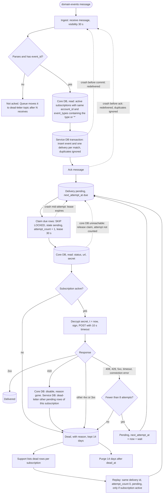

# Outbound webhooks delivery service: flow

## What this is

Today the outbox relay publishes every business event to the `domain-events` topic. Customers already store webhook endpoints in the core database, but nothing sends events to them. This service reads each event, creates one delivery for each matching endpoint, sends it as a signed HTTP POST, and retries failures. A delivery that still fails is marked dead, and support can list and replay it. All waiting happens in the service's own Postgres database, not in the queue, because waits of 30 s to 6 h are longer than the queue can hold a message. Any number of identical worker instances can run, and database row locks stop two workers from sending the same delivery at once.

## Terms

- **Event.** One business event from the outbox: an `event_id`, an `event_type`, an `account_id` and a JSON body.
- **Subscription.** A customer's webhook endpoint: URL, event types, secret and status (`active` or `disabled`). It lives in the core database table `webhook_subscriptions`.
- **Delivery.** One event sent to one subscription. It has its own id, the delivery id. There is exactly one delivery per event and subscription pair.
- **Attempt.** One HTTP POST of a delivery. A delivery gets at most 8 attempts.
- **Dead.** A delivery that will not be sent again unless someone replays it. Dead deliveries are kept for 14 days.
- **Ack.** Telling the queue a message is handled, so it is removed. An unacked message reappears after its visibility timeout (default 30 s, max 12 h).
- **Dead-letter topic.** The queue's own holding area for messages that failed too many times. This service cannot query or replay it.
- **Queue limits.** Delivery is at-least-once with no ordering. A delayed message can wait at most 15 minutes. A message can be at most 256 KB.
- **Lease.** A short claim on a delivery by one worker, ending at `lease_until`. If the worker dies, the lease expires and another worker can take the delivery.
- **SKIP LOCKED.** A Postgres clause for a claim query. A worker takes rows that no other worker has locked and skips the rest.
- **Fenced write.** An outcome update that applies only if the worker still holds the lease and the state is `sending`.
- **Unique key.** A database rule that rejects a duplicate row. `ON CONFLICT DO NOTHING` skips the duplicate instead of failing.
- **HMAC-SHA256.** A keyed hash. The receiver recomputes it with the same secret to check the signature.
- **Ciphertext.** The encrypted secret stored in the core database. It is decrypted in memory only.
- **LISTEN/NOTIFY.** A Postgres feature that wakes a worker when a row is inserted.
- **Replay.** Support resets a dead delivery to pending. It keeps the delivery id and gets 8 new attempts.

## Flow

## Steps

1. **Ingest.** Trigger: a message arrives on `domain-events`. The worker parses it and checks for an `event_id`. It reads the active matching subscriptions from the core database. In one service-database transaction it inserts the event and one delivery per match. Duplicate inserts are ignored, so a repeated message creates no second delivery. Then it acks the message.
   - If the message does not parse, it is not acked. The queue moves it to the dead-letter topic after N receives, and it cannot be replayed from there.
   - If the core database is unreachable, the worker does not ack, and the queue redelivers.
   - If a crash happens before commit or before ack, the message is redelivered and the unique keys stop a second delivery.
   - If ingest takes longer than 30 s, the worker extends the visibility or accepts the redelivery. Deduplication makes the overlap safe.
2. **Claim.** Trigger: a poll about every 1 s, or a NOTIFY. The worker takes up to N pending rows whose `next_attempt_at` is due. It locks them with SKIP LOCKED, sets the state to `sending`, sets `lease_until` to now + 30 s, and adds 1 to `attempt_count`. The 30 s lease must be longer than the 10 s request timeout plus a write margin.
   - If the worker crashes, the lease expires and the row can be claimed again with the same delivery id. The crashed attempt still counts. If the expired lease is on attempt 8, the row is marked dead with reason `lease_expired` and is not sent again.
   - If the core database is unreachable at claim, the worker releases the claim without sending and without counting the attempt, then retries shortly.
3. **Check the subscription.** Trigger: each claimed row. The worker reads `status`, `url` and `secret_ciphertext` from the core database. If the subscription is disabled, the row is marked dead with reason `subscription_disabled`, and no request is sent.
4. **Send.** Trigger: the subscription is active. The worker decrypts the secret in memory. It sets `t` to the current unix seconds and computes `v1` as HMAC-SHA256 over `<t>.<raw body>`, keyed with the secret. It then POSTs the event JSON to the URL with a 10 s timeout and these headers:
   - `X-Webhook-Id`: the delivery id. It is the same on every attempt and on replays, so receivers can deduplicate.
   - `X-Webhook-Signature`: `t=<t>,v1=<hex>`. Receivers reject a `t` older than 5 minutes, so the signature is made fresh on every attempt and every replay. The stored body never changes.
5. **Record the outcome.** Trigger: a response, a timeout or a connection error. Every update is a fenced write, so it applies only if `lease_owner` is this worker and the state is `sending`. A slow worker whose lease was taken over cannot overwrite the newer attempt's result. The worker stores `last_status` or `last_error` on every attempt.
   - **2xx:** state `delivered`, with `delivered_at` set.
   - **410:** the core database sets `status = disabled` and `disabled_reason = gone`, but only where the status is still `active`, so a repeat does nothing. Then the same service transaction marks this subscription's other pending rows dead with reason `gone`. If the process crashes between the two writes, step 3 catches it at the next claim.
   - **Other 4xx or 3xx:** dead with reason `rejected`, with no retry. Redirects are not followed.
   - **408, 429, 5xx, timeout or connection error:** if the attempt count is under 8, the row becomes pending with `next_attempt_at = now + wait`. Otherwise it is dead with reason `retries_exhausted`.
   - The waits are 30 s, 2 min, 10 min, 30 min, 1 h, 3 h and 6 h, for attempts 2 to 8. Attempt 1 is due as soon as the event is ingested.
6. **Replay.** Trigger: support calls the replay endpoint. The row returns to pending, becomes due at once, keeps its delivery id and gets `attempt_count = 0`, so it starts a new cycle of 8 attempts. Replay is refused if the row is not dead or the subscription is disabled. A purged row returns not found.
7. **Purge.** Trigger: a scheduled job. It deletes dead rows 14 days after `dead_at`.

## Where state lives

- **Core database, `webhook_subscriptions`.** The service reads `url`, `event_types`, `status` and `secret_ciphertext`. It may write only `status` and `disabled_reason`. Column-level grants enforce this, so nothing else in the service can write to the table.
- **Service database, `events`.** Columns: `event_id` (primary key), `event_type`, `account_id`, `occurred_at`, `body` (text), `received_at`. The body is stored as exact bytes, not `jsonb`. This way a replay sends the same bytes, and the signature still checks.
- **Service database, `deliveries`.** Columns: `id` (the delivery id, a uuid), `event_id`, `subscription_id`, `state` (`pending`, `sending`, `delivered` or `dead`), `attempt_count`, `next_attempt_at`, `lease_owner`, `lease_until`, `last_status`, `last_error`, `dead_reason`, `created_at`, `delivered_at` and `dead_at`. A unique key on (`event_id`, `subscription_id`) gives one delivery per pair.
- **Indexes.** A partial index on (`state`, `next_attempt_at`) serves the claim query. An index on (`subscription_id`, `state`) serves the dead-letter listing.
- **Secrets.** The service does not copy secrets. It decrypts `secret_ciphertext` on each attempt and may cache the plaintext for about 30 s. Plaintext stays in memory only.
- **Queue.** It holds nothing after ack. All waiting is scheduled in Postgres, because the waits exceed the 15-minute maximum queue delay.

## Scheduling

- Every instance runs the same loop: claim due rows with SKIP LOCKED, then send them. There is no coordinator and no leader. Any instance can send any row.
- The loop polls about every 1 s. LISTEN/NOTIFY on insert is optional, and it lets attempt 1 go out within seconds.

## Subscription changes

- **Disabled by the customer or support.** Rows still waiting are marked dead with reason `subscription_disabled` at their next claim. No request is sent. These rows stay in the listing with their reason. Replay is refused while the subscription is disabled.
- **Disabled by a 410.** See step 5.
- **Re-enabled.** Dead rows still within 14 days can be replayed.

## Retention

- Dead rows are purged 14 days after `dead_at`. Replaying a purged row returns not found.
- Deduplication relies on `events` and `deliveries`. If a duplicate message arrives after those rows are purged, it creates new deliveries. Keep these rows at least as long as the queue can redeliver a message, and confirm that window with the queue service. The brief does not state it.

## Support API

- `GET /subscriptions/{id}/dead-deliveries` returns `delivery_id`, `event_id`, `event_type`, `dead_reason`, `last_status`, `last_error`, `attempt_count` and `dead_at`.
- `POST /deliveries/{id}/replay` is described in step 6.

## Open questions

- **3xx responses.** The brief does not cover them. The design does not follow redirects and marks them dead as rejected.
- **Retention of `events` and `deliveries`.** The period is not set. It must cover the queue's redelivery window, which the queue service has to confirm.
- **Delivery attempt log.** A `delivery_attempts` table (status, error, duration, time) would help support debugging. The brief does not require it, so it is not in this design.
- **Core database load.** Each attempt does one primary-key read, or a cached read. The choice between them is open.