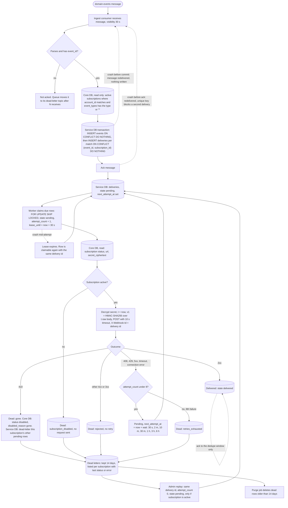

# Outbound webhooks delivery service: flow

## Flow

## Where state lives

- **Core DB (`webhook_subscriptions`).** The service reads `url`, `event_types`, `status` and `secret_ciphertext`, and writes only `status` and `disabled_reason`. Grant column-level privileges so nothing else is writable. The `status = 'active'` condition on the 410 update makes it idempotent.
- **Service DB.** Two tables:
  - `events`: `event_id` primary key, `event_type`, `account_id`, `occurred_at`, `body` as `text`, `received_at`. The body is stored as exact bytes, not `jsonb`, so replays send identical bytes and the signature stays verifiable.
  - `deliveries`: `id` (the delivery id, a uuid), `event_id`, `subscription_id`, `UNIQUE (event_id, subscription_id)`, `state` (`pending` | `sending` | `delivered` | `dead`), `attempt_count`, `next_attempt_at`, `lease_owner`, `lease_until`, `last_status`, `last_error`, `dead_reason`, `created_at`, `delivered_at`, `dead_at`. A partial index on `(state, next_attempt_at)` serves the claim query, and an index on `(subscription_id, state)` serves the dead-letter listing.
- **Secrets.** The service does not copy secrets. It decrypts `secret_ciphertext` per attempt, optionally caching for about 30 s. Plaintext stays in memory only.
- **Queue.** It holds nothing after ack. Waits of 30 s to 6 h exceed the 15 min maximum queue delay, so all scheduling is in Postgres.

## Scheduling and sharing work

- Every instance runs the same loop: claim up to N due rows with `SKIP LOCKED`, then send them. No coordinator and no leader. Any instance can run any row.
- Poll about every 1 s. Optionally `LISTEN/NOTIFY` on insert so attempt 1 goes out within seconds.
- Attempt 1 is `next_attempt_at = now()` at insert. Ingest writes deliveries in the same transaction as the event, so attempt 1 is due as soon as the message is acked.

## Failure handling

- **Crash before ack.** The message is redelivered. The unique keys on `events` and `deliveries` stop a second delivery.
- **Crash mid-request.** The lease expires after 30 s. This must exceed the 10 s request timeout plus write margin. The row is retried with the same delivery id, so the receiver may see a duplicate and dedupes on `X-Webhook-Id`. `attempt_count` is incremented at claim, so a crashed attempt counts toward the 8. If the expired lease is on attempt 8, dead-letter it as `lease_expired` rather than sending again.
- **Fenced writes.** Outcome updates require `lease_owner = me AND state = 'sending'`. A slow worker whose lease was taken over cannot overwrite the newer attempt's result.
- **Fresh signature per attempt.** `t` is computed at send time for every attempt and every replay. The stored body never changes.
- **Core DB unreachable at claim.** Release the claim without sending and without counting the attempt, then retry shortly.
- **Core DB unreachable at ingest.** Do not ack. The queue redelivers.
- **Ingest longer than 30 s.** Extend visibility or accept the redelivery. Dedupe makes overlap safe.
- **Unparseable message.** Leave it unacked. It reaches the queue's dead-letter topic after N receives. Note that it cannot be replayed from there.

## Subscription disabled

- **Disabled by the customer or support.** Rows still waiting are dead-lettered at their next claim with `subscription_disabled`. No request is sent, and the row stays visible in the listing with its reason. Replay is refused while the subscription is disabled.
- **Disabled by 410.** The core update runs first, then the same service transaction dead-letters the subscription's other pending rows as `gone`. If the process crashes between the two, the next claim catches it through the status check.
- **Re-enabled.** Dead rows still within 14 days can be replayed.

## Retention and dedupe window

- Dead rows are purged 14 days after `dead_at`. Replay of a purged row returns not found.
- Dedupe depends on `events` and `deliveries`. A duplicate message that arrives after those rows are purged would create new deliveries. Keep `events` and `deliveries` for at least as long as the queue can redeliver a message, and confirm that retention with the queue service. The brief does not state it.

## Support API

- `GET /subscriptions/{id}/dead-deliveries` returns `delivery_id`, `event_id`, `event_type`, `dead_reason`, `last_status`, `last_error`, `attempt_count`, `dead_at`.
- `POST /deliveries/{id}/replay` resets the row to pending. It keeps the delivery id, sets `attempt_count = 0`, and is refused if the subscription is disabled or the row is not dead.

## Open decisions

- **3xx responses.** The brief does not cover them. This design does not follow redirects and dead-letters them without retry, as a rejection.
- **Optional attempt log.** A `delivery_attempts` table (status, error, duration, time) would help support debugging. It is not required by the brief.
- **Core DB load.** One primary-key read per attempt, or a cached read, is the only load on the core DB from delivery.